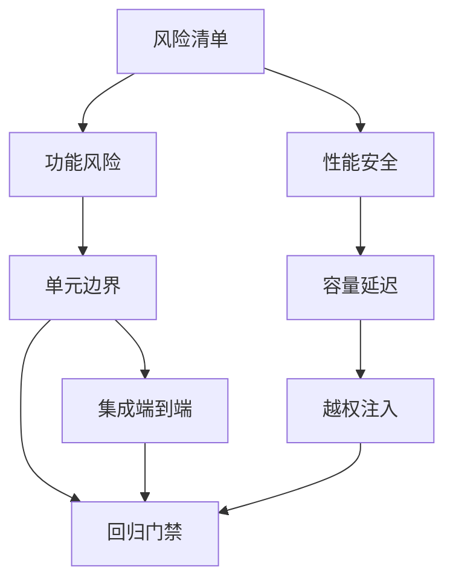
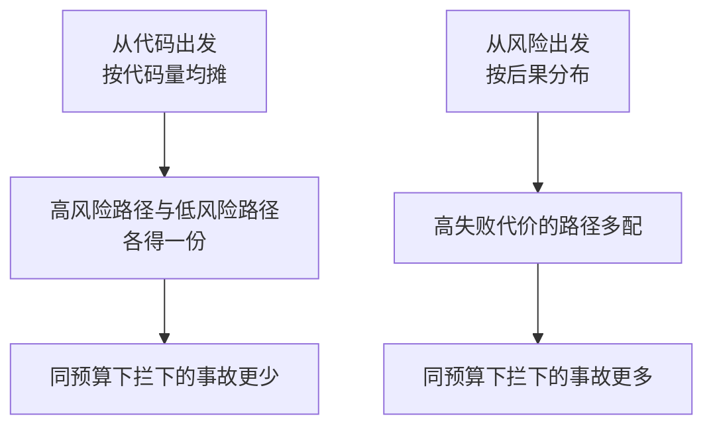
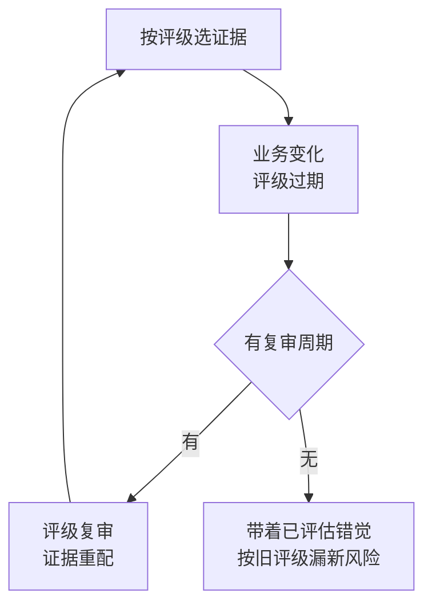

# 测试策略从风险选择证据

**测试的目标是降低未知风险，不是堆数量。测试层次要和故障成本、反馈速度以及可观测性（通过系统对外输出判断内部状态的能力）匹配**。读完你能**按故障代价挑出该写哪一层测试，并说清为什么其余层可以少写**。

投入按后果分布的形态，消息系统的优先级队列模式给了标准对照：消息按高、中、低三条队列分流，消费者池优先服务高优先级队列——队列就是风险清单，消费者就是测试预算，高失败代价的路径排在前面的队列里先被消费。微软 Azure 架构模式文档画的正是这个结构，「从风险出发按后果分布」落到调度上就是这个形状：

*图源：Microsoft Azure 架构模式，Priority Queue pattern，CC BY 4.0，https://learn.microsoft.com/zh-cn/azure/architecture/patterns/priority-queue。*

## 机制（要解决的问题）：风险怎么映射到验证

测试套件的形状由出发侧决定——从风险出发会走向按后果分布投入，从代码出发则按代码量均摊：

起点选哪一侧决定了**预算落在哪里**，两种起点的分配结果可以摊开对比：

起点选哪一侧决定了**测试套件的形状**。从代码出发会自然走向"每个模块配一套测试"，**投入按代码量均摊**；从风险出发则会走向"高失败代价的路径多配"，**投入按后果分布**。**均摊看着公平，实际是把预算从高风险路径挪给了低风险路径——同样的预算，拦下的事故更少**。图中功能与性能安全两条分支就是按后果分布的第一层分组，单元、集成端到端与容量、越权（访问了权限范围之外的资源）是分组内的证据层次。

## 本质是什么：证据强度与失败代价的配对

某个风险成真后代价越高，覆盖它需要的证据就要**越强、越接近真实**。**单元测试之于一个 DTO（Data Transfer Object，数据传输对象）转换是足够的，之于资金计算就不够——区别不在代码复杂度，在算错的后果**。

把这条对应关系看清，投入分配的判断就有了依据。**先问"这里错了会怎样"，再问"用什么证据能拦住它"，而不是先问"这里有没有测试"**。

「证据层次与成本的反比关系」有一张流传最广的图：Martin Fowler 的实用测试金字塔。塔底单元测试又快又便宜，塔顶 UI（User Interface，用户界面）测试又慢又贵，塔的形状本身就是投入分布的依据——大量证据放在塔底，少量放在塔尖：

*图源：Martin Fowler，[The Practical Test Pyramid](https://martinfowler.com/articles/practical-test-pyramid.html) 官方配图。金字塔三层自下而上是 Unit Tests、Service Tests、UI Tests；左轴标注越向上 integration 越多（更接近真实集成），右轴标注越向下 faster（反馈更快）。**塔的形状回答"证据放多少"：高层的证据强但慢且贵，低层的证据弱但快且便宜，风险越接近用户路径越需要向上取证**。*

## 测试投入该按什么规则分配

**不是所有代码都值得同样的测试投入：资金计算、权限、不变量和状态机需要边界、属性与并发测试；数据库、消息和外部 API 用真实组件或接口约定测试；低风险 DTO 转换不必为了覆盖率制造脆弱用例**。测试前的风险清单（失败代价高的路径集合）决定投入分布：**安全类覆盖越权与泄露路径、性能类覆盖容量与延迟、功能类覆盖逻辑边界与接口约定**。**覆盖率只能提示哪些代码没被执行，不能证明结果正确**。

| 弱证据 | 更强证据 |
| --- | --- |
| `assert.NoError(err)` | 断言余额、状态和副作用都符合预期 |
| 所有依赖都 mock（用替身顶替真实依赖） | 关键数据库约束和事务用真实组件验证 |
| 只测 happy path（只验证正常输入的路径） | 增加 0、空值、边界、重复、并发和故障注入 |
| 用例失败只能说明 mock 变了 | 失败能定位到具体业务不变量或跨组件约定 |

这张表向左读是当前做法，向右读是加强方向。**第一行的差别最能说明问题：`assert.NoError(err)` 只断言了没有报错，余额算错了但没报错的情况它一样通过——断言的是过程，不是结果**。

按风险布置证据，制造业的流水线是原型：1915 年维克斯枪厂的这条装配线上，检验工序布置在失败代价最高的节点，不均匀撒在每个工位——关键的装配步骤后紧跟检验站，拧螺丝的工位则不需要：

*图源：Wikimedia Commons，Bain News Service 藏品，公有领域，https://commons.wikimedia.org/wiki/File:Assembly_line)_Vicker_Sons_%26_Maxim_Gun_Factory_LCCN2014680263.jpg。*

把检验均匀摊到每个工位与按代码量均摊测试投入是**同一种浪费——预算从高风险节点挪给了低风险节点；按后果分布布置检验站，同样的预算拦下更多事故，这是「从风险选择证据」在产线上的原义**。

- **每个失败用例固定版本、配置、数据、时间、随机性和复现概率**。
- **用最小输入重现问题，修复后增加相邻边界和反例，避免只对单个样例过拟合（模型把训练数据的噪声也记住、在新数据上表现变差的现象）**。
- **测试结果要关联 commit、环境、日志、trace（分布式请求的调用链记录）和数据库状态；"通过"必须可解释**。
- **性能测试报告同时记录吞吐、p50/p95/p99（第 50/95/99 百分位的延迟值）、资源、错误和负载模型**。
- **Agent（能自主调用工具、分多步完成目标的模型应用）评测增加工具调用正确性、引用支持率、拒答准确率（预测或判断正确的比例）、越权和副作用（操作对外部状态产生的额外影响）验证**。

## AI 驱动的测试要过哪道事实门禁

**AI（用模型自动完成部分研发工作的方式）可以负责识别项目、选择构建/测试入口、适配 API、分析失败并提出下一步；测试框架只负责隔离、执行和证明**：**命令是否真的运行、退出码和产物是什么、目标 revision 是否一致、进程是否被杀、资源是否仍被占用**。**测试报告不得把 AI 的"测试不适用""编译成功"或"已经复现"当作事实，除非能指向对应日志、进程、报告和版本证据**。完整职责边界见 [[工程知识/AI 系统工程：从模型能力到生产能力/安全与治理/执行证据必须独立于AI结论]]。

## 测试分几层、失败定位在哪层

| 层次 | 主要证明 | 不能证明 |
| --- | --- | --- |
| 静态检查 | 格式、类型、规则和部分数据流 | 真实依赖和运行行为 |
| 单元测试 | 小范围逻辑、不变量和边界 | 序列化、数据库、网络约定 |
| 集成/接口约定 | 组件间 schema、事务、权限和兼容 | 完整用户路径与真实容量 |
| 端到端 | 关键用户任务在完整环境可完成 | 所有内部边界和故障分支 |
| 性能/容量 | 给定 workload（负载模型，即请求量与类型的组合）下的 SLO（服务等级目标，如 99% 请求 200ms 内完成）和资源曲线 | 其他数据分布与未来流量 |
| 故障/安全 | 部分失败、恢复、越权和攻击面 | 未建模的未知风险 |

**表格的最后一列比第二列更值得读。每一层都只证明它自己那一格：端到端通过不说明内部边界正确，性能达标不说明换一种数据分布还达标。选层次时先看"不能证明"那一列是否覆盖到了这次的风险**。

失败必须分类为：**测试断言失败、构建失败、依赖/环境阻断、超时/资源耗尽、权限拒绝或测试基础设施失败**。**目标代码被实际执行且断言观察到期望行为，这一组合成立时才算"产品行为已验证"；命令返回 0、Maven validate 成功（Maven：Java 的构建与依赖管理工具，validate 是其首个生命周期阶段）或生成了报告文件都不是充分条件**。

## 回归资产要包含哪些内容

- 用例绑定 bug/风险、输入、预期、revision（代码版本标识）、环境指纹和证据产物；
- 修复原始样本后增加相邻边界、反例和故障注入（主动向系统注入故障来验证容错能力的测试方法），避免只记住一个 case；
- flaky test（时好时坏的不稳定用例）记录失败率和条件，不靠无限重试变绿；
- 测试数据可创建、隔离和清理，敏感数据脱敏（遮盖敏感字段的部分内容、保留可辨识形态）；
- 门禁按风险设置，质量、延迟、成本和安全分别报告，不压成一个总分。

最后一条里的"不压成一个总分"值得单独说明。**总分隐含各项之间可以互相兑换，而"安全越权 +30% 吞吐"这种兑换没人会真的接受。分开报告才能各自守住各自的阈值**。

## 这一篇的入口在哪儿

- [[工程知识/AI 系统工程：从模型能力到生产能力/Agent与工作流/AI辅助研发必须形成证据闭环]]
- [[工程知识/AI 系统工程：从模型能力到生产能力/质量与运营/可靠生成需要结构、证据、拒答与回归]]
- [[工程知识/性能工程：从用户等待到资源瓶颈/观测与诊断/性能问题定位]]
- [[工程知识/软件构建：让变化可以理解、验证与交付/测试与交付/测试替身按依赖行为而非名字分类]]
- [[工程知识/软件构建：让变化可以理解、验证与交付/测试与交付/静态分析的证据边界：它证明什么不证明什么.md]] —— 证据组合中的静态证据位置
- [[工程知识/软件构建：让变化可以理解、验证与交付/测试与交付/覆盖率的三种读法：行分支与路径覆盖的证据强度.md]] —— 覆盖率在证据体系中的位置
- [[工程知识/软件构建：让变化可以理解、验证与交付/测试与交付/接口约定测试的适用边界：消费者驱动与提供者验证.md]] —— 集成风险的分层验证策略
- [[工程知识/软件构建：让变化可以理解、验证与交付/测试与交付/可观测性断言：把运行时行为写进测试.md]] —— 行为证据在测试策略中的位置
- [[工程知识/软件构建：让变化可以理解、验证与交付/测试与交付/灰度与功能开关的边界：交付节奏与配置漂移.md]] —— 交付节奏与测试成本
- [[工程知识/软件构建：让变化可以理解、验证与交付/测试与交付/回归测试的耗时分层：快速反馈层先跑，全量层收尾.md]] —— 选择好的测试按耗时组织执行：三层的触发时机与失败处置

## 效果从哪来、要付什么代价

风险评级不是一次性输入，它会随业务变化过期——这条回路把复审周期接在选证据与评级之间，没有复审那一支会带着已经评估过的错觉继续漏新风险。

**回路断掉的那一支比不做风险分级更危险，因为它把漏检包装成了已评估**。

按风险选证据的收益是**测试投入集中在高失败代价的路径上**（同预算下拦截更多事故），代价是**风险评级本身要维护**（业务变化后评级过期，按旧评级选证据会漏新风险）。

代价这一项决定了**这套做法需要配套动作：风险评级要有复审周期**，评级复审后证据重配，否则它会慢慢失效——**沿用旧评级选证据，比不做风险分级更危险，因为它带着"已经评估过"的错觉**。
