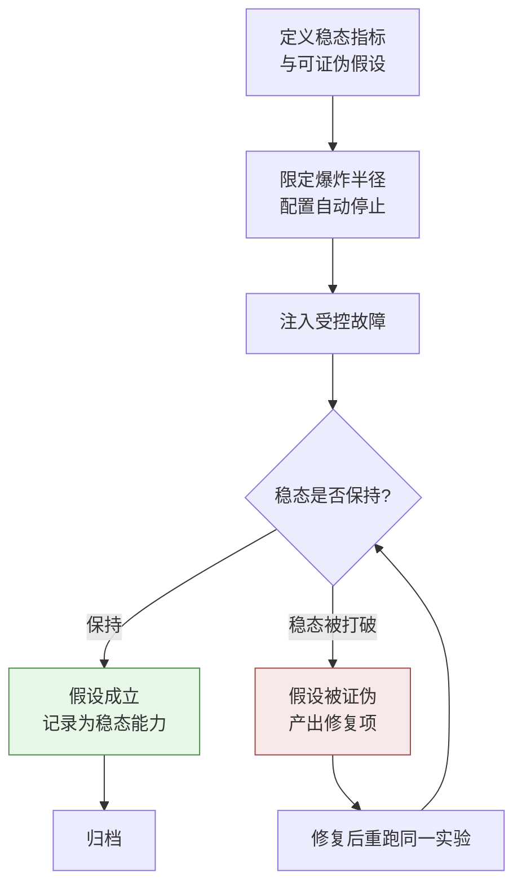
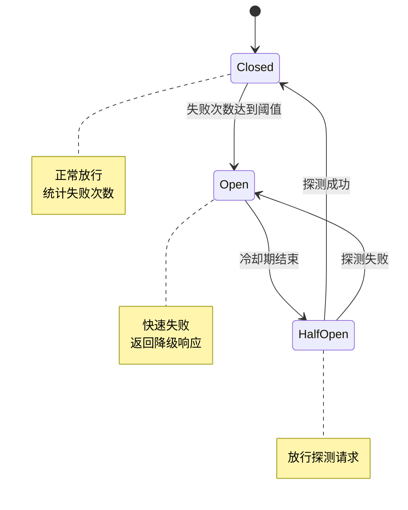

# 混沌工程验证系统是否真的能处理故障

**监控全绿只说明常规路径没出问题，恢复逻辑往往要到真实事故里才第一次被执行**。**读完这篇你能写清一次故障实验的假设、稳态（系统运行指标进入平稳区间后的状态）指标、爆炸半径和自动停止条件，在可控范围里提前验证系统扛不扛得住**。

## 先记住哪几句

| 维度 | 回答 |
| --- | --- |
| 要解决的问题 | 正常路径绿色不能说明系统能应对进程崩溃、网络分区、依赖超时、过载或数据故障；未验证的恢复逻辑往往只在事故中第一次执行。 |
| 本质 | 在可观测稳态上注入有界故障，用关键不变量、SLO 和恢复证据检验系统的真实行为。 |
| 做法 | 先写假设、稳态指标、注入范围、爆炸半径、自动停止、回滚和预期不变量，再在隔离环境或小流量灰度执行。 |
| 效果与代价 | 暴露恢复、降级、幂等和观测缺口；代价是实验风险、环境准备与值班成本。 |
| 边界 | 混沌实验不是随机破坏生产，也不能覆盖未建模风险；服务返回 200 不代表数据、任务状态和权限仍然正确。 |
| 验证 | 保存注入命令、时间线、trace、日志和恢复结果；将关键故障模型加入新版本、推理后端和数据管道回归。 |

**混沌实验以可观测的稳定状态为基线（正常状态下的指标水平、用来对比异常），注入受控故障，验证系统是否保持关键不变量并在预算内恢复**。**它不是随机破坏生产，更不是替代单元/集成测试**；**实验对象、范围、停止条件和回滚（把系统状态退回到改动之前的版本）必须明确**。

## 本质是什么：把恢复逻辑从"没跑过"变成"跑过"

**好比大楼消防演习：喷淋、疏散广播、应急灯平时都在（恢复逻辑平时都在），但从未真的喷过水、疏散过人，是不是好用只有真起火那天才知道——演习把这些动作在有人盯着的条件下跑一遍**。**未经验证的恢复逻辑有一个共同点：它只在真正的生产事故里第一次执行**。

**降级（主动牺牲部分功能或精度，保住核心链路）开关、重试退避、舱壁隔离、熔断（错误率过高时暂时断开调用快速失败）恢复——这些代码平时都在，但从来没有被触发过，于是没人知道它是否真的能工作**。**混沌工程的价值就在于让它们在执行环境里跑一次，把"应该能扛住"变成"上次确实扛住了"**。比喻到「演习跑一遍」为止，成功标准为什么不是"服务还活着"看下文。

**这也解释了为什么成功标准不能是"服务还返回 200"：200 只能说明请求没报错，说明不了数据是否一致、任务状态是否正确、重试预算有没有被耗尽**。



**爆炸半径的圈定落在三个约束上：注入对象（单个可用区、单个依赖客户端，不碰全量）、止动开关（一键撤销注入并保持随时可人工介入）、观察窗口（预算内的隔离时间，超时自动停止）**。**没有这三个约束，破坏就成了事故，实验无从谈起**。

**图里的回路是这套方法的核心：稳态被打破之后能拿到改进项，实验就产出了价值；稳态被打破之后只记一句"已知风险"，然后什么都不改，实验就退化成了一次有记录的破坏**。

**验证的对象是真实的恢复机制**。**主从（一台主节点负责写入、其他从节点同步数据的部署形态）切换就是最常见的一种：哨兵（持续探测故障并触发切换的守护进程）持续监视主从节点健康，主节点失联后自动发起选主（多节点中选出一个负责决策的主节点的过程）与切换——这套恢复逻辑有没有被验证过，只有注入一次主节点故障才知道**。腾讯云开发者社区这张哨兵架构图把监视与切换的关系画全了：


来源：[腾讯云开发者社区《Redis系列：Redis主从、哨兵、集群介绍》](https://cloud.tencent.com/developer/article/2183910)（CC 4.0 BY-SA）

在 Kubernetes（容器编排平台，负责容器的部署、调度与自愈）平台上这套实验有标准工具：Chaos Mesh 把故障注入（主动向系统注入故障来验证容错能力的测试方法）做成控制器与调度器的组合，实验定义写进 YAML（缩进层级的配置文件格式）由平台执行，下图是官方架构：


*图源：Chaos Mesh 官方文档「架构概览」，https://chaos-mesh.org/docs/architecture_overview/（中文标签官方图）。*

## 有哪些故障可以被注入

进程崩溃、节点/网络分区、延迟/丢包（数据包在网络传输途中丢失）、磁盘满、CPU/内存压力、依赖 5xx/超时、消息重复/乱序、时钟变化、GPU 驱逐（按策略移除条目或实例）和凭据失效。AI 任务还要注入模型/工具不可用、RAG（检索增强生成，先从外部资料里检索再让模型据此回答）索引旧代际和中途取消。

**注入故障之所以能验证系统，前提是系统里真的存在会随故障改变行为的机制**。**熔断器就是最典型的一种，它自身就是一个状态机——正常放行、失败累积到阈值后短路快速失败、冷却期满后放少量请求试探、试探失败继续短路**：



**混沌工程在数据中心有直接的实物对应：机房的故障演练**。**演练前先写清假设（掉一台 UPS 整流器、断一组市电输入）、限定范围（单列机柜、规定时段）、明确止动（一键恢复市电、人工急停），然后注入受控的"故障"**，考核的是**油机自启动、UPS（Uninterruptible Power Supply，不间断电源：断电时撑住供电的电池组） 电池接管、空调群控降级这一整套自动应对是否真的能执行**。**与混沌实验同构的还有关键一条：演练暴露的缺口（油机启动失败、切换超时）必须整改后重演，只记一句"已知隐患"的演练等于白演**。


*图源：Wikimedia Commons，BalticServers.com，CC BY-SA 3.0，https://commons.wikimedia.org/wiki/File:BalticServers_data_center.jpg。*

## 实验要遵守哪些约定

```text
假设 + 稳态指标 + 注入范围 + 最大爆炸半径
     + 自动停止 + 预期不变量 + 恢复证据
```

**成功的判定要看核心请求、数据一致性、权限、任务状态、重试预算、SLO（服务等级目标，服务对可用性或延迟作出的量化承诺）和恢复时间是否符合预期**，"服务还返回 200"覆盖不了这些；**副作用（操作对外部状态产生的额外影响）不能重复，失败不能覆盖已确认事实**。

## 动手跑一遍会看到什么：一个带假设的实验全程

对支付服务注入"依赖超时 2 秒"故障，完整实验记录：

```text
稳态假设（先明确写下，可证伪）：
  支付依赖慢 2s 时：下单成功率降幅 <2%，P99 <5s，无错误级联

爆炸半径控制：
  注入对象：单个可用区的支付客户端超时（非全量）
  止动开关：一键撤销注入（<5s 生效），观察者持有人工止动权

实验记录：
  t+0    注入生效（60% 请求超时重试，重试风暴现形：下游 QPS ×1.8）
  t+40s  下游线程池耗尽，未注入区域也开始超时 ← 假设已被证伪
  t+50s  人工止动，注入撤销

产出（实验的全部价值）：
  发现 1：重试无退避 → 超时被放大成重试风暴（修复：退避+抖动）
  发现 2：线程池无舱壁隔离 → 故障跨区域传染（修复：按依赖分池）
  发现 3：止动流程 50s（超标，目标 10s 内）
  → 三项进入修复队列，修复后重跑同一实验验证，实验收尾
```

**跑一遍的收获：混沌工程的产出是对故障处理能力的证据（处理了、没处理、处理得慢），价值全在"假设被证伪后产出的修复项"**——**注入本身什么也不证明，证明的是注入后系统的行为与假设的差距**。

## 这些结论的量级靠什么数字支撑

**频率与强度的账：注入强度从小比例起步（1% 请求延迟、单实例故障），生产环境实验的故障注入面不超过一个可用区（爆炸半径用流量比例圈）**；**实验频率的公开经验是月度级（配合发布节奏），稳态指标在实验间的漂移本身就是告警**。**修复验证的完整流程：实验产出的修复项，重跑同一实验是唯一验收方式（"修了"与"扛得住"之间隔着重跑），验收通过才归档为稳态能力**。

**案例回流：故障传染的实录见** [[工程知识/缺陷分析：从个案到体系/稳定性/案例三十六：写被自己的回调堵住——挂起的 add 回调.md]]（一个挂起堵住整条路径，正是舱壁缺失的形态）；**重试风暴的机制账见** [[工程知识/数据系统：在并发与故障中保存事实/数据管道与流处理/数据编排要保证依赖、重试与幂等.md]] **的退避与抖动（性能指标不稳定的起伏）段**；**实验的计划性与** [[工程知识/软件构建：让变化可以理解、验证与交付/测试与交付/CI流水线把反馈速度和发布证据连接起来]] **的证据链同源——混沌实验是流水线证据在"故障日"的形态**。

## 怎么自己动手验证

**先在隔离环境和小流量灰度（新版本先放一小部分流量验证，逐步放大到全量），保存注入命令、时间线、trace、日志、状态和恢复结果**。**每个新版本、基础设施、推理后端和数据管道的关键故障模型至少有一条自动回归**；**实验失败应产生可执行修复，不要只记录"已知风险"**。

关系：[[工程知识/后端系统：在并发、失败与变化中维持服务/分布式可靠性/部分失败决定分布式系统的设计]] · [[工程知识/软件构建：让变化可以理解、验证与交付/测试与交付/发布门禁必须绑定真实证据]]

## 效果从哪儿来，要付什么代价

**收益是恢复、降级、幂等（同一操作执行多次与执行一次效果相同）与观测缺口在受控条件下暴露**——**这些问题留在生产里发现，代价是真实事故**；**代价是实验风险、环境准备、数据隔离和值班成本**。**跳过实验的代价在于恢复逻辑始终处于未验证状态：降级开关与熔断恢复这些代码平时都在，但从未被真正执行过，是否可用要到事故当天才知道**。

## 接着读哪几篇：网络注入的生效性对账
[[工程知识/软件构建：让变化可以理解、验证与交付/测试与交付/测试环境与生产的差距要按维度补偿：并发、数据量、配置与故障注入的逃逸清单.md]]
[[工程知识/软件构建：让变化可以理解、验证与交付/测试与交付/可重复构建把产物可信从来源信任换成证据信任：非确定性来源清单与消除.md]]
[[工程知识/软件构建：让变化可以理解、验证与交付/测试与交付/不稳定测试的判定与归因：从无限重跑掩盖到按失败形态分诊.md]]

- [[工程知识/性能工程：从用户等待到资源瓶颈/观测与诊断/网络故障注入先打点对账：注入值与应用感知值对不上，注入就是无效实验.md]] —— 网络注入的生效性对账
- [[工程知识/软件构建：让变化可以理解、验证与交付/测试与交付/故障演练把预案、工具与人串成可执行的响应链.md]] —— 组织侧的配套：注入之后人与流程怎么彩排
