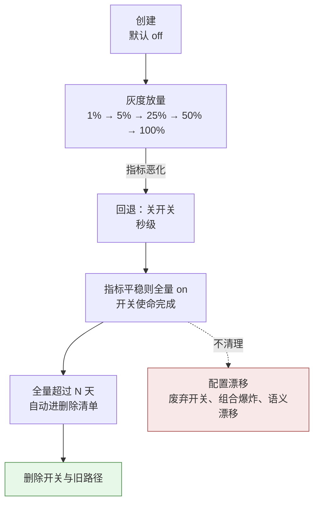
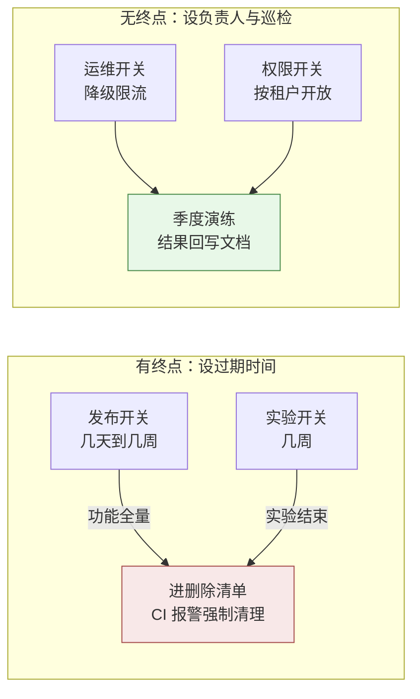

# 灰度与功能开关的边界：交付节奏与配置漂移

## 要解决的问题

**部署与发布分离（代码上线 ≠ 功能对用户可见）靠功能开关实现**：新功能藏在开关后，部署后按人群与比例逐步放量，这就是灰度。但开关有寿命：功能全量后开关该删，**拖着不删的开关是配置漂移源**（废弃开关被误开、组合爆炸、代码路径不可测）。要解决的问题是**把功能开关当有生命周期的对象管理**：分类说清哪些该长存哪些该短命，放量策略定灰度的节奏与判定，退役配删除的强制机制，让"部署与发布分离"的收益不被"开关堆积"的债务吃掉。

这与配置与特性开关分离部署与发布（见 [[工程知识/软件构建：让变化可以理解、验证与交付/测试与交付/配置与特性开关分离部署与发布.md]]）构成原理篇与边界篇的配对。

**开关的价值集中在中间那段放量过程**。**全量之后它的价值归零、风险开始累积**，所以"全量 on"**应当触发退役倒计时**，而不是**成为遗忘的开始**。

## 它是怎么做到的

*图源：OpenFeature 官方文档（CNCF（Cloud Native Computing Foundation，托管 Kubernetes 等项目的基金会） 项目），CC BY 4.0，https://openfeature.dev/docs/reference/intro/。这张图的关键在中间那层评估 API：它把"读开关"和"开关存在哪"分开了。分开之后，开关的存放位置就可以随交付节奏换，而业务代码不用跟着改——本文讲的配置漂移，正出在这两层之间。*

**开关的分类学**（Pete Hodgson 发表在 martinfowler.com 的分类）。
- 发布开关（release toggles）：未完成功能上线时隐藏，**短命——几周寿命，功能全量后删除**。
- 实验开关（experiment toggles）：A/B 测试分流，**中寿命——随实验周期，实验结束删除**。
- 运维开关（ops toggles）：紧急降级（主动关闭次要功能、保住核心链路的自保手段）路径长寿命，**但每个都要配演练（不演练的运维开关是装饰品）**。
- 权限开关（permission toggles）：按用户与租户的功能授权，长寿命，**本质是配置，该走权限系统**。

"长寿命开关要配演练"的实物原型是建筑物的疏散演习：1973 年明尼阿波利斯图书馆那次演习里，撤离路线、引导分工、人员清点全按真实流程走，唯一省掉的是火警本身——演习的意义不在那天，在真警铃响起时每个人的动作是练过的。**运维开关就是建筑的疏散通道**：平时不走，真出事时必须立刻能用；通道多久没走过、门锁是否锈住、指示牌是否还亮，**只有演练能回答**：

*图源：Wikimedia Commons，City of Minneapolis Archives，CC BY 2.0，https://commons.wikimedia.org/wiki/File:Minneapolis_Public_Library_Evacuation_Drill_(19730521118).jpg。*

**灰度放量的节奏设计**。**放量的每一步都是实验**：小比例（1% → 5% → 25% → 50% → 100%），每步的停留时间足够收集证据（指标：错误率、性能、业务转化）。**回滚（把系统状态退回到改动之前的版本）是放量的一部分**：指标恶化超过阈值**自动回退或由人工确认回退**，回退速度要事先设计（**开关回退秒级，部署回退分钟级，这是开关优于部署回滚的核心价值**）。

放量的完整机制可以看一张真实实现：AWS（Amazon Web Services，亚马逊云服务）官方博客里 Argo Rollouts 的金丝雀架构，负载均衡器把流量按 10%/90% 分给新版本与稳定版本，控制器的分析任务从 Prometheus（时序监控与告警系统）取指标做判定，**判定通过才提升流量比例**——正文说的"每步都是实验"在图上就是那个 Analysis Run 环节：

*图源：AWS 官方博客《Deployment（Kubernetes 里管理无状态应用副本与滚动更新的控制器） strategies with Amazon EKS and Argo Rollouts》Figure 4，https://aws.amazon.com/blogs/containers/deployment-strategies-with-amazon-eks-and-argo-rollouts/，文章插图。图上的 Analysis Run 就是本篇说的"每步停留收集证据"的工程形态：指标判定挂在放量路径上，判定不通过放量就停。*

**配置漂移的三个形态**。
- 废弃开关：功能全量后开关还在且默认 on，下次有人误碰开关状态，**全量功能被静默关闭，构成事故**。
- 组合爆炸：开关数 N 增长后，**2^N 的组合空间不可测**（每个开关与其他开关的交互），测试矩阵爆炸。
- 开关语义漂移：开关名与实际行为脱节（flag "new-checkout" 后来控制的是别的东西），**新人无法理解**。

**退役机制是开关治理的核心**。强制退役的工程手段：**开关的到期字段**（deadline，到期未删 CI（Continuous Integration，持续集成：代码合并后自动构建与测试）报警）、**全量后的墓碑机制**（开关全量 on 超过 N 天自动进删除清单）、**代码所有权的挂钩**（开关挂在 feature team 名下，退役进 team 的 backlog）。**没有强制机制的开关库必然堆积**（每个开关都"以后再删"，以后永远不来）。

## 它从哪儿来，要付什么代价

功能开关是持续交付运动（2010s）的伴生技术，**"部署与发布分离"让代码流动（主干开发、随时部署）与功能曝光（按业务节奏放量）解耦**。LaunchDarkly（2015+）把它产品化，OpenFeature（2022+）做标准化（SDK 抽象，供应商可换）。灰度放量随 2015+ 的"灾备演练"文化成熟（Facebook 的 progressive rollout 实践公开化）。

**"开关的全量即退役的倒计时设计"**。开关的价值在灰度过程里控制曝光，全量后价值归零，风险开始积累——废弃开关、组合爆炸。把"全量 on 超过 N 天"设计成自动进删除清单（CI 报警 + backlog 强制插入），**让开关库的堆积倾向被制度性对抗**。**倒计时设计承认开关是债务（建的时候就要想退役计划）**，与"先上后删"的拖延心理对抗。代价：**开关的运维成本随数量线性涨**（每个开关的状态管理、监控覆盖、退役跟踪），复杂开关（多维分流：人群 × 比例 × 时间）的实现成本高（分流不均会污染实验结论）；**开关让代码路径翻倍**（if flag 的两条路都要测，测试成本×2，长期不删的开关让测试矩阵不可维护）；灰度的判定需要数据基建（放量期间的指标对比要有足够统计功效，**样本量小的产品灰度不出结论，硬灰度是仪式不是实验**）。

## 这套说法在哪儿会失效

- **发布开关的寿命以周计，超过一个月就是设计错误**。长命的发布开关说明**功能粒度太粗、一次发一大坨**，正解是把功能分得小一些，让每个开关快速走完启用与退役。**开关寿命是功能粒度的体温计**。
- **运维开关必须配演练**。不演练的降级开关在真实事故时大概率失败——路径没走过、依赖已变。演练频率按事故预期定，**每季度一次是底线**，演练结果回写开关文档。
- **分流一致性与实验有效性**。同一用户在灰度期间的开关状态必须稳定，**用 hash 分流加粘性保障**，否则用户体验漂移——昨天有新功能今天没有——且实验数据被同用户跨组污染。分流的 hash 键选择（user_id vs session_id）影响统计口径。
- **开关不是权限系统**。按租户/角色的功能授权挂开关上，开关库变权限库（语义漂移 + 权限审计失效）。**授权需求走权限系统，开关只管交付节奏与应急**。

## 怎么自己动手验证

开关的四类生命周期画在同一张图上，退役压力的方向一目了然：

- **退役机制实验**：到期字段 + CI 报警上线，统计开关的平均寿命变化。预期：**平均寿命从数月降到数周（制度对抗堆积有效的证据）**。
- **灰度判定功效实验**：模拟放量期间的核心指标——错误率、转化率——在 1%/5%/25% 比例下的统计功效。预期：**小流量阶段的指标噪声大到单点不可判定**，需要停留时长或指标方差的预先设计。功效分析是放量节奏的设计依据。
- **开关组合测试抽样**：N 个活跃开关的系统中抽 2^k 组合（k 取 3 到 4）跑核心测试。预期：**组合间的交互缺陷暴露——单独全绿、组合出错**。组合爆炸的实证与抽样策略必要性。

## 动手跑一遍会看到什么：开关账本的推演

把一个季度内的开关生命周期算成一笔账（通用推演）：

| 时间 | 动作 |
| --- | --- |
| 第 1 周 | 新功能开发，feature_dark_mode 开关创建（off 默认） |
| 第 3 周 | 灰度 5% 用户，观察崩溃率与反馈 |
| 第 5 周 | 灰度 50%，指标平稳 |
| 第 6 周 | 全量 on，开关的使命完成 |
| 第 7 周 | 清理窗口开始 |
| 第 10 周 | 代码里删除开关分支（功能成为唯一路径） |
| 第 12 周 | 开关配置从配置中心删除 |

漂移的账：不执行第 7-12 周，**季度末存量开关 30+ 个**。每个存量开关意味着两条路径并存、测试矩阵翻倍、读代码时多一层迷宫。一年后，**60% 的开关没人说得清是谁的、能不能删**。

开关沉积的推演：一个三年老服务的配置中心积累到 200+ 开关，故障排查时发现某个开关处于 off，**新代码路径从未在生产执行过（团队以为上线了的功能实际三年从未运行，故障时切过去全靠想象）**；应对办法是开关清理专项，**每个开关问三问：谁建的、现在什么态、删了会怎样**，两周量级能清掉大部分。配置漂移的实录——开关默认值在不同环境不一致（测试环境 on、生产 off），**测试全绿上线即故障**；环境差异要显式声明在开关元数据里而非靠记忆。

开关的发布语义与 [[工程知识/软件构建：让变化可以理解、验证与交付/测试与交付/CI流水线把反馈速度和发布证据连接起来.md]] 的证据链衔接，模型发布的同构形态见 [[工程知识/AI 系统工程：从模型能力到生产能力/数据与MLOps/模型发布需要注册、灰度与回滚.md]]。

## 接着读哪几篇：开关双路径的测试成本

- [[工程知识/软件构建：让变化可以理解、验证与交付/测试与交付/配置与特性开关分离部署与发布.md]] —— 开关的原理篇
- [[工程知识/软件构建：让变化可以理解、验证与交付/测试与交付/测试策略从风险选择证据.md]] —— 开关双路径的测试成本
- [[工程知识/后端系统：在并发、失败与变化中维持服务/服务设计/服务降级是有损服务，损什么损多少要变成业务决策.md]] —— 运维开关背后的降级决策
- [[工程知识/缺陷分析：从个案到体系/配置/配置类缺陷的静态防线：schema校验与默认值审计.md]] —— 配置漂移与 flag 治理姊妹篇，本篇补 schema 与默认值防线
