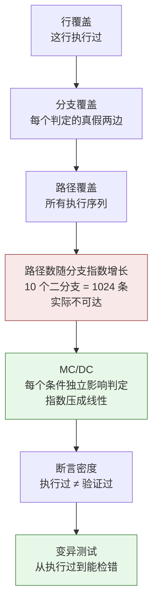
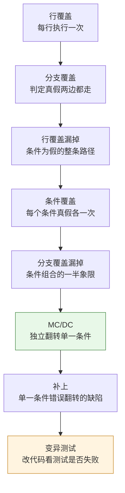
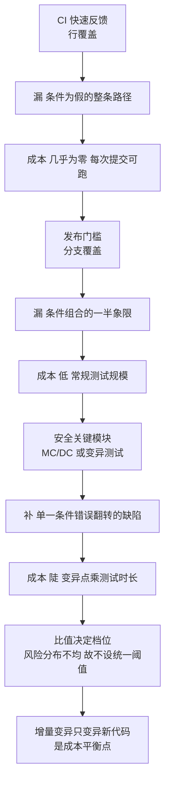

# 覆盖率的三种读法：行分支与路径覆盖的证据强度

## 覆盖率 90% 到底能证明哪些东西：要解决的问题

"覆盖率 90%"是测试报告里最常见的数字，但它掩盖了三种完全不同的承诺强度：**行覆盖（这行执行过）< 分支覆盖（每个判定的真假两边都走过）< 路径覆盖（所有执行序列都走过）**。**同一数字 90% 在三种读法下的证据强度显著不同**。

要解决的问题是**把覆盖率从单一数字还原成证据强度的谱系**，让"90% 行覆盖"与"90% 路径覆盖"根本不可换算（衡量口径不同，两个数字之间没有换算公式）这件事显形，CI（Continuous Integration，持续集成：代码合并后自动构建与测试） 阈值与质量讨论才有共同语言。这是《测试策略从风险选择证据》（见 [[工程知识/软件构建：让变化可以理解、验证与交付/测试与交付/测试策略从风险选择证据.md]]）的量化支柱，与《静态分析的证据边界》（见 [[工程知识/软件构建：让变化可以理解、验证与交付/测试与交付/静态分析的证据边界：它证明什么不证明什么.md]]）构成证据谱的两端。

横向是证据强度递增。图上有三处延伸值得留意：`P → X` 说明全路径因路径爆炸不可达；`P → M` 是判定内的折中，MC/DC（Modified Condition/Decision Coverage，修订条件判定覆盖）只压判定级那一处爆炸；`L → A → MT` 是另一条线索，变异测试的证据来自"执行过但没断言过"这个缺口，与路径爆炸无关。

## 三种读法各强在哪、漏在哪：机制

先把形状说成一件事：**三种覆盖像检查一座桥的三种深度**——行覆盖是"每一块桥板都踩过一脚"（踩过不等于踩得结实）；分支覆盖是"每个岔路口两个方向都走过"（但岔路口连起来的组合路线没走全）；路径覆盖是"把所有可能路线都各走一遍"（十个岔路口就有一千零二十四条路线，走完全城封桥）。这个比喻到"封桥"为止——现实里数字的换算、MC/DC 的折中、断言与变异测试这两个正交维度，下面逐项展开。

**三种读法的定义与强度差异**。
- 行覆盖（statement coverage）：**每行代码至少执行一次。最弱读法：执行过 ≠ 验证过**——**执行到这行但断言没检查它的结果，覆盖白覆盖**。**if 不写 else 时 100% 行覆盖可以漏掉条件为假的那条路径**。
- 分支覆盖（branch coverage）：**每个判定的每条边都走过（if 的真与假、switch 的每个 case）**。**中等强度：条件组合间的交互漏掉——A and B 的四象限只测了两象限**。
- 路径覆盖（path coverage）：**所有可能的执行路径都走过。最强读法：但路径数随分支数指数增长（10 个二分支 = 1024 条路径），全路径覆盖对真实程序不可达**。**这里有两种规模不同的爆炸要分开看**：程序级的是分支串联造成的路径爆炸，MC/DC 消解不了它；判定级的是单个判定内 k 个条件的 2^k 种组合，MC/DC（modified condition/decision coverage，航空标准 DO-178（航空软件安全标准）的要求）把这一处压成 k+1 至 2k 条用例的线性量。**MC/DC 是折中，不是全路径的替代品**。

**覆盖率高低的证据含义**。**覆盖率是必要条件不是充分条件**：**低覆盖率 = 某些代码从未被任何测试验证过（证据缺口明确）**，高覆盖率 = 所有代码被"执行过"（但不保证被"断言过"）。**断言密度（每覆盖行的断言数）是覆盖率的补充维度，与覆盖率正交**——高覆盖可以与高断言密度并存，也可以与低断言密度并存；**90% 覆盖 + 低断言密度 = 跑过但没检查，证据强度虚**。**变异测试（mutation testing）是更强读法：改一处代码看测试是否失败，测试杀掉的变异比例近似刻画测试的检错力**。它是覆盖率的证据升级（从"执行过"到"能检错"），但成本高（全量变异跑 N 倍测试时间），按风险模块选用。

**变异测试把「执行过」与「验证过」的差距变成报告里的两列数字**——PIT（Java 生态最常用的变异测试工具）的 HTML 报告总览页就是实物：项目行覆盖 100%，变异覆盖 92%（37 个变异体存活 3 个），红色小格标出的正是「跑过但没杀掉」的部分；service 包行覆盖同样满分，变异覆盖却停在 91%——**行覆盖看不出来的一切，变异测试用存活变异体逐格列出**：

*图源：Loiane Groner《Mutation Testing for Java with PIT》（loiane.com，2026-06，文章配图，PIT 工具生成的报告截图）。Line Coverage=行覆盖率，Mutation Coverage=变异覆盖率（被杀变异体/总数），Test Strength=测试强度（覆盖代码中被杀的比例），survived=存活变异体（测试执行过却没抓到的错误注入）。**行覆盖满格而变异格留红，就是正文说的「执行过 ≠ 验证过」在工具报告里的样子**。*

**复合条件与短路求值的陷阱**。以 `if (a && b)` 为例，**分支覆盖只检查整条判定的真假两边，a、b 单独的组合在检查范围之外**——`a=true/b=false` 与 `a=false/b=true` 是两条不同路径，但**只要判定结果都是假，分支覆盖就认为已经覆盖**。**复合条件覆盖（condition coverage）补这个洞**，**MC/DC 进一步要求独立性：固定其他条件，翻转单一条件能翻转判定结果**。**短路求值让问题更隐蔽：`a && b` 在 a 为假时根本不会求值 b，于是 b 的那部分代码在若干组合下从未执行**。**条件覆盖要求每个条件的真假各出现一次，但它仍可能漏掉判定取真的情形**——只测 `a=true/b=false` 与 `a=false/b=true` 时，两个条件都取过真假，判定却恒为假。MC/DC 补的就是这一层：固定其他条件，翻转单一条件能翻转判定结果。**这是航空与汽车安全标准选 MC/DC 的原因：它从指数级的组合里挑出影响行为的线性子集**。

**增量覆盖率与门禁设计**。全量阈值**的博弈**（老代码拉低均值，新代码搭便车）用增量门禁解：新代码必须 100% 覆盖（diff-coverage），存量逐步改进。**门禁分层：行覆盖做 CI 门禁（便宜快），分支覆盖做发布门槛（较贵），路径/变异按模块风险（贵，只用于核心）**。

*图源：[腾讯云开发者社区《JaCoCo 代码覆盖率：Spring Boot 集成与报告解读》](https://cloud.tencent.com/developer/article/2707793)（转载 JaCoCo 工具生成的报告截图）*

这张报告截图把「三种读法」落到了工具实物上：Missing Instructions 对应行覆盖的缺口，Missed Branches 单独一列对应分支覆盖的缺口——**同一个类可以行覆盖 100% 而分支覆盖率不足，两种读法的证据强度差别在报告里就是两列数字**。**黄色条带（部分覆盖）出现在 if 只走了真分支的行上**，正是正文说的「100% 行覆盖可以漏掉条件为假的那条路径」在工具里的样子。

## 这套谱系从哪来、付什么价：背景与代价

**覆盖率指标在 1960 年代已有早期工作，行/分支/路径的谱系在 1970 年代交代清楚**，军用与航空标准（DO-178、ISO（International Organization for Standardization，国际标准化组织） 26262）把 MC/DC 写进法规层。工业界的大讨论是覆盖率阈值**之争**（2010s）：业界流传的若干阈值（如 60% 与 80%）各自成立，取决于**语言、领域与风险分布**，共识收敛为"阈值**无普适值**，按风险分布与回归成本定"。变异测试的思想在 1970 年代提出（常与 Lipton、DeMillo 等人的工作关联，具体归属说法不一），其复兴是工具成熟（PIT、Stryker）把成本从不可用压到可选。

MC/DC 的关键一步是**把指数路径压成线性证据**。全路径覆盖不可达（组合爆炸），**只测真值表的对角线（每个条件独立翻转）却能捕捉大部分行为缺陷**。这个设计的依据：**缺陷的分布并不均匀，多数缺陷由单一条件的错误翻转引发，独立翻转覆盖恰好对应这个分布**。代价：覆盖率的三个读法都不能替代断言质量——覆盖率的证据上限是"代码被走过"，变异测试才到"测试能检错"，而真正的行为正确性要靠断言与预期结果——**断言弱，覆盖率是虚证据**。**覆盖率门禁的博弈行为（为凑数写无断言测试、把难测代码标 ignore）是管理问题，指标只能量化它不能消除它**。**变异测试的成本曲线陡（全库变异 = 测试时间 × 变异点数），只对高风险模块值得；增量变异（只变异新代码）是成本平衡点**。覆盖率的健康用法：作回归网的守门员（覆盖率下降报警，见回归网思想 [[工程知识/缺陷分析：从个案到体系/复现与回归/从复现到回归——让证据走完一圈.md]]），不作质量分数的排行榜。

## 这些读法在哪儿会失效：边界

路径覆盖为什么几乎做不到，看结构就清楚了。下面四种控制流图依次是判断分支、循环、带中途退出的自然循环、以及带两个入口的循环，**节点数量不多，但从入口到出口的可能路线在第四种上已经无法靠枚举列全**：

*图源：Wikimedia Commons《Some types of control flow graphs》，CC BY-SA 3.0。*

三种读法的强度阶梯与各自抓得住的漏洞：

- 路径覆盖对真实程序不可达（分支串联的指数爆炸），MC/DC 是判定级组合的线性折中，两者规模不同。

- **覆盖率是必要条件的证据，不是质量分数**。**高覆盖不等于高质量——断言弱则覆盖虚高；低覆盖明确是问题——未验证代码**。**把覆盖率当 KPI（关键绩效指标）考核会激励凑数行为，正确用法是门禁与缺口分析**。
- **三种读法的选择按风险分层**。**CI 快速反馈用行覆盖，发布门槛用分支覆盖，安全关键模块用 MC/DC 或变异测试**。**全库统一最高读法是浪费（贵且无必要），统一最低读法等于不设防线（漏条件组合）**。
- **不可达代码的处理是数据卫生**。**废弃代码（被删功能的残留）拉低覆盖率且永远无法覆盖，该清理；平台特异代码（OS 分支）按平台分报覆盖率，不混在一起**。
按风险分层的选型不是随便排的三档，三档的划分依据是"漏掉什么"与"要花多少"这两件事的比值：

图右侧那句"比值决定档位"是阈值之争的答案：缺陷分布不均匀，所以"60% 还是 80%"没有普适解。全库统一最高读法是浪费，统一最低读法等于不设防线。腾讯云开发者社区的 [软考高级架构师：语句覆盖、分支覆盖、判定覆盖和路径覆盖](https://cloud.tencent.com/developer/article/2421201) 与测试之家的 [白盒测试控制流测试](https://testerhome.com/topics/19991) 用同一组概念给出了中文对照，后者还给出了 C0 与 C1 的计数口径（语句覆盖 = 已执行语句数/总语句数，分支覆盖 = 已执行分支数/总分支数），可以直接对着自家报告核对。

- **覆盖率报告要配合缺口分析使用**。**数字之后的动作是看未覆盖的模块分布（风险高的模块未覆盖是红灯，样板代码未覆盖是噪音）**，**报告的可视化按风险排序而不是按目录**。

## 想自己测一遍怎么动手：验证

- **三种读法对照实验**：**同一模块分别统计行/分支/MC-DC 覆盖率，再注入缺陷（fault injection）看测试能否检出**。**预期：行覆盖高但分支覆盖低的模块，缺陷检出率显著低（条件组合漏测的直接证据）**。读法强度与检出率的相关性。
- **变异测试基线（正常状态下的指标水平、用来对比异常）**：**核心模块跑变异测试，统计变异杀除率与覆盖率的相关性**。预期：90% 覆盖的模块变异杀除率 60-80%（覆盖高并不等于**检错力强**，两个数字之间有差距），断言弱的模块杀除率急剧下降。覆盖虚高的实证。
- **增量门禁实验**：**diff-coverage 门禁上线前后，新代码的缺陷逃逸率（上线后 bug）对比**。预期：逃逸率下降（未覆盖代码上线减少）。门禁有效性的业务证据。

## 接着读哪几篇：覆盖率在证据体系中的位置

- [[工程知识/软件构建：让变化可以理解、验证与交付/测试与交付/测试策略从风险选择证据.md]] —— 覆盖率在证据体系中的位置
- [[工程知识/软件构建：让变化可以理解、验证与交付/测试与交付/静态分析的证据边界：它证明什么不证明什么.md]] —— 证据谱另一端的静态证据
- [[工程知识/缺陷分析：从个案到体系/复现与回归/从复现到回归——让证据走完一圈.md]] —— 覆盖率作为回归网守门员
- [[工程知识/缺陷分析：从个案到体系/并发/并发缺陷的复现策略：压力放大与确定性调度.md]] —— 交错是路径爆炸的极端形态，覆盖率证据分析在此放大
- [[工程知识/缺陷分析：从个案到体系/复现与回归/回归风险评估的通用骨架：从变更面到测试选择.md]] —— 覆盖率读法是测试选择的证据强度依据
- [[工程知识/软件构建：让变化可以理解、验证与交付/开发工具/依赖升级的半衰期策略：跟随与锁定的平衡.md]] —— 升级自动化的胆量由测试置信度决定，覆盖率是地基
