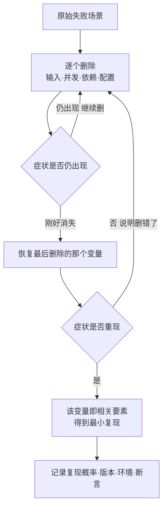

# 调试从假设到最小复现

## 要解决的问题是什么

**最小复现要做的就是砍掉无关层**。**协议栈的分层给了砍的刀法：先确认应用层，再看传输层，逐层往下剥**。

**线上偶发故障出现时，能拿到的材料只有若干条超时日志和一段模糊的用户描述，改动一处后症状消失也无法判断是否已修复，过几日再次出现时说不清是不是同一个问题**。调试要解决的问题是：没有稳定复现时因果怎样被确立、假设写成什么形式才可证伪、探针（向系统注入的检测点或检测请求）按什么顺序投放、最小复现怎样从原始失败收缩得到、以及修复之后要在哪些场景各验证一次。

## 它是怎么做到的，本质是什么

**用户看到的症状与代码里的缺陷之间隔着环境、并发、时序与配置**，**没有一条可以稳定变红的回路时，任何解释都只是众多合理猜测中的一个**。**把症状压缩成最小输入并配以明确断言，缺陷的触发条件就成为一个可以被证伪的假设**；**每次只改一个变量，假设与结果之间才存在可归属的对应关系**。

## 先看两种做法差在哪

线上偶发超时，一天几十次。

**做法 A**：翻日志，看到一堆 `context deadline exceeded`，判断"下游太慢"，加超时时间。第二天照旧，只是变慢了些。

**做法 B**：**先想办法让它按需复现——写个脚本并发打 200 请求，5 分钟内必现一次**。然后每次只改一个变量：先怀疑连接池（预先建好连接反复取用、省去反复握手建连的开销），把池从 10 调到 100，还复现，排除；再怀疑 GC，打开 `GODEBUG=gctrace=1`，发现每次卡顿都紧跟一次 STW（Stop-The-World，垃圾回收时暂停全部业务线程），锁定。

两种做法的区别不在聪明程度，在**有没有一条会变红的回路**。做法 A 从头到尾没有任何东西能为结论"变红"——它只是在合理的解释里挑了一个。

调试要交付的东西是一个**在最小输入和可观测证据下被证伪或得到支持的假设**，找到一个听起来合理的原因只算中途产物。

## 为什么没有复现，就没有因果

这是最容易被跳过的一步。没有稳定复现时：

- 修复无法区分**因果**、**巧合**和**环境变化**
- **无法确认修复真的修好了，还是这次运气好**
- 再现时不知道是不是同一个问题

没有稳定复现，就无法区分因果、巧合和环境变化，修复到底是修好了还是这次运气好也无法确认，所以第一件事是**建立能对用户症状变红的回路**：最小输入、明确断言、可重复环境、分层观测。

对偶发问题，不追求 100% 复现，但要**记录复现率**：同样跑 200 次，从"偶发"变成"10 次里出现 1 次"，就已经可以用来验证修复了。

## 假设检验的循环怎么走

1. 症状
2. 复现
3. 3-5 个可证伪假设
4. 定向探针
5. 最小修复
6. 原场景回归
7. 删除临时诊断

排查中还有几个容易做错的地方：

- **假设要可证伪**。"下游慢"是现象的复述，"连接池耗尽导致排队"是假设——打印池的等待队列长度能证实或推翻后者。
- **一次只改一个变量**。同时调池大小和超时时间，好了也不知道是哪个起作用。
- **探针要有指向性**。日志、断点、trace、core dump、属性测试、故障注入（主动向系统注入故障来验证容错能力的测试方法）各回答不同问题。**全量加日志不算观测策略，那只是把问题往后推**。

同一段 CPU 采样数据，Go 官方诊断文档给了三种探针形态的对照——文本列表直接排出最贵的调用、调用图把谁调谁画成箭头、weblist 把耗时逐行标回源码，**三种形态回答「时间花在哪」的精度逐级上升**：

*图源：Go 官方文档《Diagnostics》，CC BY 4.0，https://go.dev/doc/diagnostics。同一个采样数据换三种读法：top 列表最快定位大头、调用图看清层级、weblist 能落到具体代码行——**探针的选择就是把「读多粗」调到与假设粒度匹配**。*

**指向性探针的典型形态是火焰图（按调用层级堆叠的耗时分析图、越宽的块越耗时）**——它把采样（只采集一部分数据以控制记录开销）得到的调用关系按层级堆叠，横轴宽度就是该路径占用的时间比例。哪一种探针能回答"时间到底花在哪条路径上"，图上越宽的方块就是答案：

*图源：Brendan Gregg 官方火焰图样例（brendangregg.com/FlameGraphs，CC BY 4.0）。**父方块宽度是全部子方块之和，根部的总宽即 CPU 时间总量；点哪一块就缩放到哪条调用路径**，这正是「定向探针」的回答方式。*

**优先在正确的调用链上测试：并发问题需要多个执行者，跨服务问题需要真实边界，性能问题需要基线（正常状态下的指标水平、用来对比异常）和 profile**。

## 怎么收缩到最小复现

「能跑的最小系统」在硬件上有直接的实物：树莓派这类最小系统板。一块板、一张 SD（Software Design，软件设计）卡、一根电源线，去掉显示器与外设照样把完整系统跑起来——**工程师排查硬件问题时，第一步就是拆到这个最小配置，确认板子本身能启动，再把外设一件一件接回去，接到哪件症状出现，问题就在哪件**。**调试的收缩与此同构：把原始失败场景里与症状无关的输入、并发、依赖、配置逐一卸下**，**最后留在场景里的那组最小要素，就是「板子加电源」级别的最小复现——多一分则无关变量干扰归因，少一分则症状消失**。

*图源：Wikimedia Commons，Laserlicht，CC BY-SA 4.0，https://commons.wikimedia.org/wiki/File:Raspberry_Pi_4_Model_B_-_Side.jpg。*

**收缩是一个带回路的判定，一路删到底并不够——删到症状刚好消失还不够，恢复最后一个变量才算定位**：

回路走完得到的最小复现，同时是回归测试（改动后重跑旧用例、确认没有破坏既有功能）的原料，也是别人复核你结论的唯一依据。

从原始失败开始，逐步删除输入、并发、依赖和配置，直到症状刚好消失，**再恢复最后一个变量**——那一步删掉的东西就是相关的。

**记录复现概率、版本、环境和期望断言**。这套最小复现不只是给你自己用：**它是回归测试的原料，也是别人复核你结论的唯一依据**。

## 修完之后收尾做什么

修复后要在三个地方各跑一次：

1. **原始场景** —— 确认症状真的消失
2. **最小场景** —— 确认修复没有依赖原场景的某些偶然条件
3. **相邻边界** —— 确认不是把问题转移到另一条路径

**最后删掉临时诊断代码，保留失败样本、环境版本、输入和时间窗口**。

对非确定性问题，提高复现率并记录概率。**不把一次偶然成功写成修复。**

## 怎么自己动手验证

1. 回路变红：**为假设配一条断言，预期它在症状出现时失败、在症状消失时通过；断言从未失败说明回路没有对准症状**。
2. 单变量收缩：**从原始失败开始逐个删除输入、并发、依赖与配置，记录每步的症状变化，预期最后一次删除让症状刚好消失，恢复该变量后症状重现**。
3. **修复后三处各跑一次：原始场景确认症状消失，最小场景确认修复不依赖原场景的偶然条件，相邻边界确认问题没有转移到另一条路径**。
4. 概率记录：**对非确定性问题记录复现概率，预期修复后按同一方式统计的概率显著下降；一次偶然成功不写成修复**。
5. 断言锚点：**复现概率、版本、环境与期望断言都有记录，失败样本与输入被保留，临时诊断代码已删除**。

## 效果从哪儿来，要付什么代价

**建立可对症状变红的回路带来的收益是结论可被证伪：能区分因果、巧合与环境变化，修复后能确认真的修好而不依赖运气**。**代价是复现与探针的前置投入，偶发问题要把复现率从千分之一提到十分之一才能用来验证修复**。**修一个已知根因的成本随小时计，把错误原因当成根因去改的成本体现在后续反复回归的排查人力上**。

## 相关文章

- 关系：[[工程知识/性能工程：从用户等待到资源瓶颈/观测与诊断/性能问题定位]] · [[工程知识/软件构建：让变化可以理解、验证与交付/测试与交付/CI流水线把反馈速度和发布证据连接起来]]
- [[工程知识/软件构建：让变化可以理解、验证与交付/开发工具/崩溃现场三件套：core dump、ptrace与调试器的停止语义]] 讲探针背后那台机器：断点凭什么能停、core dump 由内核在什么条件下保存，是本文"投放探针"一步的机制层。
