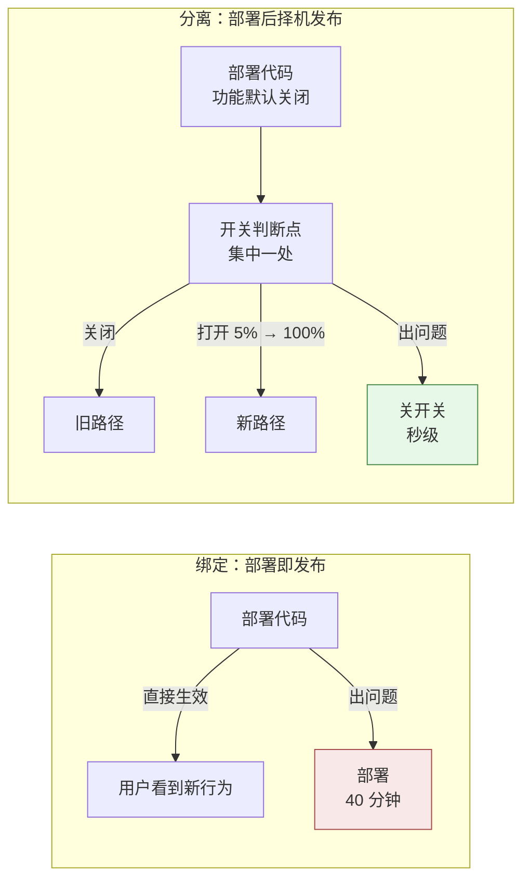
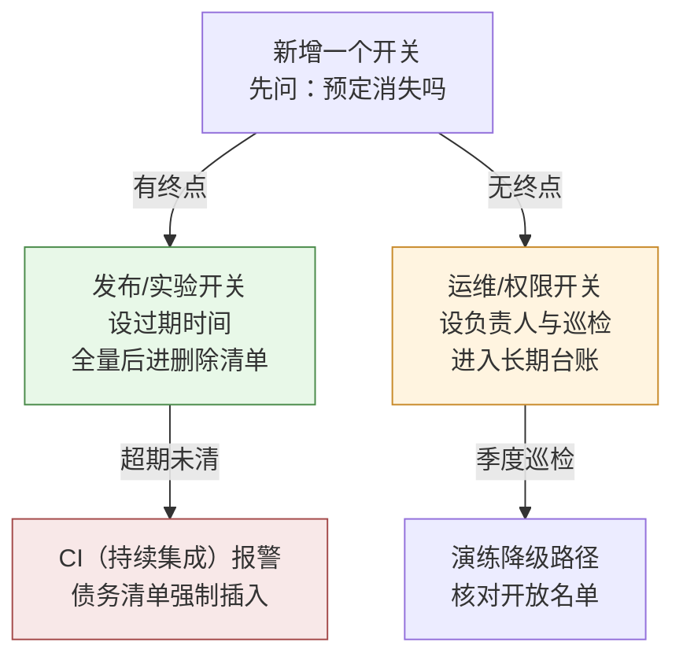

# 配置与特性开关分离部署与发布

> **要点**：部署是把代码放到生产，发布是让功能对用户可见。两者绑在一处时，每次部署都可能改变用户可见行为，于是部署变成高风险动作。开关的作用就是把发布决策从部署里拿出来，让代码的到达与功能的生效成为两件可以分别决定的事。

四类开关的存活时间差别很大：发布开关只活几天到几周，运维开关要长期存在。把它们混为一谈，是开关债的主要来源。

两种做法的代码可以完全一样，差别只在出问题之后要做的动作：绑定模式下止损是重新部署，分离模式下是改一个配置值——把两种模式的分支画在一起，判断点两侧各通向哪里就清楚了：


开关把「代码上线」与「功能放开」拆成两次动作，出问题时要撤回的是后者，所以「部署变安全」的实质是把止损动作从重新部署换成改配置值：右侧关开关是秒级，左侧回滚（把系统恢复到上一个可用版本）部署是 40 分钟，中间差的是一整次构建与发布流程。（本图画的是部署与发布的分离，与四类开关的生命周期是两件事，后者见后文）。

图里两条路径的差别不在代码，而在"出问题之后要做什么"。绑定时的止损动作是重新部署，分离时是改一个配置值。

## 部署与发布为什么要分成两件事

一个大功能开发完成后留在主干上的开关，在上线时刻关不掉；想只开放给一部分用户时缺少手段；半年后回来清理，发现同一个开关的判断分散在十几处，旧代码路径没人敢删。部署本身会改变用户可见行为，于是每次发布都成为高风险操作。本篇回答：部署与发布为什么要分成两件事、四类开关的生命周期差别在哪里、默认值与读取路径怎样设计才不至于成为故障源、判断点集中在什么位置、以及开关债务通过什么机制清理。

读完这一篇，你能给自己的发布流程加一道"先上代码、再决定什么时候对谁打开"的闸门。

特性开关像水龙头的阀门：水管（部署）装好之后，水什么时候流、流多大由阀门决定，不用每次改流量都重新换管子。

这个比喻到"阀门会积灰"为止——水管上的阀门装了就一直在，而代码里的开关用完不清理就会越积越多，最终每读一处代码都要先判断十来个开关的状态，这才是开关真正的代价。

## 为什么代码部署了，功能却不敢开

好比新厨房的燃气管道已经接通，点火开关却用铅封封着——想开火得把整个灶台重新报装一遍。一个大功能开发完，合并到主干，部署上线。但因为"不敢一次全量开放"，代码里留了一个 `if (false)`，等下个迭代再打开。这带来三个问题：

- 上线后想紧急关闭 → **要改代码、重新部署**（40 分钟）
- 想先给 5% 用户看 → 做不到
- 半年后回头看，`if (false)` 还在，旁边的代码已经改过好几轮，**没人敢删**

**部署（deploy）和发布（release）被绑在了一起。** 结果是部署变得可怕，因为每次部署都可能改变用户可见行为。

## 怎么把发布决策从部署中分离出来

### 核心思路是什么

好比新房装修：布线（部署）与通电（发布）本来就该分两步，线先全部布好不放心通，通电由配电箱一只只开关决定——下文的断路器面板就是这个思路的实物版。

```
部署 = 把代码放到生产（不改变用户可见行为）
发布 = 让功能对用户可见（改一个配置）
```

**开关让这两件事解耦**：可以先部署所有代码（功能关闭），然后在需要时打开。

把"线路就位"与"通电生效"分成两个动作，配电箱做了上百年。下图是一个打开的 Eaton 断路器面板：每条回路的线缆早已布好，通电与否由面板上一只只断路器分别决定——推上去回路生效，拉下来线路仍保留。特性开关在软件里做的就是这只断路器：代码已布线，生效由开关单独决定。


> 图：打开的 Eaton 断路器配电面板，来自 [Wikimedia Commons](https://commons.wikimedia.org/wiki/File:Eaton_circuit_breaker_panel_open.JPG)，CC BY-SA 3.0，摄影 BrokenSphere。

### 四类开关的生命周期差在哪里

| 类型 | 目的 | 存活时间 | 例子 |
| --- | --- | --- | --- |
| 发布开关 | 隐藏未完成功能 | 几天到几周 | "新结算流程" |
| 实验开关 | A/B 测试 | 几周 | "新版推荐算法" |
| 运维开关 | 降级、限流 | 长期 | "关闭推荐服务" |
| 权限开关 | 按用户/租户开放 | 长期 | "内测功能" |

四类开关在生命周期与动态性两个维度上的分布，Pete Hodgson 在原文里画成了象限图：横轴是静态到动态（配置修改后立即生效，还是要重新部署），纵轴是存活几分钟到存活一年以上。发布开关属于「短期静态」象限，权限开关属于「长期动态」象限，两者相距最远，管理方式也该差得最远。


（图片来源：Pete Hodgson，[Feature Toggles (aka Feature Flags)](https://martinfowler.com/articles/feature-toggles.html)，Martin Fowler 站点允许署名引用）

最常见的错误是把它们混为一谈，导致运维开关被当发布开关清理掉，或者发布开关存活两年变成技术债。

区分的依据是"这个开关有没有预定消失的那一天"。发布开关与实验开关有终点：功能全量之后，它们的使命就结束了。运维开关与权限开关没有终点：降级（主动牺牲部分功能或精度，保住核心链路）与限流（控制单位时间放进来的请求数量，超过配额就拒绝）要一直能用，按租户开放是长期的业务形态。给前两类设过期时间、给后两类设负责人与巡检，是同一种管理动作在两个方向上的写法。

四类开关按这个判据分成两支，分流后的管理动作如下图：


于是开关债的清理走两条各带触发条件的支路：左侧由 CI（Continuous Integration，持续集成：代码合并后自动构建与测试）在过期时把开关强制插进债务清单，右侧靠季度巡检演练降级路径。缺任何一条，就会漏掉一类开关——运维开关被当发布开关删掉，或发布开关存活两年变成技术债。

### 实现时要注意哪些点

**1. 开关要有默认值和类型**

```go
type Flag struct {
    Name         string
    DefaultValue bool            // 配置中心挂了时的兜底
    Description  string
    Owner        string          // 谁能删
    ExpiresAt    *time.Time      // 到期提醒
}
```

**默认值是关键的可靠性设计**：配置中心不可用时，服务应该按最安全的方式运行（通常是"关闭新功能"）。

**2. 开关读取要快且可靠**

- **本地缓存 + 定期刷新**，不要每次判断都查远程
- 远程失败时用缓存值，缓存也没有用默认值
- **开关读取绝不能成为故障源**

开关读取路径在真实产品里的完整形态，Flagsmith（一个开源特性开关平台）的官方 SaaS 架构图是一个现成参照：多区域的 Edge API 负责就近响应 SDK（软件开发工具包）的开关求值请求，Core API 与 Task Processor 管理配置的存储与传播，Dashboard 供开关的创建与修改——「求值快」与「配置可靠」由分层的两套组件分别承担：


*图源：[Flagsmith 官方文档](https://docs.flagsmith.com/overview/)（2026-09-27 取）。SDK 求值走边缘、配置修改走核心库再同步到边缘——读取路径与写入路径分开，正是「本地缓存 + 定期刷新」在平台层的实现形态。*

**3. 判断点要少且集中**

```go
// 差：分散在各处
if flags.IsEnabled("new_checkout") { ... }   // 15 个地方

// 好：在一个地方判断，用策略模式分发
checkout := flags.IsEnabled("new_checkout") ? newCheckout : oldCheckout
```

**分散在各处的判断会让删除变得困难**——半年后要删这个开关时，得找全 15 个地方。

**4. 开关状态要可观测**

```
当前启用的开关、每个开关的命中次数、因开关分流的用户比例
```

**没有这些，就无法知道开关是否真的在工作。**

### 开关用完为什么必须清理

**发布开关必须被清理**，否则会累积成"开关债"。开关越积越多，每读一处代码都要先判断一堆开关状态。

清理开关要配强制手段，靠下面的两条规则兜住：

```go
// 开关带过期时间，CI 检查过期的开关
if flag.ExpiresAt != nil && time.Now().After(*flag.ExpiresAt) {
    // 告警 + 阻断构建
}
```

完整流程走三步：
2. 到期时 CI 告警
3. 功能稳定后删除开关和**旧代码路径**

**只删除 `if` 判断不删旧代码是最糟糕的结果**——代码体积翻倍，且没人知道哪条路径在用。

### 配置和开关差在哪里

| | 配置 | 开关 |
| --- | --- | --- |
| 变化频率 | 低 | 高 |
| 谁改 | 运维/SRE（Site Reliability Engineering，网站可靠性工程：用软件方法做运维） | 产品/开发 |
| 例子 | 数据库连接串、超时时间 | 功能是否启用 |
| 存储 | 配置文件/环境变量 | 配置中心/数据库 |

**功能开关与配置文件分开放**——放进配置文件的开关，改一次要重新部署，开关的意义就没了。

## 效果与代价：换来什么，付出什么

灰度把新功能先放给一小部分用户：反响好再全量发布，反响差关掉开关就行，其他功能不受影响。**收益**

- **部署变安全**：部署不改变行为，出问题回滚配置即可（秒级）
- **可以灰度（新版本先放一小部分流量验证，逐步放大到全量）**：5% → 20% → 100%，逐步放量
- **快速止损**：线上出问题，关开关比回滚部署快得多
- ** trunk-based 开发可行**：未完成的功能也能合并到主干

**代价**

- **代码复杂度上升**：每个开关都是一条分支
- **测试组合爆炸**：N 个开关 = 2^N 种组合。**通常只测"全开"和"全关"**
- **开关债**：不清理会累积成难以维护的废弃代码
- **配置中心成为依赖**：它挂了服务要能继续运行（靠默认值和缓存）

## 动手时该从哪里开始

**第一步：区分"配置"和"开关"**

把功能开关从配置文件里挪出来，放进能动态修改的地方。

**第二步：给每个开关加 owner 和过期时间**

这是防止开关债的关键。**没有 owner 的开关不会被清理。**

**第三步：实现本地缓存 + 默认值兜底**

确保配置中心不可用时服务正常。**开关系统不能成为单点（没有备份、一坏全局受影响的组件）故障。**

**第四步：集中判断点**

用策略/工厂分发，而不是分散在各处的 `if`。

**第五步：定期清理**

每月 review：哪些开关已全量超过 30 天？**删除开关 + 删除旧路径。**

## 哪几种写法一定会出问题

**错误 1：开关永远不删**

两年后代码里有 40 个开关，没人知道哪些还有效。**必须带过期时间和 owner。**

**错误 2：只删判断，不删旧代码**

`if` 删了但 `oldCheckout` 函数还在 → 废弃代码累积。

**错误 3：开关读取失败导致服务不可用**

每次判断都查远程，远程挂了就 500。**必须缓存 + 默认值。**

**错误 4：开关分散在各处**

15 个地方判断同一个开关 → 删除时找不到全。**集中到一个分发点。**

**错误 5：用开关做长期权限控制**

发布开关被当成"给 VIP（Very Important Person，这里指付费或高等级）用户的功能"用了两年。**权限控制是另一回事，用权限系统。**

**错误 6：开关状态不同步导致状态错乱**

用户 A 在"新流程"下创建了订单，开关关闭后走"旧流程"处理 → 数据不一致。**有状态的功能要小心，开关切换要考虑已有数据的兼容。**

## 怎么自己动手验证

1. 默认值核对：在没有配置源的干净环境中启动，预期服务按代码中的默认值运行，随后逐项注入配置并用运行时接口核对生效值。
2. 判断点统计：统计代码中判断同一开关的位置数量，预期收敛到一处分发点；对分散在各处的判断逐项收敛。
3. 关闭路径演练：把开关关闭后执行一次完整业务流，预期行为回到旧路径，且旧路径在当前数据上仍然可用。
4. 数据兼容核验：在开关打开期间创建的数据，在关闭开关后用旧路径处理，预期不出现状态错乱或无法读取。
5. 债务清理：删除一个长期打开的开关，预期编译通过、判断点全部消失、旧代码路径可以移除且无残留引用。
6. 断言锚点：默认值有定义，判断点集中，开关切换与已有数据兼容经过演练，清理后的引用被核对过。

## 接着读哪几篇：部署与发布的分离

- [[工程知识/软件构建：让变化可以理解、验证与交付/架构与代码/绞杀者模式用增量迁移替代整体重写]] · [[工程知识/软件构建：让变化可以理解、验证与交付/架构与代码/技术方案先写清约束、取舍与验证]]

- [[工程知识/软件构建：让变化可以理解、验证与交付/测试与交付/灰度与功能开关的边界：交付节奏与配置漂移.md]] —— 开关的原理篇
- [[工程知识/后端系统：在并发、失败与变化中维持服务/服务设计/优雅停机的完成语义：排空连接与任务交接.md]] —— 部署与发布的分离
