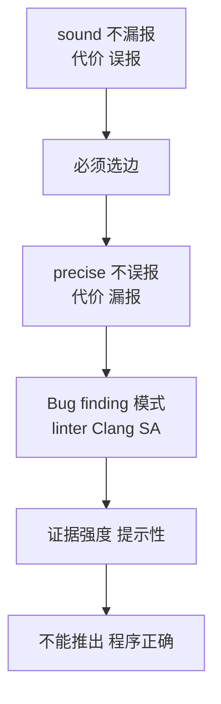
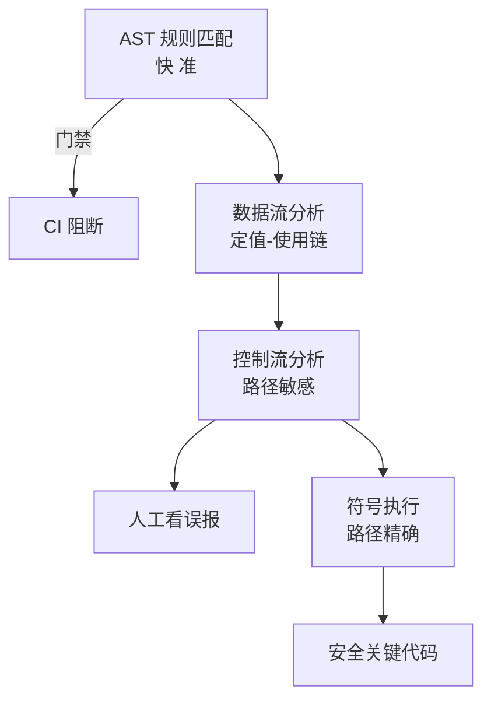
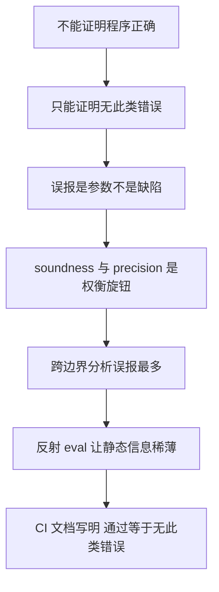

# 静态分析的证据边界：它证明什么不证明什么

## 要解决的问题

静态分析（不运行程序，从代码结构推断性质）在 CI（Continuous Integration，持续集成：代码合并后自动构建与测试） 里宣称"零成本发现 bug"：不写测试就能查空指针、未初始化、类型错配。但**它的告警有真有假**（false positive 让人麻木，false negative 让缺陷漏网），**它的「证明」有强有弱**（bug finding 模式 vs sound 验证模式）。要解决的问题是**把静态分析定位成证据的一种，明确它能证明什么、不能证明什么**，与动态测试（见 [[工程知识/软件构建：让变化可以理解、验证与交付/测试与交付/测试策略从风险选择证据.md]]）互补而不是互替。这决定 CI 策略（哪些告警设门禁、哪些只报告）与工具选型（bug finder vs verifier）。

「告警有真有假」的实物形态在工具界面上看得最直接：Astrée 分析一个 C 工程后给出的统计面板——20 条告警分成数据流告警 6、控制流异常 2、未初始化变量 3、无效指针转换 5 等类目，每条都带源码位置与上下文判定（Definite 与 Alarm 的分级就是「证据强度」在产品里的体现）：

来源：AbsInt Astrée 官方产品页截图，https://www.absint.com/astree/index.htm。Definite 与 Alarm 的分级对应正文说的证据强度分层——前者是「在此上下文中必然发生」的结论，后者是「保守近似下可能发生」的提示，门禁策略按这个分级配置才有依据。

## 它是怎么做到的

**静态分析能证明的，是代码结构层面的性质；证明不了的，是运行时的实际行为**。要看清这个边界，可以对照汇总视图的做法：视图给出的是按规则推导出来的结果，它与真实数据是否一致，得另外对账。

两种模式处在同一条权衡轴上的两个位置，分不出好坏。图的顶部是数学边界——任何工具只能在轴上选位置，不能取消这条轴。

- Bug finding（如 linter、Clang SA 的默认模式）：目标抓常见 bug 模式，允许漏报即不承诺全，追求低误报。证据强度：**提示性（"这里可能有 bug"），不是证明**。
- Sound 验证（如形式化验证、抽象解释的 prover 模式）：承诺**「验证通过 = 无此类错误」**（所有路径枚举或保守近似），代价是误报（sound 但 imprecise 会报不存在的 bug）。证据强度：**证明性（数学上成立），但只对验证的属性成立**。

**停机问题划下的硬边界**。任意程序的非平凡性质判定——会不会空指针、会不会死锁（多个执行流互相等待对方释放资源）——**不可判定**（Rice 定理），任何静态分析必须在漏报与误报之间选边：全 sound 即不漏、必引入近似即误报，全 precise 即不误、必漏。**这是数学边界不是工具缺陷**，工具的改进只是在边界上移动参数，不可能突破。工程含义：**没有「既不误报也不漏报」的分析器**。

**分析的谱系与各自的证据强度**。AST（Abstract Syntax Tree，抽象语法树：把代码按语法结构拆成的树）规则匹配最浅——命名规范与简单模式；数据流分析看变量定值-使用链、做未初始化检测；控制流分析路径敏感、查空指针路径；符号执行路径精确但路径爆炸；抽象解释不动点迭代、sound 但粗。**谱系越深证据越强，工程成本即时间与误报也越大**。CI 的典型配置：**AST 层设门禁（快、准），数据流层报告（慢、误报要人看），符号执行层按需（安全关键代码）**。

五层谱系的证据强度与成本同向增长，CI 里各占的位置不同：

**静态与动态的互补分工**。静态的证据是「代码结构蕴含的性质」（全部执行路径上的性质，但近似），动态的证据是「实际执行过的路径」（精确但只覆盖走过的路）。分工：**静态管结构类缺陷（类型、空指针、资源泄漏的形状）、动态管行为类缺陷（逻辑错、性能、集成问题）**。测试金字塔（单元为主）与静态门禁（lint 为门禁）是两条证据链的合理配比。

两种证据的边界在仪器上有对应物。下图是一台 HP 1650B 逻辑分析仪：探头夹到电路的每条线上，总线上的每个电平跳变都被如实记录——它给出的证据精确到每一个边沿，但只覆盖探头夹住的那段时间里发生的事；没接探头的时段、芯片内部没引出到引脚的信号，仪器一概不知。这与静态/动态的证据边界严格同构：静态分析像原理图审查（覆盖全部路径但不知道实际通电后各节点的波形），逻辑分析仪与测试像探头（抓到的全是真的，但只有夹住的那些）。**知道自己拿的是哪种证据，才知道漏了什么**。

> 图：HP 1650B 逻辑分析仪，来自 [Wikimedia Commons](https://commons.wikimedia.org/wiki/File:HP_1650B_Logic_Analyzer.jpg)，CC BY-SA 4.0，摄影 Whiteknight。

## 它从哪儿来，要付什么代价

静态分析与编译器优化同源（1970s 数据流分析为优化服务，后来独立成缺陷检测），抽象解释（Cousot 1977）给 sound 近似数学基础。工业应用：Coverity/Polyspace 类工具进航空航天与汽车（安全关键代码的强制验证），Clang Static Analyzer 与 Infer 类静态分析器进大型工程（Meta 用 Infer 扫移动端亿行级代码），ESLint（静态检查代码风格与常见错误）/Pylint 类 linter 成为开源 CI 标配。

误报治理的转折是机器学习排序（2018+，按告警是 true positive 的概率排序，让人先看最像真的），把**「误报淹没开发者」缓解成「排序后的优先级队列」**。

工具的另一面视图是程序结构本身：Astrée 的调用图面板把 main 到各子函数的调用关系画成有向图，配合内存与分析时长统计（Available 8.59 GiB、Maximum 174 MiB、Duration 9s）——「分析要消耗多少资源」与「告警分布在哪里」在同一屏上，是评估 ROI（Return On Investment，投入产出比）曲线时该看的实物：

来源：AbsInt Astrée 官方产品页截图，https://www.absint.com/astree/index.htm。左侧导航树就是「静态分析能看什么」的目录：控制流、数据流、调用图是结构证据，污染图（taint）是数据从外部流入敏感操作的追踪——每一项对应一类可证明的性质，不在树上的性质它不承诺。

抽象解释的**「sound 但不精确」分层设计**值得单独说明。精确回答走不通（这条路通向路径爆炸），于是把程序状态抽象成保守近似（如「这个变量可能是 0 也可能不是」），在抽象域上迭代到不动点，**数学上保证结论对原程序成立（sound）**，代价是**结论可能太保守**（把安全代码也报了）。Astrée 验证 Airbus 飞控代码（C 代码无运行时错误证明）是工程顶点：**交付物是一份无 bug 证明**，报 bug 反而不是**它的目标**。

代价：**静态分析的 ROI 曲线并非线性**——linter 层的成本极低收益稳定（每代码行抓 0.1-1 个真 bug），数据流层成本升（配置与误报治理），符号执行层的成本陡增（路径爆炸的取舍、专家配置），sound 验证层只对安全关键代码划算（Airbus 的例子是每行代码几十美元的验证成本）。CI 的分层门禁策略按这条曲线定：**每层证据的边际成本与边际收益相称，加层才有依据**。误报治理本身是持续成本：规则集的维护（语言版本升级、框架模式的更新）、告警基线的管理（存量告警豁免机制），**无治理的静态分析三个月后退化为噪音源**。

## 这套说法在哪儿会失效

- **静态分析不能证明"程序正确"**，只能证明「程序无某类特定错误」（sound 模式）或「发现了一些疑似问题」（bug finding 模式）。「验证通过」的语义要写进 CI 文档：**通过 = 无此类错误，不是无 bug**。
- **误报不是缺陷是参数**。每个 sound 分析器都有 soundness 与 precision 的权衡旋钮（抽象域的粗细），**误报率 5% 与 50% 是同一个工具的不同配置**。团队要主动选参数（按误报承受力），不是被动接受默认。
- **跨边界分析最容易产生误报**。动态语言（JS/Python）的运行时类型、反射（程序在运行时读取和操作自身结构的机制）、eval 让静态信息稀薄，分析器被迫保守（误报飙升）。**动态语言的静态分析价值集中于 lint 层，深度分析要配类型注解（TypeScript、mypy 的路线）**。
- **告警修复的优先级按风险排序**。静态告警的风险排序（可达性 × 后果严重度）要接测试策略（见 [[工程知识/软件构建：让变化可以理解、验证与交付/测试与交付/测试策略从风险选择证据.md]]）：**高危路径的告警先修，不可达代码的告警可豁免**。告警一视同仁的修复策略浪费预算。

四条边界限定的是"能通过"这个词到底在说什么：

第二条最容易被当成工具缺陷来抱怨，实际它是设计参数：**soundness（不漏报）与 precision（不误报）是一对权衡，追求 sound 就必然引入误报**。[数据流分析 Data Flow Analysis](https://yian-lang.net/lian/cn/02.background/2-2.dataflow) 把这对关系拆得很清楚——soundness 指凡是实际发生的问题都包含在分析结果中（不漏报），completeness 指凡是分析出的结果就一定是实际发生的（不误报），误报率 = 误报数 / 总报告数量，精确率 = 1 - 误报率。第三条是同一个权衡在具体语言上的表现：动态语言的运行时类型、反射、eval 让静态信息稀薄，分析器只能保守，误报因此飙升，所以动态语言的静态分析价值集中在 lint 层，深度分析要配类型注解。

## 怎么自己动手验证

- **证据强度分层实验**：同一代码库跑 linter、数据流、符号执行三层，统计各层告警的确认率（true positive rate）。预期：**linter 高（>80%）、数据流中（40-70%）、符号执行低但单个告警价值高**。分层证据强度的分布是门禁配置的量化依据。
- **误报基线演进**：新告警零基线（new-code-only 门禁）上线，存量告警豁免表维护，统计豁免表的增长与确认率。预期：**新告警门禁让人工审核量下降一个数量级，豁免表增长缓慢（规则成熟后收敛）**。基线机制有效性的证据。
- **sound 验证试点**：安全关键模块（认证、支付核心路径）跑 abstract interpretation 类工具，对比 bug finding 模式的发现。预期：**sound 模式给出「无越界/无除零」的证明性结论（bug finding 给不了）**，误报集中在并发与外部调用边界。两种语义的承诺差异实证。

## 接着读哪几篇：证据组合中的静态证据位置

- [[工程知识/软件构建：让变化可以理解、验证与交付/测试与交付/测试策略从风险选择证据.md]] —— 证据组合中的静态证据位置
- [[工程知识/软件构建：让变化可以理解、验证与交付/测试与交付/覆盖率的三种读法：行分支与路径覆盖的证据强度.md]] —— 动态证据的覆盖强度谱
- [[工程知识/性能工程：从用户等待到资源瓶颈/观测与诊断/指标、日志、Trace与剖析各答一问，合起来才构成证据.md]] —— 运行时证据的互补面
- [[工程知识/软件构建：让变化可以理解、验证与交付/架构与代码/架构适应度函数：把架构约束写成可执行检查.md]] —— 静态分析供证据，适应度函数是它在架构域的定向应用
- [[工程知识/缺陷分析：从个案到体系/配置/配置类缺陷的静态防线：schema校验与默认值审计.md]] —— 配置域的防线形态：把这份证据边界用到 schema 与默认值上
