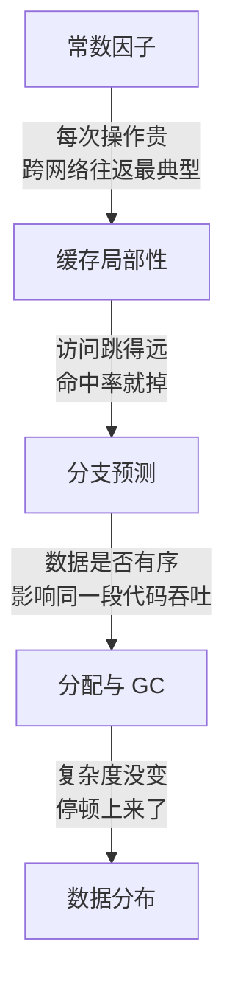
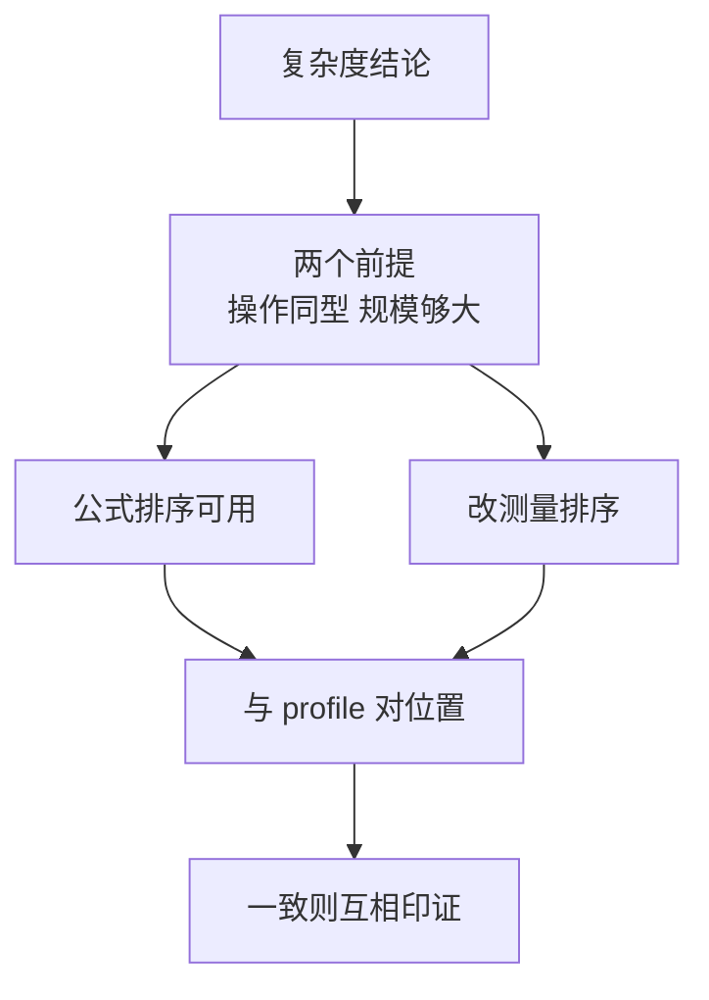

# 算法复杂度连接规模与资源成本

同样是判断 10 万个 ID 里哪些是已注册用户，一版要跑 1000 秒，另一版只要几秒——差别来自算法把随机访问换成了顺序读。读完这篇你能用规模估算反推该选哪种算法。

第一版每来一个 ID 就查一次数据库索引：10 万次查询，每次一个网络往返加一次 [[工程知识/数据系统：在并发与故障中保存事实/查询与索引/B+Tree索引为访问路径服务|B+Tree]] 查找，按每次往返 10 毫秒估算要跑 **1000 秒**；第二版先把 10 万个 ID 放进哈希集合（内存里按键直接定位的查找表），再顺序扫描一遍用户表，每读一行做一次内存里的哈希（把任意长度数据压成固定长度指纹、不可逆）查找，耗时由顺序读完整张表的磁盘吞吐决定，按百万行、每行约 100 字节、顺序读每秒 500 MB 估算是**零点几秒到几秒**。

两版各自都是 O(n) 量级（前者的 n 是 ID 数，后者的 n 是用户表行数），复杂度这一档看不出差别，估算出的耗时却差了两个量级。差别全在"每次访问走多远"：Big-O 描述增长上界，是选型的第一道筛子；真正决定延迟的是常数因子、缓存局部性、分配开销和数据分布，这些都不在公式里。本页要解决的问题是：拿到一个复杂度结论之后，还要补哪些账才能做决定。

## 算法复杂度怎么把规模与资源成本连起来

Big-O 的本质是**增长上界**：输入从 1 万涨到 100 万时，代价按什么形状放大。它是选型的第一道筛子，性能预测要靠测量。

增长形状的差别，画成曲线比背符号直观：


*图示：常见时间复杂度（算法耗时随输入规模增长的量级）的增长对比。图源：Wikimedia Commons《Comparison computational complexity.svg》，作者 Cmglee，CC BY-SA 4.0，https://commons.wikimedia.org/wiki/File:Comparison_computational_complexity.svg。*

同一组曲线换一个视角看：工程上给复杂度档位直接标可用性评级——O(1) 与 O(log n) 落在 Excellent 区，O(n) 与 O(n log n) 落在 Good/Fair 区，O(n²) 进入 Bad 区，指数与阶乘直接标 Horrible。选型时先问目标规模落在色带哪一格，再谈常数因子：


*图源：Big-O Cheat Sheet（bigocheatsheet.com），https://www.bigocheatsheet.com/。*
来源：Wikipedia「Computational complexity」相关条目（CC BY-SA 4.0，作者 Cmglee）。图上 O(n²) 与 O(2^n) 那两条陡升的线，就是规模一大就不可用的形态；O(1) 与 O(log n) 几乎贴着横轴，说明这两档之间换不来多少收益。收益最大的一步是把 O(n²) 这类高阶多项式降到 O(n log n)。

真正决定实际延迟的是这几样，而它们都不在 Big-O 里——五样东西各走一条路，任何一条都能把复杂度给出的排序翻过来：




| 因素 | 为什么重要 |
| --- | --- |
| 常数因子 | O(n) 扫描可能比 O(log n) 索引更快——如果索引每次都要跨网络 |
| 缓存局部性 | 数组顺序访问 vs 链表指针跳转，差在 CPU 缓存命中率 |
| 分支预测 | 数据是否已排序，会影响同一段代码的实际吞吐 |
| 分配与 GC | 每次迭代都分配对象，复杂度没变，但 GC 停顿上来了 |
| 数据分布 | 哈希表的平均 O(1) 依赖均匀分布，热点键会让它退化成链表 |

复杂度只算增长趋势，不常数项和内存访问是否连续；n 小的时候常数项与缓存命中主导实际耗时，n 大到一定程度增长趋势才压过它们。所以 O(n) 的扫描可能输也可能赢，**取决于 n 和数据布局**。这就是为什么必须测。

Big-O 省略的东西可以用一句话概括：它数的是"操作次数"，不数"每次操作走多远"。一次寄存器加法与一次跨网络往返，在公式里都记作一次操作。复杂度要直接拿来比较，得同时满足两个条件：操作类型相同，且规模大到增长形状压倒常数差异。只要有一条不满足，公式给出的排序就可能与实际相反。

这也是为什么"渐进更优"与"实测更快"经常冲突：前者说的是规模趋于无穷时的形状，后者说的是当前规模与当前数据布局下的实际值。二者并不矛盾，它们回答的是不同问题——选型时先用复杂度排除明显不可行的形态，再用测量在剩下的候选里排序。

## 选数据结构前先看清什么

选数据结构前，先问"这问题的形状是什么"：

- **数组 / 切片** —— 连续访问和下标索引；适合顺序扫描和批处理（把多个请求合并成一批同时计算、提高硬件利用率）
- **链表** —— 牺牲缓存局部性，换任意位置 O(1) 插入删除；今天大多数场景数组更快
- **哈希表** —— 平均 O(1) 查找，但依赖哈希质量、容量、冲突策略和攻击防护
- **堆** —— 优先队列；调度和取前 k 大（top-k）的默认选择
- **树 / 图 / 并查集** —— 分别表达层级、关系和连通性
- **动态规划（把大问题拆成重叠子问题、缓存子问题解的算法思路）** —— 重叠子问题；用空间换掉重复计算
- **流式 / 近似 / 采样（只采集一部分数据以控制记录开销）** —— 用精度换内存、延迟或带宽

同样的选择在系统各处重复出现：[[工程知识/AI 系统工程：从模型能力到生产能力/知识与检索/向量数据库不是RAG本身|RAG]] 里取相似度最高的 k 条（top-k）与近似最近邻检索ANN（Approximate Nearest Neighbor，近似最近邻搜索：牺牲精度换速度的向量检索）、数据库的索引、调度的优先队列，都是"访问路径换资源"的同一道题。

## 为什么要动手测而不是只算

### 最小规模实验怎么做

构造**四类输入**——均匀、热点（访问集中在少数键或节点上的现象）、已排序、最坏顺序——然后逐步放大规模。每一步记录：

```text
正确性、CPU 时间、内存峰值、缓存 miss（缓存未命中次数）、通信、p95（95% 请求都快于它的那个延迟值）、单位成本
```

**把测到的拐点写进决策**，渐进符号只是结论的注脚。比如："哈希集合在 5 万条以内比索引查询快 30 倍，超过 200 万条时内存成为瓶颈，需要分片（把数据按规则切开存到不同节点）。"——这才是能拿去做决定的结论。

### 复杂度差异在生产规模上怎么兑现

同一份数据，两种复杂度的差距随规模放大。10 万条数据，O(n log n) 排序约 170 万次比较（n × log₂n ≈ 10⁵ × 17），毫秒级；O(n²) 冒泡约 50 亿次比较（n²/2），秒到十秒级；两者差约 3000 倍。数据到 1000 万条，前者约 2.3 亿次（10⁷ × 23），后者约 5 × 10¹³ 次，差距拉大到二十万倍量级。开发环境的小数据上测不出这个差距，生产规模上它就是可用与不可用的分界。

空间换时间也要算账。哈希索引把点查（按一个键取一条记录）从 O(n) 换到 O(1)，代价是内存占用涨数倍，范围查询（取某个区间内的所有记录）能力归零（哈希无序）；B+ 树（一种多叉有序树索引，数据全在叶子层，范围查询沿叶子链表走）用 O(log n) 保住范围查询。选哪个由查询形态决定，比较复杂度数值本身得不出答案。

两条库内实录可以对照着看：

## 验证要覆盖哪些情形

- **边界**：空输入、单元素、全重复、倾斜分布
- **最坏顺序**：已排序数据常常是某些算法的退化输入
- **规模**：至少测到预期峰值的 2 倍
- **指标**：CPU、内存、分配次数、缓存 miss、尾延迟（p95、p99 这类最慢那一小部分请求的延迟）

一个复杂度结论能不能直接拿来排序，取决于两条分叉：操作类型相同与规模足够大这两个前提是否同时成立，以及预期瓶颈位置与 profile 显示的位置对不对得上。



两条分叉合起来说明复杂度只在自己的前提内有效——前提破了或位置对不上，结论就得交回给测量：两个前提都成立时公式排序可用，前提破了就改测量排序，最后还要与 profile 对一次位置，一致才算互相印证。

复杂度分析和 profile（运行时采样，看时间花在哪些函数上）必须**互相校验**。预期的瓶颈位置由复杂度推断给出，profile 显示的位置与它对不上，说明漏了某个常数因子——去找它，公式此时已经不可信。

本页结论的边界：Big-O 只对"规模放大后的形状"负责。单次访问要付多少代价，只有测量能回答。

## 接着读哪几篇：用 O(log n) 保住范围查询的索引形态

- [[工程知识/数据系统：在并发与故障中保存事实/查询与索引/B+Tree索引为访问路径服务]] —— 用 O(log n) 保住范围查询的索引形态
- [[工程知识/AI 系统工程：从模型能力到生产能力/知识与检索/向量数据库不是RAG本身]] —— top-k 与近似检索里的同一道选择题
- [[工程知识/数据系统：在并发与故障中保存事实/查询与索引/慢查询治理从发现到索引闭环]] —— 嵌套循环与哈希 join 的选型实录


- [[工程知识/数据系统：在并发与故障中保存事实/查询与索引/慢查询治理从发现到索引闭环]] 里，两张表按条件拼接（join）用嵌套循环还是哈希，是治理闭环的第一决策点：嵌套循环拿小表的每一行去大表里找匹配，O(n×m)；哈希 join 先把小表建成哈希表再扫一遍大表，O(n+m)，规模一大差一个量级。
- [[工程知识/缺陷分析：从个案到体系/性能/案例二十五：库自带了一支军队——OpenBLAS 的隐式线程]] 是常数因子的反面实录：复杂度对了，实现层的线程爆炸照样把资源账打翻。复杂度过关只是入场券，实现层的资源账要另算一遍。
