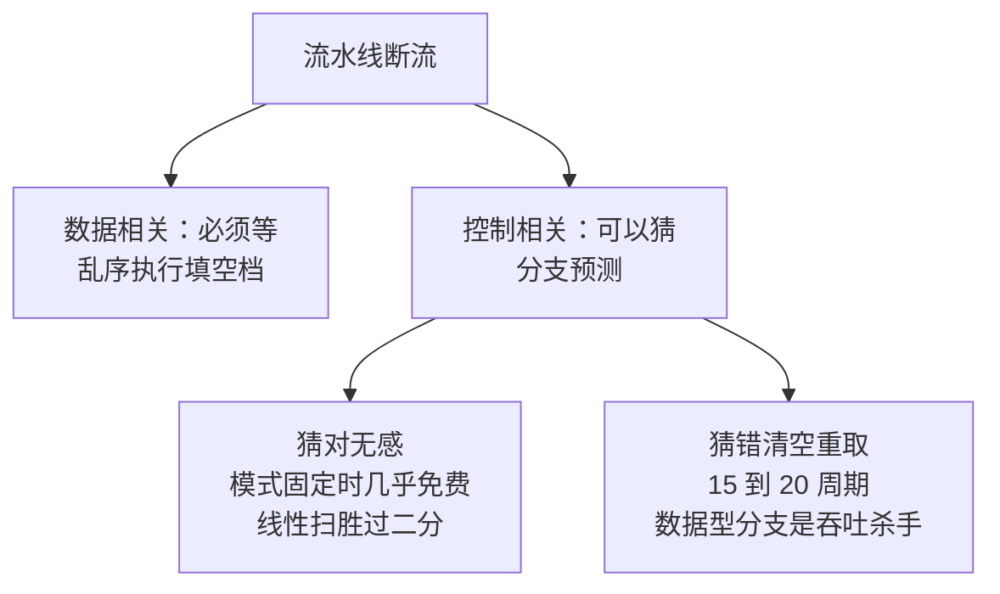

# CPU微架构与流水线：分支预测乱序执行对程序员的可见影响

## 要解决的问题

打个比方：流水线像洗衣房的流水作业——洗衣机、烘干机、熨烫台各管一段，上一件进烘干时下一件就能进洗衣机，没人闲等；一旦猜错了下一件衣服的洗护程序（分支预测失败），已经叠好的衣服得全部拆开重来。这个比方到「猜错要清空重来」为止，预测器结构与访存停顿看正文。

流水线与乱序执行要解决的问题，是**让快的部件不等慢的部件**。一条指令的执行被切成五段（取指、译码、执行、访存、写回），不同指令的不同段可以重叠：第 1 条在执行时第 2 条在译码、第 3 条在取指。

理想情况吞吐翻数倍。但两个东西会打断重叠：分支（下一条指令是谁取决于**本条结果**，预测错了已取的指令全作废）与慢指令（cache miss 要等几百周期，后面的指令全堵着）。分支预测与乱序执行分别救这两个坑：前者猜方向让流水线继续取指，后者把后面的独立指令提到前面先执行。

它们对程序员的可见影响，是代码的**实际性能与代码顺序脱钩**——写得顺的代码不一定跑得快，数据布局与分支形态比算法复杂度常数更重要。缓存与分支对有效执行时间的影响——见 [[工程知识/性能工程：从用户等待到资源瓶颈/处理器与内存/CPU缓存与分支决定有效执行时间.md]]——写的是怎么测，本文写机制本身与它的可见后果。

## 它是怎么做到的

**流水线：重叠执行与断流代价**。五段流水线让 IPC（每周期指令数）逼近 1（标量）或更高（超标量，多发射）。断流（stall）的两个来源：数据相关（后一条要前一条的结果，必须等）与控制相关（分支没解析，不知道取谁）。断流的代价是**清空与重填流水线**，十几到几十周期。

同一时刻五个部件各忙各的，单条指令仍要走完五段，但每个周期都有一条指令完成：

*五级流水线的时空重叠：三条指令的取指、译码、执行、访存、写回阶段依次错开一个时钟周期，理想情况下每周期完成一条指令（图源：博客园「蝉沐风的码场」）*

*图源：Wikimedia Commons「Fivestagespipeline」，许可 [CC BY-SA 3.0](https://commons.wikimedia.org/wiki/File:Fivestagespipeline.png)。斜向阶梯就是这个机制的全部：没有重叠时每五个周期才出一条结果，重叠后每个周期都有一条进入写回。断流的代价也在这张图里——抽掉任意一格，整条阶梯向右平移。*

数据相关让阶梯出现停顿是什么样子，看下面这张时空表就清楚：指令 SUB 在第 3 周期的执行段才产出结果（红格标出），紧随其后的 AND 指令在第 3 周期就进了解码段，需要用到 SUB 的结果却在同周期就要开始执行，只能等 SUB 走到第 5 周期写回、第 6 周期才拿到值（绿格）。中间那两格停顿，就是数据相关造成的断流：

*图源：Wikimedia Commons《Pipeline Data Hazard》，CC BY-SA 3.0。转发的线路（红色，从执行段结果直接回送到下一条的执行段输入）就是为了消掉这类停顿而加的旁路（绕开主流程的备用路径）。*

**分支预测：猜错了全作废**。分支预测器（现代 CPU 的预测准确率 95%+，多级历史表 TAGE（Tagged Geometric History，利用超长历史的分支预测器）类）提前猜分支方向与目标。猜对，流水线无感；猜错（mispredict），清空流水线重新取指，代价 15-20 周期。可见影响：高度可预测的分支几乎免费，不可预测的数据依赖分支是吞吐杀手。排序后二分（每次把搜索范围砍半、按对数速度收敛的查找法）查找败给线性扫（小数组）的经典反直觉案例，根源就是分支预测——线性扫的分支模式固定（全顺序），预测器全中；二分的分支看数据（每次走向不同），预测器频繁失手。

预测器记住的是一段历史，某一次的结果只是历史里的一个点：从端点往中间走要连错两次才翻转判断，中间那两个「弱」状态就是它犹豫的地方：

*图源：Wikimedia Commons「Branch prediction 2bit saturating counter」，许可 [CC BY-SA 3.0](https://commons.wikimedia.org/wiki/File:Branch_prediction_2bit_saturating_counter-dia.svg)。两侧端点各自带自环，意思是同一方向连续出现只会加固判断；要离开端点得连错两次。这就是「预测准确率 95%+」与「模式突变后要几十条分支才重新训练」两句话在同一个机构上的来源。*

**寄存器重命名：让乱序不用改语义**。程序里的寄存器名是逻辑的，物理寄存器远多于它。写 a 时引擎映射到新的物理寄存器，旧值仍在（别的读者还用着），WAR（Write After Read，反依赖）/WAW（Write After Write，输出依赖）这类假相关被消除，真相关RAW（Read After Write，真数据依赖）保留等待语义。这一笔让「乱序」不必改动程序语义——提交仍按程序顺序，只重排（布局或尺寸变化触发重新计算排版）执行时机。

**乱序执行：把等待变成机会**。指令窗口（ROB，ReOrder Buffer，数百条目的重排序缓冲）里，引擎扫描哪些指令的输入已就绪，就绪就发到执行单元，不管它在程序顺序里的位置。慢指令（cache miss）在等内存时，后面几十条独立指令已经执行完。可见影响一：**内存访问的重排**。CPU 不保证按程序顺序访存——写 a 后写 b，别的核可能先看到 b 后看到 a。多核可见性靠内存屏障（memory barrier）显式约束，这直接解释了并发编程为什么需要屏障与原子指令：语言层面的 happens-before（判断一个操作的结果对另一操作可见的先后关系） 语义（见 [[工程知识/软件构建：让变化可以理解、验证与交付/语言与运行时/内存模型决定并发读写何时可见.md]]）往下追到微架构，就是乱序引擎的这个行为。

这套机制的原型机 IBM 360/91 的 Tomasulo 架构长这样：译码器把指令派给保留站（图下部两个 TAG/SINK/SOURCE/CTRL 表格），操作数没就绪的指令在保留站里等标签，运算单元（加法器、乘除法器）算完把结果放上公共数据总线 CDB（Common Data Bus），所有保留站同时监听总线、对上标签就取走数据——「扫描哪些指令输入已就绪」的原始形态就是这条总线广播：

*图源：Wikimedia Commons《Tomasulo Architecture》，作者 Tylerc0726，CC BY-SA 4.0，https://commons.wikimedia.org/wiki/File:Tomasulo_Architecture.png。图里每条保留站表项开头的 TAG 字段就是重命名的物理载体：指令记的是「哪条总线事件会送来我要的数」——WAR/WAW 假相关在这一步消失。*

**投机执行与它的幽灵**。分支预测猜方向，流水线就投机执行猜中的路径，猜错回滚（把系统状态退回到改动之前的版本）。Spectre/Meltdown（2018）证明投机执行的回滚不干净：投机路径上碰过的缓存行留下了侧信道痕迹，可被测量反推出秘密数据。这是"性能优化的可见影响"里最戏剧的一例——乱序引擎为了快留下的物理痕迹变成了安全边界洞，软件层要用屏障与猜测屏障堵。

为什么分支预测值得花这么多晶体管：代价与命中率（请求直接从缓存拿到结果的比例）的关系不是线性的。一次误预测要清空重填十几到二十级流水线，而一条分支指令在可预测负载下的执行成本不到一个周期。命中率从 95% 掉到 90%，多出来的 5% 每次要赔上二十周期——平均下来每条分支的成本翻了一倍多。这个不对称解释了为什么「分支模式是否稳定」比「分支多不多」重要得多：一万条方向固定的分支几乎免费，一千条方向随机的分支能吃掉大半个核。

## 它从哪儿来，要付什么代价

断流的两个来源性质不同，能用上的优化手段也完全不同：

右半部分是这条机制对写代码的人真正的**意义：分支本身不贵**，贵的是预测器猜不中。分支走向由数据决定的时候（二分的每次比较看数据），预测器频繁失手，清空流水线的代价累积起来会吃掉算法复杂度上的优势——这就是小数组上线性扫赢过二分查找的原因。数据相关那一侧没有对应的手段，只能靠乱序执行在等待期间找别的指令填进来。

流水线思想来自 1960s 的 CDC（Change Data Capture，变更数据捕获：把数据库的增删改实时导成事件流） 6600（Control Data Corporation 出品的大型机， Thornton 的 scoreboard 计分板：乱序的雏形）与 IBM 360/91（Tomasulo 算法，1967：寄存器重命名让乱序实用化）。RISC（Reduced Instruction Set Computer，精简指令集）运动（1980s）把指令切成等长段，流水线如虎添翼。深流水线（Pentium 4 的 31 级）在 2000s 撞墙（功耗与 mispredict 代价），行业转向多核，单核微架构在宽发射（6-8 宽）与大 ROB上继续。

预测与乱序的收益集中在**可预测、可并行**的负载；指针追逐（pointer chasing）、分支密集的解释器、依赖链长的串行计算，乱序引擎无事可做，IPC 跌回 0.2-0.5。写代码时"给引擎喂可预测的东西"（数据布局连续、分支模式稳定、依赖链短）是微架构友好的基本功，数据布局的微架构友好实践见 [[工程知识/性能工程：从用户等待到资源瓶颈/处理器与内存/CPU缓存与分支决定有效执行时间.md]] 的测量部分。

验证这一族机制有个共同困难：微架构行为不保证可观测。同一段代码在一台机器上测出的重排，换一代 CPU 可能测不出来——机制还在，触发条件变了。所以下面三条验证里，只有前两条是稳定的（分支预测与乱序遮蔽在任何现代 CPU 上都能复现），第三条访存重排要特定指令组合才触发，做不出来不代表不存在。

## 这套说法在哪儿会失效

- **IPC 高不等于效率高**。乱序引擎会把忙等循环也跑出高 IPC（每周期都在执行自旋指令）。性能判断要结合 stall 原因（perf（Linux 性能剖析工具，统计 CPU 采样与硬件事件） stat 的 branch-misses、cache-misses），见测量方法论（见 [[工程知识/性能工程：从用户等待到资源瓶颈/处理器与内存/CPU缓存与分支决定有效执行时间.md]]）。IPC 单指标会骗人。
- **分支预测是统计数据不是承诺**。预测器在负载变化（分支模式突变）时要几十条分支才重新训练，负载切换瞬间（请求类型变化）的吞吐凹陷是预测器失手的可见信号。benchmark 的分支行为与线上不同（输入分布不同），实验室数据外推要打折扣。
- **乱序窗口有限**。ROB 几百条目，miss 后能遮蔽的独立指令就这么多。多个 miss 叠加（指针追逐链）时窗口耗尽，流水线彻底停滞。MLP（memory level parallelism）是这个场景的解药：软件层预取或显式并行让多个 miss 重叠。
- **微架构行为不构成编程约定**。预测器实现、重排策略、窗口大小每代 CPU 都变，同一段代码在不同代的性能排序可能反转。依赖微架构细节的优化（手工按缓存行摆放数据、时序假设）是脆弱的，写进文档要标注"微架构相关，换 CPU 需重测"。

乱序引擎能遮蔽多少延迟，取决于**窗口里有多少条指令不依赖正在等待的那条**。这个数量是软件能影响的：长依赖链（每一步都要上一步的结果）让窗口里可发的指令数趋近于零，引擎再宽也无事可做。把一次大计算改成若干独立的小计算、把指针追逐改成连续数组遍历，都是在增加窗口内的可发指令数——优化的是并行度，指令条数是次要的。

## 怎么自己动手验证

- **分支预测代价实测**：对同一数组做"先排序后查找"与"不排序直接查找"，条件分支命中率天差地别。预期：小数组（几千元素内）线性扫快于二分，perf stat 的 branch-misses 线性扫低一个数量级。数字对不上就查编译器是否优化掉了分支（-O2 可能向量化改写循环）。
- **乱序遮蔽实测**：串行依赖链（b 依赖 a，c 依赖 b）与独立计算（a/b/c 互不依赖）同指令数对比，预期：独立的吞吐数倍于依赖链。这是乱序引擎"提独立指令到前面"的最直接证据。
- **访存重排实测**：两个核分别写 x、y，另一核观察到的写入顺序与程序顺序不符（需要精心构造的乱序窗口，如 IRIW 案例的简化版）。做不出来不代表重排不存在——多数架构上要特定指令组合才触发，可用 litmus test 工具（herd7）在模型层面验证。

## 接着读哪几篇：测量这套机制的方法论

- [[工程知识/性能工程：从用户等待到资源瓶颈/处理器与内存/CPU缓存与分支决定有效执行时间.md]] —— 测量这套机制的方法论
- [[工程知识/软件构建：让变化可以理解、验证与交付/语言与运行时/内存模型决定并发读写何时可见.md]] —— 微架构重排在语言层的约定化
- [[工程知识/性能工程：从用户等待到资源瓶颈/处理器与内存/NUMA让跨槽访问付出带宽与延迟代价.md]] —— 跨槽访存的代价表与伪共享的区分
- [[工程知识/AI 系统工程：从模型能力到生产能力/模型基础与训练/GPU执行模型与显存层级：SIMT与合并访存.md]] —— CPU 与 GPU 两条优化路线的对照
