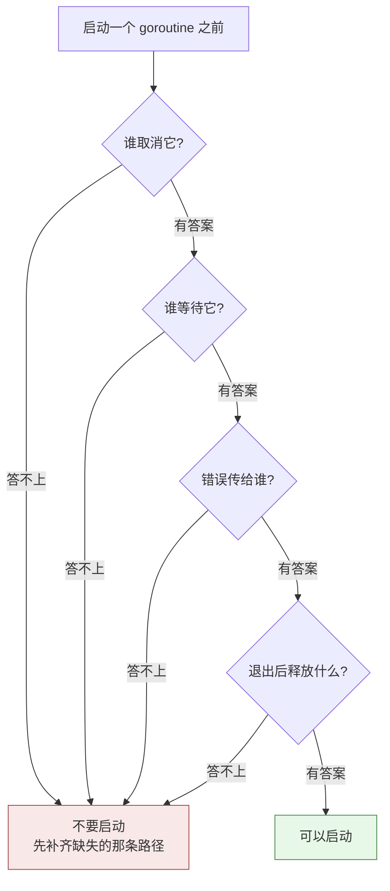
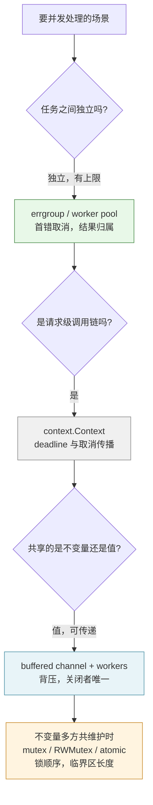

# Go 并发以所有权、取消与错误传播为边界

## 要解决的问题是什么：并发正确性靠什么边界保证

**Go 的工程价值用较小的语言和运行时模型构建可部署、可靠的服务，而不是"goroutine 很轻"**。**需要掌握的是所有权、取消、背压（backpressure，处理方向上游反馈「我处理不过来了」，让上游减速而不是任由任务堆积）、错误传播和版本治理**；**把每个操作放进 goroutine 并不会自动获得可靠并发**。

**"轻"这个特性恰恰是问题的来源**。**创建成本一旦低到可以忽略，goroutine 就会在没有经过设计的情况下被大量创建——每个都缺少明确的取消者、等待者和错误接收者**。**语言的调度能力再强，也补不上设计阶段缺的那三个答案**。

## 心智模型是什么样：并发的机制分层

```text
source -> package/module -> compile/link -> goroutine scheduler
       -> channel/lock/atomic -> network/storage -> cancellation/observability
```

- **goroutine 是运行时调度的执行单元，不等于操作系统线程；阻塞、抢占和调度成本仍要实测**。
- **这套心智模型的本质是把并发的每一层机制拆开看：调度、通信、共享、生命周期各自有边界，正确性问题因此能定位到具体某一层**。
- **channel 传递值和同步事件，mutex 保护共享不变量；不要把"channel 优先"误解为禁止锁**。
- **垃圾回收减少手工释放，但文件、连接、锁、ticker、响应体和 goroutine 仍需要明确生命周期**。
- **module 决定依赖和版本边界，package 决定代码可见性；领域边界不应由目录偶然形成**。

**第二条里的误解值得展开**。**"用 channel 通信来共享内存"说的是传递所有权的场景，不是所有场景**。**保护一个共享缓存的不变量时，channel 反而要把不变量拆成消息协议，比一个 mutex 更难写对**。**判断标准是：这个状态有没有唯一写者**。**有，用 channel 传递；没有、是多方共同维护的不变量，用锁**。

**第三条常被误读成"有 GC 就不用管释放"，那是把内存生命周期误当成了全部资源生命周期：GC 管的是内存，文件描述符（进程打开文件的编号句柄）、连接、goroutine 本身都不在它的职责范围内**。


来源：[美团技术团队《Java线程池实现原理及其在美团业务中的实践》](https://tech.meituan.com/2020/04/02/java-pooling-pratice-in-meituan.html)（CC 4.0 BY-SA）


来源：[小林coding《进程、线程基础知识》](https://www.xiaolincoding.com/os/4_process/process_base.html)


## 不同并发场景各用什么结构

| 场景 | 推荐结构 | 主要约束 |
| --- | --- | --- |
| 独立且有上限的并行任务 | `errgroup`/worker pool（`golang.org/x/sync` 的包，提供并发上限、错误收集与整组取消） | 并发上限、首错取消（组内第一个错误触发整组取消）、结果归属（每个结果能追溯到发起它的任务） |
| 请求级调用链 | `context.Context` | deadline、取消传播、不可把可选参数塞进 context |
| 有界生产消费 | buffered channel + workers | 容量、背压、关闭者唯一 |
| 共享缓存/状态 | mutex/RWMutex/atomic | 写不变量、锁顺序、临界区长度 |
| CPU 密集 | 有界 worker + profile | 核数、GC、内存带宽和调度开销 |

**每个 goroutine 都要能回答：谁创建、谁取消、谁等待、谁接收错误、退出后释放什么**。**无界 `go func()`、无人读取的 channel、遗失的 timer 和未关闭的响应体，最终都会变成泄漏或尾延迟（tail latency：少量请求远慢于多数的那部分高百分位延迟）**。



**这四个问题合起来构成所有权：一个并发任务只有在有人负责终止它、有人负责收它的结果、有人负责接它的错误、有人负责回收它退出时持有的资源时，才算真正被拥有**。**缺任何一环，这个 goroutine 就是在系统里漂流**。



**这张图覆盖了上表除 CPU 密集外的四类场景，是同一套判断的另一种写法**。**"共享的是不变量还是值"这一问对应前面展开过的那条线：有唯一写者就传递所有权，多方共同维护的不变量才用锁**。

## 错误、取消和清理各自怎么处理

1. **错误用 `%w` 保留 cause，由边界层转换成日志、状态码或重试分类；不要在每层重复记录同一个错误**。
2. **网络、数据库和外部命令都应显式设置 deadline——`net.Conn` 要调 `SetDeadline`，`database/sql` 与 `os/exec` 要配合 context 才有超时；上游取消必须传播到下游阻塞操作**。
3. **`defer` 适合函数级资源释放，但在超长循环中会延后释放；必要时把单次处理提取成函数**。
4. **重试只用于可识别的临时错误，并受次数、总时长、抖动（性能指标不稳定的起伏）和幂等（同一个操作执行一次和执行多次的结果相同，重复执行不会产生额外副作用）约束**。
5. **服务关闭顺序是停止接收、取消任务、等待有界时间、刷出必要状态、强制终止；不能只监听信号后立即退出**。

**错误用 %w 保留 cause 这一条里，"边界层"是关键词：错误在传播途中应当保持原样，只在跨越系统边界（转成 HTTP 状态码、决定要不要重试）时才被翻译**。**每层都记一遍日志，结果是同一个错误在日志里出现十几次，排查时反而找不到源头在哪一层**。

**重试只用于可识别的临时错误这一条里，"可识别"是准入门槛**。**无法区分临时错误与永久错误时做重试，等于对一个必然失败的操作重复发压，既拿不到成功，也把下游拖垮**。

## 服务与数据的边界画在哪里

- **HTTP server 设置 read/header/write/idle timeout、请求大小、并发和优雅关闭；客户端也要有 transport 级连接池（预先建好连接反复取用、省去反复握手建连的开销）与超时**。
- **`database/sql` 是连接池抽象，不是单连接；设置最大连接、空闲连接和连接寿命，并监控等待时间**。
- **streaming 和消息消费要处理背压、重复、乱序、提交点和 poison message**。
- **接口在消费者侧保持最小；不要为"方便 mock"给所有类型提前造大接口**。
- **序列化（把内存对象转成可存储或传输的字节格式的过程）、数据库 schema 和 API 的兼容迁移遵循先兼容读写、再迁移、最后删除旧路径**。

## 测试与性能各查什么

- **table-driven test 表达输入/预期，子测试隔离案例；关键边界补 fuzz 和属性测试**。
- **`go test -race` 用动态执行发现数据竞争（多个执行流同时读写同一数据且无同步，结果随时间顺序变化），但只能覆盖实际跑到的路径；通过不等于没有 race**。
- **benchmark 固定数据、并发和环境，报告分配、延迟分布与正确性；profile 后再优化**。
- **goroutine dump、runtime metrics、trace 和 pprof 应绑定请求/版本/负载，单张火焰图（按调用层级堆叠的耗时分析图、越宽的块越耗时）不能直接证明因果**。

**第二条限定了 race detector 的能力范围：它是动态分析，只在实际执行到的交织下报告冲突**。**一次干净的运行只说明这条路径上没撞上，不代表别的时序下安全——race detector 的通过是必要条件，不是充分条件**。

## 版本和依赖该怎么管

**Go 官方支持窗口会随发行推进，应从 [release history](https://go.dev/doc/devel/release) 选择仍受支持的版本，不把本页固定为长期默认版本**。**升级时同时检查**：

**截至 2026-08-31，Go 1.26.7 与 Go 1.27.0 已于 2026-08-19 同日发布**。**Go 1.27 带来泛型方法、`encoding/json/v2`/`jsontext`、原生 `uuid`、`goroutineleak` profile 和 `go test` 默认 `stdversion` vet 检查；`encoding/json` 的默认实现已由 v2 支撑，但 v1 API 仍兼容**。**升级前应特别回归 JSON 重复字段/非法 UTF-8（变长 Unicode 编码，互联网最通用的文本编码） 行为、pprof/trace 访问绑定、go.mod/toolchain 和旧平台支持，不要把新特性当作无成本替换**。[Go 1.27 release notes](https://go.dev/doc/go1.27)

**最后一句是升级检查的要点：v1 API 兼容不等于 v1 行为兼容**。**默认实现换成 v2 之后，重复字段与非法 UTF-8 这类边缘输入的处理可能变了，而这类变化不会在类型检查时报错，只会在线上数据里现形**。

- **`go.mod` 的 `go`/`toolchain` 语义和 CI（Continuous Integration，持续集成：代码合并后自动构建与测试） 镜像**；
- **编译器、标准库、GC/调度器和 `vet` 行为变化**；
- **module graph、间接依赖、许可证和漏洞**；
- **跨平台、cgo、race、benchmark 和回滚（把系统状态退回到改动之前的版本）构建**。

## 有哪些反模式要避开

goroutine 的所有者在硬件上有对应物：一个核在同一时刻只执行一条指令流，多个执行流共享内存与外设——每个执行流的写操作必须约束在自己的作用域内，共享资源由明确的负责人调度：


*图源：Wikimedia Commons，公有领域（FBI 摄影），https://commons.wikimedia.org/wiki/File:FBI_workstation.jpg。*

——Go 官方插画把这套纪律画成角色：拿铅笔的与拿扳手的口袋鼠各干各的活，每个动词有一个明确的所有者。

所有权被池化边界吞掉的反例是线程池（预先建好一组线程反复取用、避免频繁创建销毁）父子任务死锁：父任务占满核心线程后在池内等子任务，子任务在队列里等线程——等待关系成了环，任何所有权纪律都救不回一个没有属主边界的提交。JavaGuide 的生产事故图把环画得很直白：


*图源：[JavaGuide《Java 线程池最佳实践》](https://javaguide.cn/java/concurrent/java-thread-pool-best-practices.html)，CC BY-SA 4.0，文档引用。*

并发问题排查时先定性：线程是在处理器上运行、在等处理器，还是阻塞在锁或通道上。状态占比决定排查方向，混淆三者会把争用当成算力不足。


- **用 goroutine 掩盖同步设计问题，且没有取消与上限**。
- **producer 和 consumer 都尝试关闭同一个 channel**。
- **把 `context.Context` 存在结构体中跨越不相关生命周期**。
- **忽略接口返回的 `(n, err)` 组合、短写、部分成功和超时后的未知状态**。
- **只以 QPS（每秒查询数，系统每秒处理的请求量）为结果，不检查错误率、尾延迟、分配、GC 和结果正确性**。


## 效果从哪儿来，要付什么代价

**所有权模型的收益是并发结构可推理（每个值有唯一写者，泄漏与竞争在结构上被排除），代价是设计期的所有权划分与 channel、context 的传递纪律**；**共享内存加锁的模型上手快，代价是竞争与死锁（多个执行流互相等待对方释放资源）排查的长期成本——两套模型的成本支付时点不同，服务型代码的所有权纪律在长期维护里回本**。

**支付时点的差异是选型的核心：加锁模型把成本推到后期，而后期排查竞争与死锁的成本远高于前期划分所有权**。**短生命周期的脚本与长期运行的服务面对的是同一笔账，只是服务跑得够久，久到一定会把这笔账付掉**。

## 验证锚在哪儿

**并发结论要与 goroutine 生命周期对账——预写每个启动点都有明确的取消者、等待者与错误接收者，实测 goroutine dump 与 `goroutineleak` profile 应无持续增长，与预期对不上**。

## 接着读哪几篇：同在软件构建里的相邻问题

- [[工程知识/后端系统：在并发、失败与变化中维持服务/分布式可靠性/部分失败决定分布式系统的设计]]、[[工程知识/性能工程：从用户等待到资源瓶颈/观测与诊断/性能问题定位]]、[[工程知识/软件构建：让变化可以理解、验证与交付/测试与交付/测试策略从风险选择证据]]。
