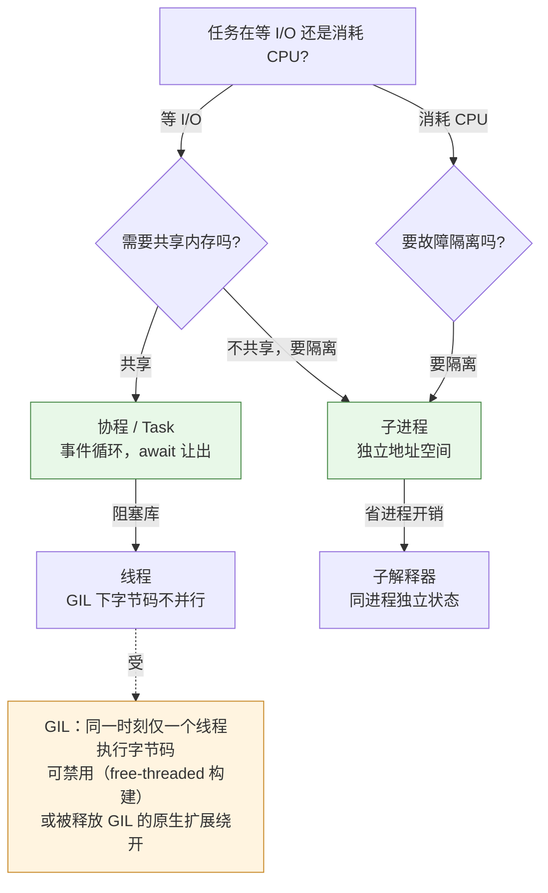
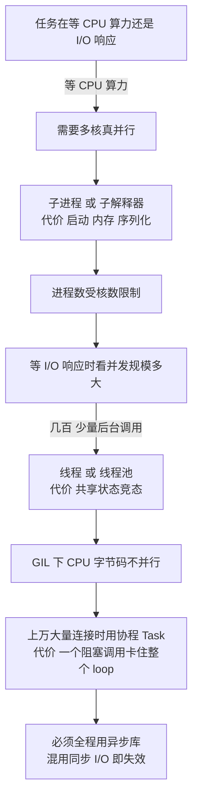

# Python 并发先区分协程、线程、进程与解释器

GIL（Global Interpreter Lock，Python 的全局解释器锁：同一时刻只允许一个线程执行 Python 代码）可以把它想成**一家只有一个收银台的超市：不管排了几个收银员，同一时间只有一个能扫码**。这个比方只到「同一时刻只有一个线程在执行」为止，I/O 期间锁怎么释放、多进程为什么能绕开要看正文。读完你能按任务类型在协程（用户态调度、可在执行中主动让出的轻量执行单元）、线程、进程之间做出选择，并知道 GIL 到底卡住了哪一类活。

这个比喻到"锁保护的是什么"为止——**那把锁保护的是收银台（解释器自身），不管你卖的是什么商品；所以即使有它，你自己的数据结构（多个线程同时改的同一个列表、同一个计数器）该加的锁一个都不能少**。

读完这一篇，你能在把代码改成协程或线程池（预先建好一组线程反复取用、避免频繁创建销毁）之前，先判断手上的任务属于哪一类、该选四种执行单位中的哪一种。

**先回答三个不同问题，再选并发模型：任务的主体是等待 I/O 还是消耗 CPU？需要共享内存还是隔离故障？取消、超时和副作用（操作对外部状态产生的额外影响）能否被可靠回收**？“协程一定更快”“线程不能并行”**都不是跨版本、跨扩展和跨负载成立的结论**。

## 要解决的问题

把代码改成协程之后整体反而变慢，原因是**事件循环**（反复取出队列里的回调执行的调度机制）里混入了阻塞调用；用线程池处理 CPU 密集任务，多核并没有带来加速；任务被取消之后进程仍占着连接与临时文件；内存随流量持续上涨，排队中的任务无人持有。本篇回答：协程、线程、子进程与子解释器各自的内存与故障边界在哪里、GIL 限制的到底是什么、结构化并发——structured concurrency，任务都在显式作用域内创建、作用域退出前子任务全部结束、生命周期由结构保证——怎样让生命周期可证明、取消与超时如何在多层之间传递预算、以及并发上限与背压（backpressure：消费端跟不上时，压力反向传导到生产端让它慢下来）应当设在什么位置。

## GIL 到底限制住了什么

**传统 CPython（Python 的官方参考实现）构建中，GIL 让同一解释器同一时刻只有一个线程执行 Python 字节码；线程在阻塞 I/O 或某些释放 GIL 的原生扩展（用 C 写的 Python 扩展模块，后文也称 C 扩展、第三方 C 扩展，指同一种东西）中仍可并发**。**它保护的是解释器实现，不是业务数据结构**：即使有 GIL，**复合操作（如 `x = x + 1` 这样的读改写序列，字节码间隙可被其他线程插入）、外部资源和共享状态仍需锁或其他同步协议**。

**从 Python 3.13 开始，CPython 提供可禁用 GIL 的 free-threaded 构建；它不是默认发行模式，不兼容的第三方 C 扩展会导致导入失败或中止（可用环境变量 `PYTHON_GIL=1` 手动回退到启用 GIL 的模式），而且单线程有额外开销，具体幅度随版本变化（3.13 与 3.14 差异显著，需实测）**。**必须在目标 Python 构建、依赖 wheel（按平台预编译的二进制包，装 C 扩展不必现场编译）和真实负载上做基准，不能把“升级到 3.13+”当作自动获得多核加速**。

[Python free-threading 文档](https://docs.python.org/zh-cn/3/howto/free-threading-python.html)



**图的第一个分叉把选择分成两支：等 I/O 与消耗 CPU 各自通向不同的执行单位，混合负载则要拆开处理。GIL 只限制其中一条——它限制 CPU 字节码的并行，不限制阻塞 I/O 期间的并发，也不限制释放了 GIL 的原生扩展；禁用 GIL或使用释放 GIL 的原生扩展后，线程的字节码也能并行**。**所以"线程不能并行"这个说法只在带 GIL 构建下纯 Python 字节码的 CPU 场景中成立**。


## 四种执行单位各自管什么

| 单位 | 内存/故障边界 | 是否抢占 | 适合 | 主要代价 |
| --- | --- | --- | --- | --- |
| 协程/Task | 同一事件循环、共享进程 | 在 `await` 处协作让出 | 大量 I/O、连接和 Agent 工具调用 | 一个阻塞调用会卡住整个 loop；取消需传播 |
| 线程 | 同一进程、共享内存 | 操作系统调度 | 阻塞库、少量后台 I/O、与同步 API 集成 | 共享状态竞态；GIL 构建下 CPU 字节码不并行 |
| 子进程 | 独立解释器和地址空间 | 操作系统调度 | CPU 隔离、崩溃隔离、不同运行时 | 启动、内存、序列化和 IPC（进程间通信）成本 |
| 子解释器 | 同一进程不同解释器状态 | 由线程调度，各自持有独立解释器状态 | 需要多核且可显式隔离数据的纯 Python 工作 | 扩展兼容性和跨解释器通信复杂；Python 3.14 `InterpreterPoolExecutor` 才加入标准库 |

四种执行单位的边界说的是"内存归谁、故障传多远"，还有一半在时间里：一个线程此刻到底在算、在等 GIL、还是卡在阻塞调用上——协程被卡住的原因都落在这一半。

按"瓶颈是什么"往下走，四种单位各有各的对口位置：



三条代价是**互斥的：进程花在启动与序列化**（把内存对象转成可存储或传输的字节格式的过程）上，**线程花在锁上，协程花在"必须全程异步"这个约束上**。**选错模型的代价通常大于不并发——把 CPU 密集任务放进协程会让整个 loop 停摆，把高并发 I/O 放进线程会先撞上内存与调度上限**。天翼云开发者社区的 [多线程 vs 多进程 vs 协程：Python并发编程选型指南](https://www.ctyun.cn/developer/article/678518215110725) 给出的是同一套按瓶颈分流的选法。


*图源：[Brendan Gregg 性能分析站点 thread_states](https://www.brendangregg.com/Perf/thread_states.html)，Brendan Gregg，CC BY-SA 4.0（1400×886）。图上把时间切成"在 CPU 上执行""可运行但排队""阻塞等待"几段，正对着本篇的判断：GIL 只在第一段生效（同一时刻一个线程执行字节码），协程的 `await` 让出与线程池里的阻塞调用都发生在阻塞段——所以"协程变慢"要去阻塞段找那个没让出的调用，而不是去 CPU 段找多核。*

协程不是线程，也不是“后台任务”：**调用 `async def` 只创建 coroutine object，必须交给事件循环驱动（`await`、包装为 Task，或用 `asyncio.run()` 直接驱动）才会运行**。**Task 由事件循环调度，单个协程在 `await` 前执行的 CPU 代码仍会阻塞其他任务**。[asyncio tasks 文档](https://docs.python.org/zh-cn/3/library/asyncio-task.html)

官方文档把这套驱动关系列成目录：Coroutines、Creating tasks、Task cancellation、Running tasks concurrently 一路排下来——「协程要交给事件循环驱动」写在标准库文档的章节结构里：


*图源：[Python 3.14 官方文档 asyncio Coroutines and Tasks](https://docs.python.org/3/library/asyncio-task.html)（页面截图，2026-09-27）。文档目录的顺序就是驱动顺序：先声明协程、再包成 Task、再谈取消与并发；「必须交给事件循环驱动」对应正文里 `asyncio.run(main())` 那一行。*

单核芯片是事件循环最直白的实物模型：Intel 4004，人类第一颗商用微处理器，一颗芯片一个执行核心，操作系统在它上面轮流给几十个进程分时间片——每个进程都以为自己独占 CPU，实际上核心同一时刻只执行一条指令流。**协程的并发与此相同：几十个 Task 共用一个事件循环，`await` 就是时间片用完、调度器切换到下一个任务的时机**。**危险也随之清楚：某个任务进入不开中断的死循环（阻塞调用），整个系统停摆——这就是「一个阻塞调用卡住整个 loop」，也是协程并发反而变慢的第一嫌疑**。


*图源：Wikimedia Commons，the Science Museum London，CC BY 4.0，https://commons.wikimedia.org/wiki/File:Intel_4004_open.jpg。*

## 怎么让子任务的生命周期可证明

**优先使用 `asyncio.TaskGroup`（Python 3.11+）管理相关子任务：离开上下文时等待全部任务；一个任务失败会取消同组其余任务并聚合异常，避免 `create_task()` 后无人持有引用或吞掉异常**。对边界调用使用 `asyncio.timeout()`（Python 3.11+），**在 `finally` 中关闭连接、释放锁和取消子任务**。**捕获 `CancelledError` 做清理后通常应继续抛出，否则会破坏 TaskGroup/timeout 的取消语义**。

```python
import asyncio

async def fetch_all(client, ids):
    async with asyncio.TaskGroup() as group:
        tasks = [group.create_task(client.fetch(item_id)) for item_id in ids]
    return [task.result() for task in tasks]

async def bounded_call(client, item_id):
    async with asyncio.timeout(5):
        return await client.fetch(item_id)
```

`asyncio.gather()` 仍有用途，但默认一个任务失败时不会取消其他任务；需要强生命周期保证时选择 TaskGroup，并为每个子任务设并发上限、总截止时间和结果大小上限。

## 执行器该怎么挑

```python
from concurrent.futures import ThreadPoolExecutor, ProcessPoolExecutor

# 阻塞同步库：在线程池中运行，但不要把无限任务塞进无界队列
with ThreadPoolExecutor(max_workers=16) as pool:
    result = pool.submit(blocking_call, arg).result(timeout=5)

# CPU 密集：进程隔离，参数和返回值必须可序列化
with ProcessPoolExecutor() as pool:
    result = pool.submit(cpu_bound_call, data).result(timeout=30)
```

`InterpreterPoolExecutor`（Python 3.14）为每个 worker 提供独立解释器和 GIL，可实现多核并行；代价是**可变对象不能直接共享**，模块/运行时状态需要在各解释器中初始化，通信通常要序列化。[concurrent.futures 文档](https://docs.python.org/zh-cn/3/library/concurrent.futures.html)

选择顺序应是：**先用同步函数证明正确性 → 明确阻塞点和资源上限 → I/O 用协程或线程池 → CPU 用原生扩展、进程或子解释器 → 用 profile 和基准确认收益**。**不要为了“异步”把所有代码改成 `async`，也不要在事件循环里直接调用阻塞数据库、文件或 subprocess API**。

## 取消和共享状态要怎么处理

- **取消是控制流，不是普通异常日志：在 `finally` 中释放连接、锁、临时文件和子进程；对不可取消的外部系统用幂等（同一个操作执行一次和执行多次的结果相同，重复执行不会产生额外副作用）键（idempotency key：给操作带的唯一标识，重复提交时凭它识别同一次操作）和状态查询补偿**。
- **连接超时、读取超时、总截止时间分开设置，并把剩余预算传递给下游；多层重试只按一个总预算计算**。
- **线程共享可变状态用 `Lock`、`Queue`、`Event` 或不可变消息；不要依赖 dict/list 的“原子性”推断业务安全**。**free-threaded 构建也不改变业务同步约定**。[threading 文档](https://docs.python.org/zh-cn/3/library/threading.html)
- 进程/子解释器之间**只传递明确 schema 的消息**；大对象优先共享文件/内存映射或批量传输，避免每个任务重复 pickle（Python 的对象序列化格式，进程间传数据要靠它来回转换）。
- 队列、线程池、连接池（预先建好连接反复取用、省去反复握手建连的开销）和并发工具调用都要**有上限、背压、拒绝/降级（主动牺牲部分功能或精度，保住核心链路）策略和积压指标**。

## 服务里的并发该怎么组织

一次 Agent 请求通常包含：并行检索、模型调用、工具执行和写入事实源。检索可以在 TaskGroup 中并发，写入工具必须按幂等键（请求自带唯一标识，重复提交只生效一次）串行或由事实源协调；模型流式输出不能代替任务状态。把请求取消、客户端断开、模型超时和工具超时统一映射为可观察的状态机，并记录 trace/span、任务 ID、版本和副作用结果。

## 变慢了该从哪里开始查

至少同时测：吞吐、p50/p95/p99 延迟、CPU 利用率、内存峰值、上下文切换（CPU 从一个任务换到另一个任务、保存并恢复现场的过程）、队列等待、取消完成时间和失败重试次数。对同一 workload 比较同步、协程、线程池、进程/子解释器，并记录 Python 版本、GIL 构建、依赖版本和硬件。常见症状与方向：

| 症状 | 优先检查 |
| --- | --- |
| 协程并发却整体变慢 | loop 中的阻塞调用、无界并发、DNS/连接池和大响应 |
| CPU 线程没有加速 | GIL 构建、C 扩展是否释放 GIL、锁竞争和数据拷贝 |
| 取消后进程仍占用资源 | 子任务引用、`finally` 清理、线程池无法强制终止 |
| 内存随流量上涨 | 无界队列、未回收 Task、缓存/响应体和进程池 worker |
| free-threaded 反而退化 | 单线程开销、扩展回启 GIL、锁/分配器竞争和缺少专用 wheel |

## 接着读哪几篇：同在并发主题里的相邻文章

- [[工程知识/软件构建：让变化可以理解、验证与交付/语言与运行时/跨语言并发模型必须同时比较抽象与运行机制]]
- [[工程知识/软件构建：让变化可以理解、验证与交付/语言与运行时/Go并发以所有权、取消与错误传播为边界]]
- [[工程知识/后端系统：在并发、失败与变化中维持服务/任务与并发/任务生命周期必须覆盖进程、日志、超时与清理]]
- [[工程知识/性能工程：从用户等待到资源瓶颈/观测与诊断/性能问题定位]]
- [[工程知识/AI 系统工程：从模型能力到生产能力/Agent与工作流/构建可靠Agent应用]]

相关（运行时对照）：[[工程知识/软件构建：让变化可以理解、验证与交付/语言与运行时/TypeScript类型边界与Node事件循环共同约束服务]] —— 协程在不同事件循环下的差异

## 怎么自己动手验证

1. 阻塞探测：在事件循环上混入一次同步阻塞调用，比较前后的请求延迟分位数（把耗时排序后取某个百分比位置的值、如 P99），预期延迟抬升的区间与阻塞调用持续的时间对齐。
2. 加速比测量：把同一 CPU 密集任务分别交给线程池与子进程执行，记录多核使用率与总耗时，预期线程方案在多核上没有加速，原因可回到 GIL 的释放情况。

3. 取消核验：取消一个持有连接与临时文件的任务，用 `ls -1 /proc/<pid>/fd | wc -l` 与连接数核对资源是否回收；未回收时检查子任务引用与 `finally` 清理路径。
4. 内存跟踪：在稳定流量下跟踪常驻内存与排队任务数，预期两者不随流量单调上涨；上涨时按无界队列、未回收 Task 与缓存逐类排查。

5. 构建对照：在同一压测下比较普通构建与 free-threaded 构建的吞吐与单线程开销，预期退化可归因到具体的锁竞争（多个执行流争抢同一把锁造成的等待开销）或扩展回启 GIL。
6. 断言锚点：阻塞调用被识别并移出事件循环，并发上限与背压已设置，取消路径回收资源，内存曲线在稳定流量下持平。