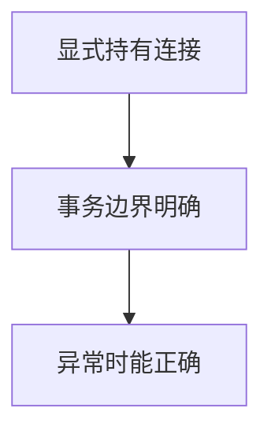
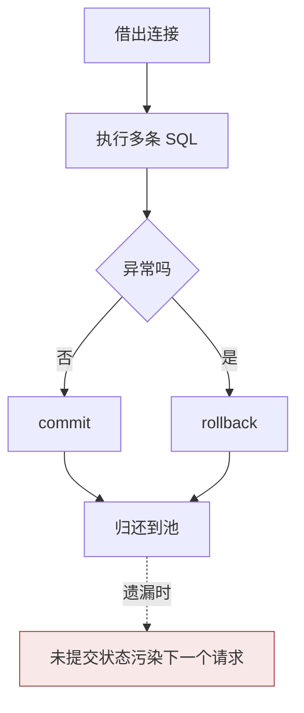
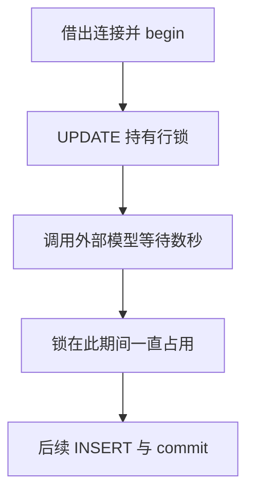

# Python 数据访问必须显式拥有连接与事务

## 要解决的问题是什么：连接与事务为什么是两种不同性质的边界



连接与事务的归属要清晰：


连接和事务常被一起提及，但它们是两种不同性质的东西，混在一起正是缺陷的来源。连接是**有限资源**——数据库能同时维持的连接数有上限，借出就要归还，不归还就会耗尽。事务是**原子边界**——它圈定一组操作要么全生效要么全不生效，保护的是业务不变量。

两者的生命周期也不相同：一个连接在其生命周期内可以先后承载多个事务。把"借连接"和"开事务"写成同一个动作，短期看省了一行代码，代价是**异常路径上分不清该归还什么、该回滚**（把系统恢复到上一个可用版本）什么——合并后的接口在失败时不再暴露事务是否已开启，于是调用方无法判断失败发生在开启之前（只需归还连接）还是之后（还需先回滚）。

需要划清的是，批评的对象是"合并之后不再暴露事务状态"的接口，而不是所有一步到位的写法：`engine.begin()` 同样把借连接与开事务合成一个动作，但它把异常时的回滚与归还都接管了，调用方不需要判断，也就不存在分不清的问题。

一次用例里，「借连接、开事务、执行、提交或回滚、归还」这五步的先后是固定的，异常只在中间分一次叉——两条分支最终都汇到同一个归还点（一个连接在生命周期内可以先后承载多个事务，这里只画其中一个事务）：


连接池（预先建好连接反复取用、省去反复握手建连的开销）把连接当作可复用资源，归还动作不携带事务状态，所以 rollback 与 commit 都必须在归还之前发生：图上那条虚线是顺序被违反后的结果——连接带着未提交状态回到池里，下一个借到它的请求在不知情的情况下继承了上一个请求的事务上下文。

## 先记住哪几句

| 维度 | 回答 |
| --- | --- |
| 要解决的问题 | Python 服务容易把连接、session、事务和业务逻辑混在一起，导致连接泄漏、隐式提交、长事务、N+1 和错误重试。 |
| 本质 | 连接是有限资源，事务是业务不变量的原子边界；数据访问抽象必须显式表达两者的所有权和生命周期。 |
| 做法 | 由用例层拥有事务，显式借还连接并在异常后 rollback，设置池和超时，参数化查询，并将外部副作用（操作对外部状态产生的额外影响）用 outbox/补偿协调。 |
| 效果与代价 | 资源释放、并发语义和错误分类更可预测；代价是边界代码更多，团队必须理解数据库方言、计划和迁移。 |
| 边界 | ORM（对象关系映射：把数据库表映射成程序里的对象）/查询构造器不能消除 N+1、锁、索引和事务隔离；数据库事务不能覆盖网络、模型调用或人工等待。 |
| 验证 | 测连接池耗尽、异常回滚、并发冲突、死锁、N+1、超时和进程 fork，检查事务状态、SQL 数量、锁等待和最终事实。 |

选择 raw SQL（不经对象映射、直接写 SQL 语句的原生方式）、query builder 或 ORM，依据是查询复杂度、领域映射、事务边界、可观测性（通过系统对外输出判断内部状态的能力）和团队维护能力。项目规模在这几个依据里排不上号。

同一个请求如果在事务里等待模型或网络，会长时间占用连接与锁，并阻止数据库回收 MVCC（多版本并发控制，读写互不阻塞）下的行旧版本（多版本并发控制中被更新前的历史版本，长事务不结束它们就不能清理）；如果异常后未 rollback，连接归还池后还可能污染下一个请求。

这些现象来自同一个原因：连接与事务的生命周期没有在代码里被显式写出来，于是"什么时候归还、什么时候回滚"由运行时偶然决定，而不是**由代码决定**。

因此"能查到数据"只是功能起点；在并发、超时和重试下仍能释放连接、保持事务不变量并解释 SQL 数量，才是生产可用的数据访问层。


来源：[CSDN @bjmayor《图解分布式事务模式》](https://bjmayor.blog.csdn.net/article/details/154004146)（CC 4.0 BY-SA）


来源：[小林coding《事务隔离级别（并发事务互相可见程度的分级）是怎么实现的？》](https://www.xiaolincoding.com/mysql/transaction/mvcc.html)


## 这套机制分几层：每层管什么

```text
业务用例/事务边界
  -> Repository/Query service（可选）
  -> ORM / SQL expression / raw SQL
  -> DB-API driver
  -> connection pool
  -> database
```

| 方式 | 优势 | 边界 |
| --- | --- | --- |
| Raw SQL + driver | SQL 行为透明，适合复杂/性能关键查询 | 手动映射、事务和动态拼接风险 |
| SQL expression/query builder | 参数化、组合性和跨驱动接口 | 抽象仍不能消除数据库方言/计划差异 |
| ORM | 聚合映射、unit of work、关系和生命周期 | N+1、隐式 flush/lazy load、对象状态复杂 |

同一系统可以混用：写模型用 ORM，复杂报表或批处理（把多个请求合并成一批同时计算、提高硬件利用率）用显式 SQL。不要因为使用 ORM 就不学习索引、事务和执行计划。

ORM 那一行里的"unit of work"（工作单元）指：它指 ORM 跟踪一批对象的变更，在提交时统一生成 SQL。这个机制把"什么时候发 SQL"从代码里藏了起来——`flush` 可能在一次属性查询时自动触发，于是语句数量和时机都不再由调用点决定。这是隐式写入的来源。

另一面是读取，N+1 就来自这里：一次主查询取回 N 条记录，再逐条访问各自的关联属性时每条各发一次 SELECT，合计 N+1 条语句。lazy load 让这个动作发生在属性被访问的那一刻，调用方看着像在读内存，实际每次都在打数据库。

N+1 与隐式写入是两件事，共同点是都由"SQL 的发出时机不在调用点上"造成——前者在读取侧，后者在写入侧。

## 连接与池要按什么配置

- 池大小按并发、事务时间和数据库上限计算；不是越大越快。
- 连接池返回的是复用连接；每次借出后必须回滚/清理未完成的事务和会话状态——此处指数据库连接侧的会话状态，如临时表与会话级变量；ORM 的 Session 是另一层概念，见下一行。
- 设置 connect/read/query/transaction timeout，区分网络暂态、死锁（一组进程互相持有对方需要的资源、谁都推进不了的状态）、约束冲突和语法/业务错误。
- fork 前创建的连接池不能直接在子进程复用；每个进程拥有自己的池。
- 密钥从 secret/env/provider 注入，示例不写真实密码；日志脱敏（遮盖敏感字段的部分内容、保留可辨识形态）参数和 DSN（Data Source Name，即包含地址、库名与凭据的连接串）。

第一条里的"不是越大越快"有具体原因：数据库连接数上限固定，池开得越大，单库能承载的应用实例数就越少；而且并发事务越多，锁竞争（多个执行流争抢同一把锁造成的等待开销）和上下文切换（CPU 从一个任务换到另一个任务、保存并恢复现场的过程）的开销越大。计算上界时应使用单实例口径：**每实例并发事务数 × 实例数 ≤ 数据库上限**，由此反推单实例池大小约为"上限 ÷ 实例数"，再按实测的等待时间调整。

第四条说的是 fork 与连接的关系：`fork` 只复制进程内存，不复制数据库侧的会话状态。父子进程共用同一个 socket 之后，两边发出的协议包会在同一条连接上交错，结果无法预期——所以要么在 fork 之后重建池，要么在 fork 之前就关闭它。

在事务里等待模型或网络调用，会把这条边界拉长到远超 SQL 执行所需的时间：

占用有多长，要看行锁是从哪条语句开始持有、到哪一步才释放——把 UPDATE 持锁、模型调用、INSERT 与 commit 排在同一条时间轴上，那段「数据库什么也没做」的空白落在哪里就清楚了：


图上这段空白就是「事务时长远超 SQL 执行时间」的全部来源：锁从 UPDATE 一直持到 commit，中间那条外部调用的耗时被原样加进了持锁时长和 MVCC 旧版本的存活时长——把它移出事务，是缩短这段区间的唯一直接办法。

三种方式并不互斥（组合方式的选择见上表），常见组合是写路径用 ORM 换取开发效率，复杂报表与批处理退到显式 SQL 换取对执行计划的控制。混用时要注意事务边界统一——连接与事务的所有权如果按层分裂，前面的所有权显式化就白做了。

## 事务边界该怎么划


*图示：事务 ACID（原子性、一致性、隔离性、持久性，事务的四个特性） 四属性之间的关系。图源：Wikimedia Commons《Acid transaction properties》，作者 FeedMeGrapes，CC BY-SA 4.0，https://commons.wikimedia.org/wiki/File:Acid_transaction_properties.svg。四条性质里，只有原子性由回滚日志直接保障——图里剩下的三条决定了**并发下能看到什么、崩溃后留下什么**。*

事务围绕一个业务用例，而不是**围绕每条 DAO**（Data Access Object，数据访问对象）调用。明确：

- begin/commit/rollback 由哪一层拥有；
- 异常后 session/connection 是否必须 rollback 才可复用；
- 隔离级别、锁顺序、重试条件与幂等（同一个操作执行一次和执行多次的结果相同，重复执行不会产生额外副作用）键；
- 外部 API/消息不能假装与数据库处在同一本地事务中，必要时使用 outbox/Saga；
- 长事务会持有锁、旧版本和连接，不能跨用户思考/网络等待。

第四条是最容易踩的一条。本地事务的原子性由数据库的回滚日志保障，而一次外部 API 调用或一条已发出的消息都不在这套机制里——数据库回滚了，消息却已经投递出去。

outbox 模式（事务性发件箱：把待发消息写进同一事务里的一张表）把这个缺口补上：提交之后再由独立的投递进程读取发送，于是"消息最终发出"与"事务最终提交"由同一个事实决定；已经发出且无法撤回的动作则要靠补偿（Saga：执行一个语义上的反向操作来抵消已生效的那一半）。outbox 的本地消息表长什么样，见本库《事务边界应覆盖完整业务用例》一篇的第一阶段图——业务操作与消息记录写在同一个本地事务里，正是这段描述的实物形态。

这一节的五条里有三条指向同一件事：让数据访问的行为可被观测。SQL 数量、池等待、事务时长、慢查询——这些指标共同回答"这段代码在数据库上实际做了什么"。缺少它们时，性能问题只能在用户侧被感知，而那时已经无法还原当时的执行形态。

## 安全与性能各要注意什么

- 永远使用参数绑定；表名/列名等标识符只能从允许列表生成。
- 批量写入使用 executemany/bulk/copy 等数据库能力，但确认错误和返回语义。
- 监控池等待、连接数、事务时长、慢查询、行数和 query fingerprint。
- 避免 ORM N+1：用 eager load、显式 join/batch（数据库批处理，把多条操作合并一次提交），并通过 trace/SQL 计数测试。
- 性能结论以数据库执行计划和真实数据分布为准，不以 ORM 代码是否简洁为准。

第一条分成两半是因为参数绑定只覆盖值，不覆盖标识符。列名、表名、排序方向无法作为参数传入，只能用字符串拼接；这时唯一可靠的做法是拿允许列表做白名单校验，而不是**转义——转义规则在不同方言下并不一致**。

用例层拥有事务还带来一个具体的测试收益：事务边界集中在一处，测试可以用一个替身事务替换掉整条边界，而不必在每个数据访问方法上各自打桩。反过来说，如果事务散落在各个 DAO 方法里，测试就只能在每个方法上分别处理提交与回滚，组合数量随方法数增长。

## 最小可用的模式长什么样

```python
def transfer(engine, src, dst, amount):
    with engine.begin() as conn:  # success commit; exception rollback
        debit = conn.execute(DEBIT, {"id": src, "amount": amount})
        if debit.rowcount != 1:
            raise InsufficientBalance(src)
        conn.execute(CREDIT, {"id": dst, "amount": amount})
```

`engine.begin()` 的语义是"借出连接并开启事务，正常退出时提交，异常时回滚并归还连接"——一个上下文管理器同时表达了借还、事务边界和异常路径三件事，这正是前面说的所有权显式化：读这一行就能回答谁提交、谁回滚、谁归还。

示例只表达资源和事务所有权；实际还需幂等、（同一操作执行一次与执行多次结果相同）隔离、审计、货币精度和并发测试。

把所有权显式化之后，"这段数据访问代码是否可靠"这个问题可以拆成三个可分别验证的命题：连接在任何路径上都被归还、事务在任何异常路径上都被回滚、SQL 数量与数据规模的关系符合预期。三个命题各自对应下面的一组验证步骤，且都能在不启动完整服务的前提下执行——这正是边界显式带来的可测性。

## 怎么自己动手验证

1. 连接归属：把连接池上限设为 1，并发发起两个需要连接的请求，预期第二个请求等待而不是**各自新建连接**；池等待时间与并发数一起记录。
2. 异常回滚：在事务中途抛出异常，预期已执行的写入全部回滚；用同一事务内先写后读的方式确认中间状态未提交。
3. 并发冲突：并发执行两笔会竞争同一行的事务，预期隔离级别对应的结果出现（等待、失败或串行化错误），事务状态可以查询。
4. N+1 检查：对列表查询打开 SQL 语句计数与 trace，预期语句数量与列表项数无关；有关时改用 eager load 或显式 join。
5. 进程复制：在 `fork` 之后使用父进程创建的连接，预期行为与驱动文档描述一致；若驱动不支持跨进程复用，应在子进程重建连接。
6. 断言锚点：连接与事务的所有权显式，异常路径回滚被验证，池等待与事务时长进入监控，SQL 数量由测试断言。

回过头看，这几节里的每一条规则——池大小、fork 后重建、参数绑定、事务边界、SQL 计数——都是同一个动作的不同侧面：把原本由运行时隐式决定的事情，改成由代码显式决定。隐式决定的代价不在代码量上，在于出问题时没有人能说清当时到底发生了什么。

## 效果从哪儿来，要付什么代价

显式所有权的收益是**资源释放、并发语义与错误分类都可预测——连接不会泄漏**，回滚路径明确，错误能分到网络暂态、死锁、约束冲突等具体类别；代价是**边界代码更多**，且团队必须真的理解数据库方言、执行计划与迁移。隐式管理的写法上手更快，代价是**缺陷集中出现在异常路径与并发下：回滚遗漏污染连接池、**N+1 在数据量增长后才现形，这些问题的排查成本远超当初省下的代码量。

## 文中的术语指什么

- **N+1**：读取侧的隐式查询放大，正文「事务边界内的隐式行为」一节有完整定义与触发链条。
- **DB-API**：Python 的数据库接口标准（PEP 249），定义了 `connect`、`cursor`、`execute` 等统一接口，各数据库驱动按此实现。
- **Session**：本文两处含义不同——ORM 的 Session 是对象与数据库之间的工作单元；数据库的会话是连接上的状态（临时表、会话级变量）。
- **lazy load**：关联属性在首次被访问时才发起查询，读取动作因此延迟到调用点之外。

## 接着读哪几篇：同在软件构建里的相邻问题

- [[工程知识/数据系统：在并发与故障中保存事实/事务与存储/事务隔离决定并发读写能观察到什么]]、[[工程知识/数据系统：在并发与故障中保存事实/查询与索引/B+Tree索引为访问路径服务]]、[[工程知识/软件构建：让变化可以理解、验证与交付/语言与运行时/Python并发先区分协程、线程、进程与解释器]]。
