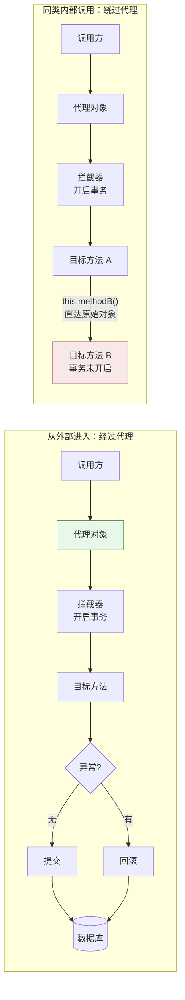
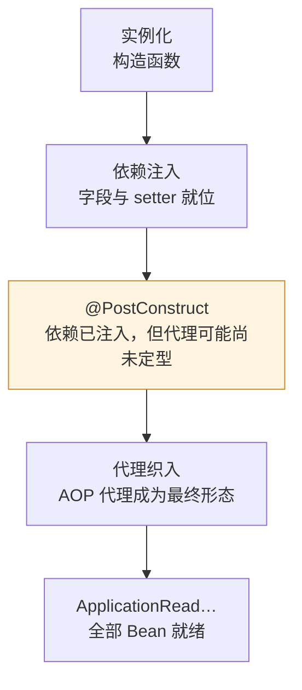
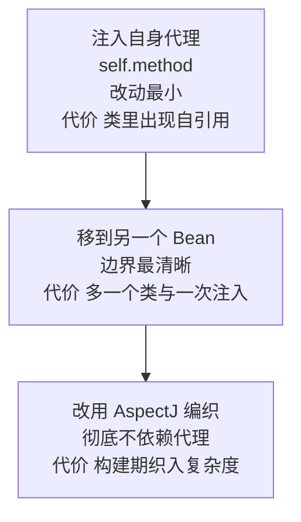

# Spring 代理与 Bean 生命周期：调用边界与初始化时序

Spring（Java 生态的应用框架，提供依赖注入与事务管理等容器能力）解决的是**对象创建、配置、事务和横切逻辑在大型 Java 服务中重复实现且容易失控**的问题。核心机制是**容器管理 Bean（由 Spring 容器创建、装配并管理生命周期的对象）的生命周期，并通过代理织入调用边界**；收益是**依赖和事务治理集中**，代价是**隐式调用路径、启动顺序和代理限制增加**。**验证要覆盖同类内部调用、异步边界、事务提交后的副作用和版本迁移**。



两个子图执行的是同一段目标逻辑，差别只在入口：**上半部从代理进入，拦截器先开事务；下半部虽然也从代理进入 A，但 A 内部用 `this` 调 B 时直达原始对象，B 上的事务注解不生效**。**`this` 指向对象自身而非代理，拦截器没有介入的机会**——这是 Java 方法调用的语义，不是 Spring 的实现缺陷。

## 要解决的问题：容器管理 Bean 生命周期的哪些阶段

加了事务注解的方法在同类内部被调用之后没有回滚，数据已经写入；横切逻辑要靠注解维持，**调用路径却被代理改写，排查时看到的调用栈与源码不一致**；配置、生命周期与事务治理集中在容器里，**对象的创建顺序和代理是否织入完成却难以从代码上看出来**。本篇回答：**容器管理 Bean 生命周期的哪些阶段、代理在什么位置介入调用、哪些调用形式会绕过代理、事务边界应当包住什么**、以及启动关闭阶段的超时与探针（向系统注入的检测点或检测请求）如何验证。

代理在哪一步织入，决定了 `@PostConstruct` 里能读到什么：



## 这套模型是什么样

Spring 的价值在于依赖注入、生命周期管理、配置和横切能力；它不替代领域边界、事务设计和可观测性（通过系统对外输出判断内部状态的能力）。Bean 生命周期通常经历实例化、依赖注入、Aware 回调（容器把自身环境信息回传给该 Bean 的一组接口）/后处理器、初始化、使用和销毁，代理可能改变调用路径和事务边界。

容器的输入输出关系，Spring 官方文档画成一张最简图：业务对象 POJO（Plain Old Java Object，无框架依赖的普通 Java 对象）与配置元数据从两侧进容器，容器产出「配置完成、可直接使用的系统」——生命周期管理、依赖注入、代理织入全部发生在容器内部，调用方拿到的已经是最终形态：


*图源：[Spring Framework 官方文档《The IoC Container》](https://docs.spring.io/spring-framework/reference/core/beans/basics.html)，Spring 版权，文档引用。*

生命周期里有两个时点值得单独记住：**`@PostConstruct` 在依赖注入完成后执行，`ApplicationReadyEvent` 在全部 Bean 就绪后触发**。正常情况下容器会先完整初始化被依赖的 Bean（含其配置绑定与自身的 `@PostConstruct`）再注入，所以**在 `@PostConstruct` 里读注入进来的依赖通常拿到的是就绪对象**。例外是循环依赖：**容器会提前把尚未初始化完毕的引用交给对方，此时读到默认值的情形才会发生**。**需要读取其他 Bean 配置的初始化动作，放在 `ApplicationReadyEvent` 之后最稳妥**。

## 事务边界怎么划

- **事务应围绕一个完整的持久化不变量**（一次业务操作结束后，落到库里的数据必须始终满足的那些约束，例如账户余额不为负），而不是**包住网络调用或长计算**。
- **`@Transactional` 依赖代理调用；同类内部直接调用可能绕过代理，事务不生效**。
- 明确传播（一个事务方法调用另一个事务方法时，是加入已有事务还是新开一个）、隔离、只读、超时和回滚异常；**声明的隔离级别（并发事务互相可见程度的分级）会透传给数据库连接，数据库不支持该级别时按实际配置生效**。
- **异步、事件和事务提交后的副作用要通过 outbox（本地事务表加异步投递）、消息确认或补偿机制协调**。

## 配置与发布各要注意什么

- **配置按环境分层，密钥进入密钥管理系统，不写入仓库和日志**。
- **兼容升级遵循“先兼容读写，再迁移数据，最后删除旧路径”**；锁定 JDK（Java Development Kit，Java 开发工具包）、Spring、构建插件和驱动版本。
- **健康检查区分存活（进程是否还活着）与就绪（能否接流量）**；启动、关闭、线程池（预先建好一组线程反复取用、避免频繁创建销毁）、连接池（预先建好连接反复取用、省去反复握手建连的开销）和数据库迁移都要有超时。

## 同类内部调用为什么绕过代理

`@Transactional` 织入的是**代理对象**上的方法调用。Spring 在创建 Bean 时，**如果该类需要事务增强，容器实际注入的是代理实例**；外部通过代理调用方法时，**事务拦截器先开启事务再执行目标方法**。

但同一个类内部用 `this.method()` 调用，走的是**对象自身的引用**，不经过代理，**拦截器不会触发**。这Java 方法调用的语义——**代理只在从外部进入时才有机会介入**，而不是**Spring 的缺陷**。

最小复现：

```java
@Service
public class OrderService {

    // 外部调用：经过代理，事务生效
    @Transactional
    public void placeFromOutside() {
        repository.save(...);
        throw new RuntimeException("rollback");  // 回滚
    }

    // 同类内部调用：绕过代理，事务不生效
    public void place() {
this.placeFromOutside();   // 事务未开启，数据已写入数据库
    }
}
```

调用 `placeFromOutside()` 抛异常会回滚；调用 `place()` 则不会——**两者最终执行的是同一段目标逻辑，差别只在于进入这段逻辑时是否经过代理**。

代理模式的通用形态见下图：左边类图里 Client 持有的是 Subject 接口，Proxy 与 RealSubject 都实现它；右边时序图里 Client 的 operation() 调用先落到 Proxy，再由 Proxy 转给 RealSubject——拦截的机会就在这一跳：


*代理模式的类图与时序图（图源：Wikimedia Commons，Vanderjoe 绘，CC BY-SA 4.0）*

`this.method()` 绕过代理的原因在时序图里看得直白：内部调用的起点已经是 RealSubject，Client 到 Proxy 的那一跳根本不存在，拦截器自然没有介入的位置。Spring 官方文档用两张对照图说明这件事——没有代理时调用直达对象本身；持有代理时调用先经过代理这一跳，拦截器才有介入位置：


*图源：Spring Framework 官方文档《AOP 代理机制》Understanding AOP proxies 配图（Apache-2.0），https://docs.spring.io/spring-framework/reference/core/aop/proxying.html。第一张 Calling code→Plain Object：没有代理，foo() 直接在对象上执行；第二张 Calling code→Proxy→Plain Object：调用先经代理的 foo() on the proxy，再转 foo() on the object——自调用失效正是因为内部调用走的是第一张的路径而外部调用走第二张。英文标签对照：Calling code=调用代码，Proxy=代理，Plain Object=普通目标对象，foo() on the proxy=代理上的 foo()，then foo() on the object=再调用对象上的 foo()。*

三种修法，代价不同：**注入自身代理**（`@Lazy private OrderService self;` 后调 `self.placeFromOutside()`，简单但引入自引用）；**把方法移到另一个 Bean**（边界最清晰，代价是**多一个类**）；**改用 AspectJ 编织**（不依赖代理，代价是**构建复杂度**）。

三种修法都在做同一件事——**让调用重新经过代理**，区别在于**这件事发生的位置：**



前两种是让调用重新走一遍代理，第三种是干脆不用代理——AspectJ 在编译期（代码编译成可执行文件时发生的阶段）或加载期把切面织进字节码，**方法调用不再需要"从外部进入"这个前提，private 与 final 方法上的注解也能生效**。代价是**把一部分行为从运行时挪到了构建期**，构建配置与本地调试都会复杂一层。

阿里云开发者社区的 [理解和解决Spring框架中的事务自调用问题](https://developer.aliyun.com/article/1647283) 与博客园的 [Spring-AOP自调用代理失效解决方案](https://www.cnblogs.com/llm1/p/20212916) 都对这几种写法给出了可对照的中文示例。

## 示例与版本有哪些使用原则

早期的写法和示例工程不作为当前 API 或生产配置。重写示例时先锁定 JDK、Spring、构建插件和数据库驱动版本，再以当前官方文档验证 Bean 生命周期、代理事务和迁移行为；默认密码、绝对路径、旧注解组合和日志配置不复制到新项目。

## 代理边界怎么算账：量化锚点与案例回流

代理带来的调用开销与行为差异的量级——**JDK 动态代理走反射调用，单次开销的绝对量很小**（需在自己的负载上实测，通常相对一次数据库访问可忽略）；**代理拦截器链每多一层（事务、日志、安全各一层），就多一帧栈与一次调用**。生命周期时序的量化：`@PostConstruct` 在依赖注入完成后、代理最终形态确定前执行，`ApplicationReadyEvent` 在全部 Bean 就绪后——**两个时点之间所有 Bean 的初始化都可能穿插**。

内部调用绕过代理的实录——**`this.doQuery()` 从同类内部调用带 `@Transactional` 的方法，事务不生效**（代理包裹的是外部入口，内部 this 直达原始对象），**数据不一致在并发下现形**，**修复为注入自身代理或改用另一个类**。初始化时序的实录——**`@PostConstruct` 里启动后台线程读其他 Bean 的配置，读到的是默认值**（对方 Bean 的配置绑定在其 `@PostConstruct` 里更晚执行），**启动完成事件后再启动线程才稳定**。

代理失效的家族实录与 [[工程知识/软件构建：让变化可以理解、验证与交付/架构与代码/AST提供语法结构，语义仍需符号与运行证据]] 的语法与语义分叉同构——**源码看到的调用关系（语法）与运行时实际走的对象（语义）之间隔着代理与生命周期两层改写，运行证据是唯一裁判**。

## 这套说法在哪儿会失效

代理机制的适用前提是**调用从容器管理的边界进入**。以下情况它不再成立：**对象是 `new` 出来而非容器创建（无代理）；方法是 `private`、`static` 或 `final`**（CGLIB 通过生成字节码子类实现代理，无法覆盖这三类方法）；自调用（如上一节）；以及 **Bean 尚在初始化阶段就被提前引用（代理可能未织入完成，表现为部分增强丢失）**。

`@Transactional` 也不能替代事务设计：它只说明"这段方法在一个事务里"，不说明事务边界是**否覆盖了完整的持久化不变量**。**把网络调用或长计算包进事务，会让连接池在慢调用上堆积**——这是**常见且难以在测试环境暴露的失效模式**。

## 怎么自己动手验证

代理边界要与回滚事实对账——**预写同类内部调用后检查数据库是否真的回滚，只测外部入口而内部调用未回滚，与预期对不上**。

- **同类内部调用后检查数据库是否真的回滚，而不是只测外部入口**。
- **检查 `@Transactional` 方法的 `private`/`final` 修饰与自调用路径**。
- **事务提交后再触发的副作用（消息、缓存、外部 API）单独验证，确认失败时有补偿或 outbox**。
- **启动与关闭阶段检查线程池、连接池、数据库迁移的超时行为，确认就绪探针在迁移完成前不通过**。

## 和哪些主题有关联

关系：[[工程知识/软件构建：让变化可以理解、验证与交付/架构与代码/分层与依赖方向决定可测试性和演进成本]] · [[工程知识/后端系统：在并发、失败与变化中维持服务/服务设计/API接口约定定义输入输出和演进边界]]

- [[工程知识/软件构建：让变化可以理解、验证与交付/软件构建：让变化可以理解、验证与交付]]
- [[工程知识/数据系统：在并发与故障中保存事实/数据系统：在并发与故障中保存事实]]
- [[工程知识/数据系统：在并发与故障中保存事实/事务与存储/事务边界应覆盖完整业务用例]] —— 事务该包住什么
- [[工程知识/后端系统：在并发、失败与变化中维持服务/服务设计/流量入口只负责路由与连接，不负责业务正确性]] —— 调用边界的另一半
- [[工程知识/软件构建：让变化可以理解、验证与交付/测试与交付/发布门禁必须绑定真实证据]] —— 启动与关闭的验证归属

