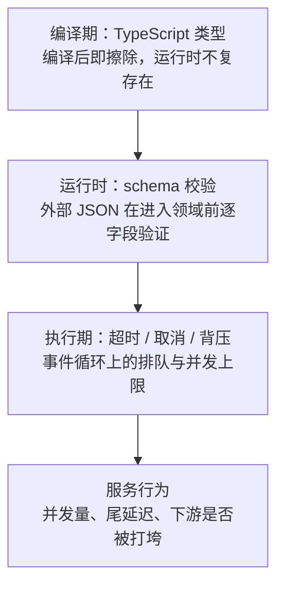
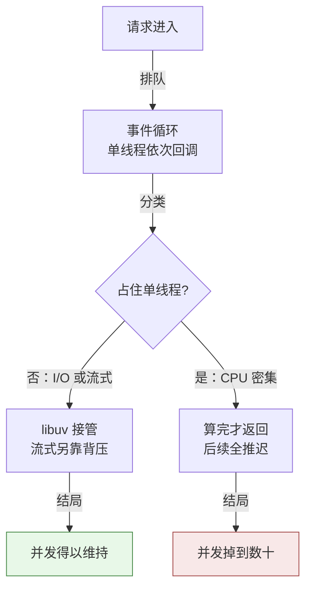
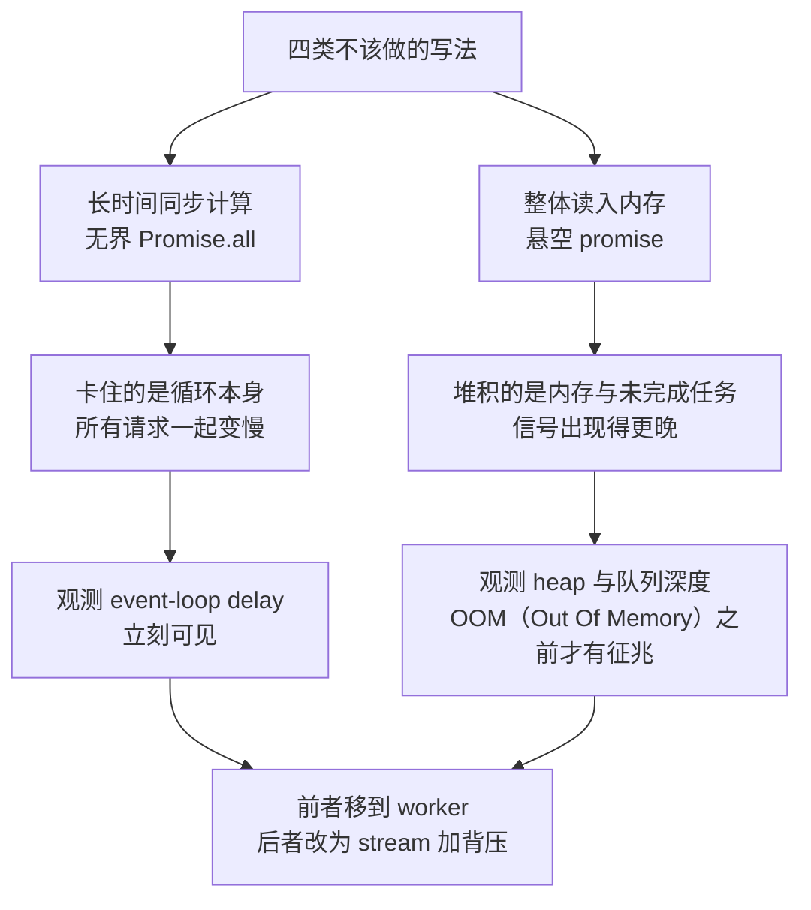

# TypeScript 类型边界与 Node 事件循环共同约束服务

TypeScript（在 JavaScript 上加了静态类型检查的语言，写代码时就能查出类型错误）提供静态检查和可维护的接口约定，Node.js（让 JavaScript 跑在服务器上的运行时环境）提供事件循环（单线程不断取任务并执行、用异步回调处理并发的运行机制）、异步 I/O 和服务端运行时；**两者都不能自动验证网络输入、数据库数据或外部工具结果**。工程边界应是：**类型约束内部程序，runtime schema（运行时格式规范，按字段描述外部数据该长什么样，逐项验证进来的数据）校验外部世界，超时/取消/背压约束执行。**

## 类型通过编译为什么还不够：要解决的问题

**三条边界各拦一段，谁也替不了谁**，各自的守位见下图：



箭头终止于“服务行为”而不是**第四道防线：类型与 schema 决定“数据对不对”**，超时/取消/背压决定“并发与延迟好不好”，**最后一格是被前三层共同决定的结果**。

图里四格对应正文四节：类型只在编译期（代码编译成可执行文件时发生的阶段）起作用、编译后即擦除，所以**外部进来的数据必须由 schema 逐字段验证**；验证过的数据进入执行期后，还要靠超时、取消与背压限制事件循环上的排队。

**编译期拦不住运行时收到的字节，运行时校验拦不住并发把下游打垮，所以三条都要有**。


编译通过的服务把外部返回的 JSON 直接标注为领域类型，字段缺失或被替换之后**错误出现在远离边界的位置**；一个 CPU 密集的同步调用让**并发能力从数万掉到数十**；无界并发向下游发起请求，**最先失效的是被依赖的一方**。本篇回答：**类型在运行时留下什么、网络与数据库输入在哪里校验、事件循环上的工作如何分类、取消与背压由谁提供、以及模块解析与依赖升级要核对哪些项**。

## 三条边界怎么分工：机制与本质

先把形状说成一件事：这套三层约束像机场的安检、检疫与塔台——安检（TypeScript 类型）在你出门前查证件（编译期检查，登机后不再查）；检疫（runtime schema）在国境入口对外来物品逐件开箱（外部数据进门前逐字段验证）；塔台（超时/取消/背压）管天上同时能飞几架、排队等多久（执行期并发上限与排队纪律）。**三层缺一不可：安检拦不住境外带来的东西，检疫管不了天上堵不堵**。这个比喻到"塔台"为止——现实里每层的具体工具（类型擦除、schema 库、事件循环调度）下面分节展开。

TypeScript 与 Node.js 共同约束服务的机制层：**类型只在编译期存在，编译之后被擦除，运行时收到的仍是未被验证的字节**；事件循环把 I/O 交给 libuv（Node 底层的 C 库，事件循环与线程池都由它实现）与线程池（预先建好一组线程反复取用、避免频繁创建销毁），回调在单线程上依次执行，**任何一处同步计算都会推迟其后所有请求**。**静态约束到不了外部世界，运行时事实又不受类型影响，两个边界分别由类型检查和 schema 校验负责**。


*图源：libuv 官方设计文档 Design overview，CC BY 4.0（libuv 文档许可，见仓库 LICENSE-docs），https://ant.readthedocs.io/en/latest/design.html。*

这张图是「I/O 交出去」那条分支的底层实物：事件循环是 libuv 的中心，网络、文件、DNS（Domain Name System，域名系统：把域名解析成 IP 地址） 各子系统都挂在它周围，线程池承接没有系统级异步接口的操作。正文说「I/O 交出去之后事件循环继续转」，交出去的去向就是图里这些子系统；理解了 handle（长生命周期对象）与 request（短生命周期操作）的分工，**监控里的活跃 handle 数到底在数什么也就清楚了**。**事件循环六个阶段依次转完再回到 timers，微任务（promise 回调）在每个阶段切换的间隙清空，优先于下一个阶段的回调——这也是 setTimeout 与 promise 的执行顺序经常出乎直觉的原因**。


*图源：Node.js 官方文档 The Node.js Event Loop，官方许可，https://nodejs.org/en/learn/asynchronous-work/event-loop-timers-and-nextticks。*

这张图给出事件循环本身的实物：正文说「回调在单线程上依次执行」，**依次的次序就是图里的六个阶段**——定时器到点进 timers，I/O 回调在 poll（无上限但每次要全量传的 IO 多路复用） 里被处理，setImmediate 进 check；**每个阶段切换的间隙清空微任务，所以排在循环里的工作也有先后**。**监控 event-loop delay（事件循环延迟，衡量回调排队等多久才被执行的指标）时，延迟就来自某个阶段里耗时过长的回调**。


## 编译完类型去哪了：从源码到运行时

```text
TypeScript source
  -> type checker / emit or transpiler
  -> ESM/CJS module resolution（ESM 是标准的模块格式，CJS 是 Node 早期的 require 格式）
  -> V8 + Node event loop/libuv
  -> network/filesystem/database/worker
```


*图源：TypeScript 官方 wiki（TypeScript Compiler Layers），Apache-2.0，https://github.com/microsoft/TypeScript/wiki/Architectural-Overview。*

- **类型会在运行时大多被擦除（type erasure：编译后类型信息被丢弃，运行时只剩普通对象），因此 `as User`（把对象断言成 User 类型的写法）不能把不可信 JSON 变成经过校验的 User**。
- **JavaScript（TypeScript 编译后运行的目标语言，网页与 Node 共用）的单线程执行语义不等于**进程只使用一个线程**；I/O、线程池和 worker 都可能参与**。
- **promise 表示未来结果，不自动提供取消、超时、并发上限或背压（消费方来不及处理时，反向挡住生产方的机制）**。
- **前端 React（用组件搭界面的前端框架）的组件状态/渲染模型与 Node 服务端运行时是不同主题；共享语言不代表共享生命周期**。

## 外部数据进门前该让谁查：类型与外部约定

1. **在 `strict` 下建模领域状态，使用判别联合（TypeScript 里靠一个共用字段区分几种成员的联合类型，适合表达有限状态）表达有限状态，而不是**大量可选字段**。
2. **`unknown` 用于尚未验证的输入；在 HTTP、队列、配置、MCP（Model Context Protocol，模型与外部工具之间交换调用与结果的一套协议）/工具结果边界做 schema 校验**。

3. **区分缺失、`undefined`、`null` 和空值；序列化（把内存对象转成可存储或传输的字节格式的过程）与数据库行为并不相同**。
4. **泛型表达输入输出关系，不用复杂条件类型隐藏业务流程**。

5. **类型生成必须绑定 OpenAPI（描述 HTTP 接口的标准规范）/JSON Schema/数据库版本，并在 CI（持续集成，代码合并前自动跑的检查流程）检测漂移**。



**两条分支里只有 CPU 密集那条通向坏结局，I/O 与流式最终都汇回维持并发那一格**。

两条分支的判据是“**这段工作会不会占住那个单线程**”。I/O 不会——它交出去之后事件循环继续转，回调排队返回，并发得以维持；其中大文件的流式处理另靠背压挡住生产速度，普通 I/O 只交接管。CPU 密集会——它一直占着，**本服务的后续工作全推迟，排队越积越多，请求越拖越久，等排队耗尽下游的耐心，被依赖方才会跟着遭殃**。下面表格把常见工作按这条判据分类，网络与数据库 I/O、大文件流式都归“交出去”的分支，CPU 密集归“占住”的分支。**把 CPU 密集任务包上 `async` 不会改变这一点，`async` 只影响写法，不影响这段计算占用线程的事实**。

## 事件循环堵住了会怎样：并发与背压

| 工作 | 推荐方式 | 不应做什么 |
| --- | --- | --- |
| 网络/数据库 I/O | async API + deadline + 并发限制 | 无界 `Promise.all` |
| CPU 密集计算 | worker thread、独立进程或专用服务 | 长时间阻塞 event loop |
| 大文件/响应 | stream + backpressure + pipeline | 整体读入内存再拼接 |
| 后台任务 | 队列 + worker + 持久状态 | HTTP 返回后依赖悬空 promise |
| 请求上下文 | 显式参数或 AsyncLocalStorage（Node 提供的异步上下文存储，请求内随处取到同一份上下文） | 全局可变变量跨请求共享 |

**监控 event-loop delay、队列深度、活跃 handle、heap 与 GC（垃圾回收，运行时自动回收不再被引用的内存）、下游等待和 p95/p99——把响应时间从小到大排，95% 与 99% 的请求都快于的门槛值，后者更贴近最差用户的体验**。**CPU 利用率不高也可能因单个同步热点（访问集中在少数键或节点上的现象）阻塞所有请求**。

表格里"不应做什么"那一列的四种写法，**失败形态其实分两类，各自的观测信号也不同**：



**两类都得改，但紧迫性不同：卡住循环的那类会立刻反映在所有请求的延迟上，容易被发现；堆积内存的那类在压力不高时看不出问题，等到 OOM（Out Of Memory，内存耗尽后被系统强制终止进程）才暴露，而此时已经难以定位是哪条路径堆起来的**。

## 依赖升级要核对哪几项：模块与发布

- **明确 ESM/CJS 目标——ESM 是 JavaScript 官方模块格式，CJS 是 Node 早期沿用至今的 CommonJS 格式——以及 package `exports`、构建输出与测试运行器；不要依赖偶然的 module resolution**。
- **lockfile（锁文件，记录安装时每个依赖的精确版本的文件）进入版本控制，CI 使用可复现安装；依赖升级核对 breaking changes、Node 支持范围、许可证和供应链风险**。
- **生产使用受支持的 LTS（Long-Term Support，长期支持版：厂商承诺多年维护的版本） 线，具体状态以 [Node.js release 页面](https://nodejs.org/en/about/previous-releases) 为准；不要长期固定在早期写法**。
- **截至 2026-08-31，Node.js 26 为 Current、Node.js 24（Krypton）和 22（Jod）为 LTS；生产优先使用 Active/Maintenance LTS（长期支持版），Maintenance 只收安全修复，Current 是最新尝鲜线——不把 Current 当长期稳定线**。[Node.js release status](https://nodejs.org/en/about/previous-releases)
- **TypeScript 6.0 于 2026-08-28 发布，是面向 TypeScript 7 原生编译器的过渡版本；包含 breaking changes 和弃用项，`ignoreDeprecations: "6.0"` 只能临时延缓迁移，TypeScript 7 将移除这些选项。升级需运行完整类型/构建/模块解析回归，并优先修复弃用警告**。[TypeScript 6.0 release notes](https://www.typescriptlang.org/docs/handbook/release-notes/typescript-6-0.html)
- **schema、消息和 API 迁移先兼容旧读写，灰度（新版本先放一小部分流量验证，逐步放大到全量）后删除旧路径；source map、版本和构建指纹要进入错误报告**。

## 服务挂了先查哪几处：可靠性

- **为 server、client、DNS、连接、请求体和下游调用分别设置合理超时；用 `AbortSignal` 传播取消**。
- **重试只针对临时错误，必须有幂等（同一操作执行多次与执行一次效果相同）键、退避、次数/总时长上限**——幂等指同一个操作执行一次和执行多次的结果相同，键是给一次操作带的唯一标识，重复提交时凭它识别出是同一次，**防的是重复副作用（操作对外部状态产生的额外影响）而不是**重复请求**。
- **进程监听终止信号后停止接流量、等待有界任务、关闭连接并由外部编排确认退出**。
- **错误按输入、业务、依赖、超时、资源、程序缺陷分类；不要把所有 rejection 转成 500 后丢失 cause**。
- **AsyncLocalStorage 可传播 request/trace（请求级追踪上下文）context，但仍需测试跨库、worker 和回调边界**。

## React 稳的是哪条边界

**React 页面长期要掌握的是组件纯度、state 所有权、单向数据流、effect 与外部系统同步、服务端/客户端边界和可访问性；具体脚手架和旧 class 教程不应作为知识主干**。**effect 不是普通数据派生工具，能在 render 中计算的值不要通过 effect 再写一份 state**。当前 API 以 [React 官方 Learn](https://react.dev/learn) 和 reference 为准。

## 测试门禁该怎么设

- **类型检查只证明静态约定，不替代 runtime schema、集成测试和权限测试**。
- **单测（针对最小可测单元的自动化测试）覆盖纯逻辑；接口约定测试覆盖 HTTP/消息/schema；集成测试覆盖真实数据库与生命周期**。
- **fake timers、mock 和 snapshot 都可能隐藏调度或语义变化；关键路径保留真实时钟/网络/stream 用例**。
- **性能测试同时记录 event-loop delay、heap、GC、下游延迟和正确性，不只看平均 QPS（每秒查询数：一秒钟处理了多少个请求）**。

## 哪些写法一看就错：反模式

- **用非空断言、`any` 或 `as` 消除编译错误，却没有运行时验证**。
- **fire-and-forget promise（发射后不管：启动了 Promise 却不接住它的结果和错误）没有 owner、取消、错误接收和持久状态**。
- **把 CPU 密集任务包装成 `async`，误以为不会阻塞**。
- **stream 忽略 backpressure、错误和关闭顺序**。
- **React effect 同步两个本可由单一状态推导的值，造成循环和陈旧状态**。


## 想自己验一遍怎么动手：验证

1. **类型擦除核验：在运行时向标注了领域类型的入口传入字段缺失或类型不符的载荷，预期错误出现在边界校验处；缺少校验时错误会出现在远离入口的位置**。
2. **调度延迟度量：在请求处理路径上插入一段同步计算，记录 event-loop delay 与延迟分位数（把耗时排序后取某个百分比位置的值、如 P99），预期其后所有请求一起被推迟，推迟幅度与计算耗时可对照**。

3. **流式背压：构造生产速度高于消费速度的 stream，预期写入方被背压阻塞、内存保持平稳，忽略 backpressure 的实现会出现缓冲持续增长**。
4. **生命周期核验：对 fire-and-forget promise 的路径检查 owner、取消、错误接收与持久状态；取消请求后预期相关工作停止而不是**继续执行**。

5. **断言锚点：边界处有 runtime schema 校验，event-loop delay 进入性能记录，stream 背压与取消行为经过对照测试**。

## 收益从哪来、付什么价：效果与代价

**用类型约束内部结构、用 schema 校验外部输入、用取消与背压约束执行，换来的是编译期就能拦下的一部分接口误用，以及边界处数据形状的显式确认**。**代价是运行时校验的额外开销与一套需要跟随上游版本维护的生成**流程。**类型检查省下的是评审与回归的人力，代价出现在每次边界变更都要同步 schema 与生成代码**。

## 接着读哪几篇：同在软件构建里的相邻问题

- [[工程知识/后端系统：在并发、失败与变化中维持服务/服务设计/HTTP请求穿过浏览器、网络与服务端边界]]、[[工程知识/后端系统：在并发、失败与变化中维持服务/任务与并发/任务生命周期必须覆盖进程、日志、超时与清理]]、[[工程知识/后端系统：在并发、失败与变化中维持服务/分布式可靠性/部分失败决定分布式系统的设计]]、[[工程知识/软件构建：让变化可以理解、验证与交付/测试与交付/测试策略从风险选择证据]]。
