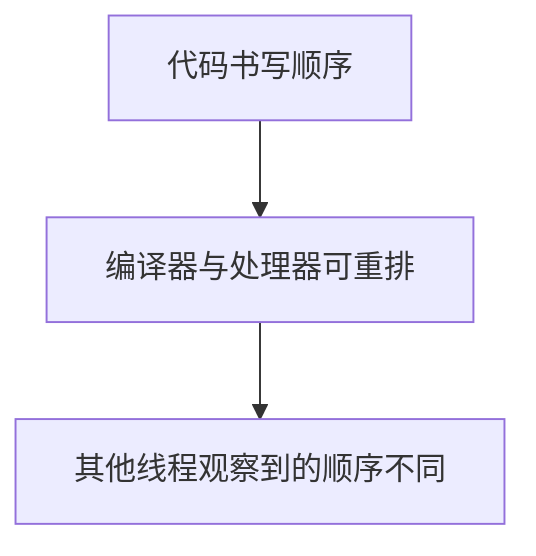
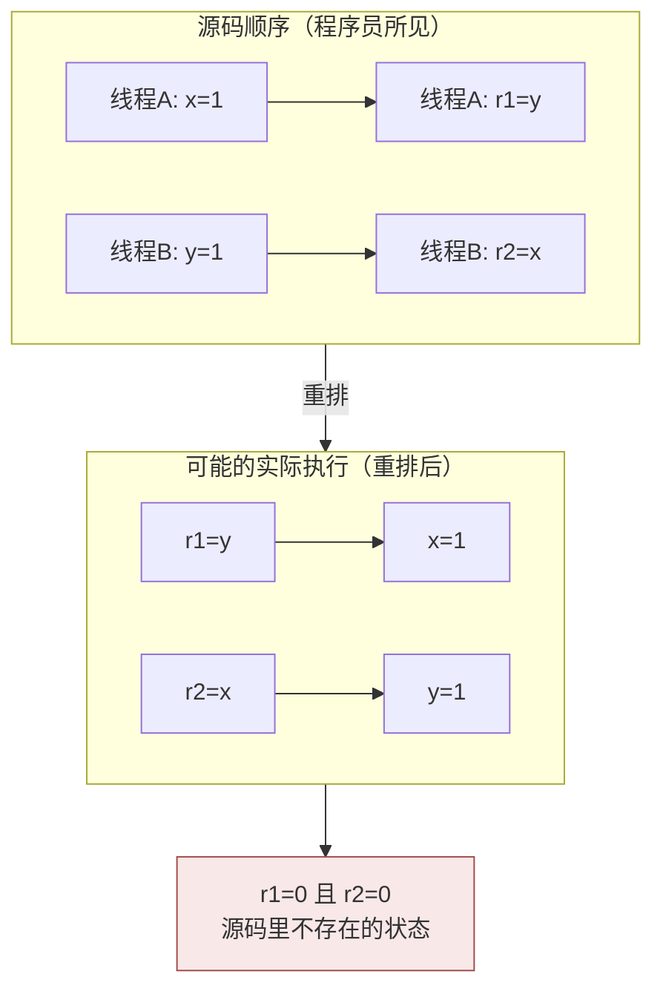

# 内存模型决定并发读写何时可见

## 要解决的问题是什么：代码顺序为什么不等于执行顺序



**可见性的根源是这条链：代码书写顺序先经过编译器与处理器两道重排（布局或尺寸变化触发重新计算排版），到其他线程眼里就成了另一个顺序**：


重排序可以实测复现。下面这张是两个线程读写共享变量时出现重排的实际程序输出——相同的代码跑很多次，其中若干次出现了源码里不存在的执行顺序。


*图示：重排序的实测复现（来源：preshing《Memory Reordering Caught in the Act》）。这张图只用于说明指令级现象，重排本身无法靠"看起来跑对了"排除。*

**写下的代码是一串顺序语句，实际执行是另一回事。编译器为了填满流水线会调换无依赖的指令，CPU（中央处理器）为了不空等会把写操作先放进 store buffer（存储缓冲区，CPU 与缓存之间的临时写入队列）**。**这些重排在单线程里不可见——因为语言保证"好像按序执行"，但这份保证只对单线程成立**。**两个线程互相观察对方时，各自的重排列组合起来，就出现了源码里根本不存在的执行顺序**。

**内存模型就是语言给出的那张清单：哪些重排被允许、哪些同步操作能重新建立顺序**。**没有它，"这个程序会不会出错"没有答案，因为同一个程序在 x86 和 ARM（一种精简指令集的处理器架构，广泛用于手机与嵌入式设备） 上跑出的是不同的结果集合**。



**单次测试读到"正确值"不能证明并发程序正确：未同步的读写可能在另一架构、优化级别或时序下重排，多个原子字段也可能共同违反业务不变量**。**先写线性化点（操作在外部观察者看来瞬间生效的那个时间点）和可见性要求，再选择同步原语**。

**最小并发实验：让一个线程发布多字段状态，另一个线程在不同同步策略下读取；在高并发、随机调度和弱内存架构上检查是否观察到半更新、旧值和 ABA（值经 A→B→A 变化后，被 CAS——Compare-And-Swap，比较并交换——误判为未变）**。**再用 race detector（如 ThreadSanitizer）与业务断言交叉验证**。

## 先记住哪几句

| 维度 | 回答 |
| --- | --- |
| 要解决的问题 | 多线程读写可能因重排、缓存可见性、非原子更新和错误同步产生未定义或业务错误，即使单次测试看似通过。 |
| 本质 | 语言内存模型规定哪些读写有定义，以及锁、原子变量、channel 等同步如何建立 happens-before 关系。 |
| 做法 | 为共享状态写出不变量和线性化点，选择合适同步原语，缩小共享范围，并让取消、资源释放和跨进程/网络边界显式化。 |
| 效果与代价 | 行为在允许的执行重排下仍可推理；代价是同步开销、争用、复杂度，以及不同架构和运行时的验证成本。 |
| 边界 | 原子性不自动保护多字段不变量；语言锁不能跨越数据库事务、进程隔离或网络消息的可见性边界。 |
| 验证 | 使用 race detector、并发压力、随机调度、弱内存架构和故障注入，检查正确性、饥饿、ABA、取消与释放。 |

**多线程程序不仅面临"两个线程同时写"的数据竞争（多个执行流同时读写同一数据且无同步，结果随时间顺序变化），还面临编译器/CPU 重排、缓存可见性、原子性和同步顺序**。**语言内存模型定义哪些读写组合有定义、哪些同步建立 happens-before（先行发生，保证前一个操作的结果对后一个可见）；锁、原子变量、channel 和消息传递是建立关系的工具**。


来源：[腾讯云开发者社区《30 张图揭开「内存管理」的迷雾，瞬间豁然开朗》](https://cloud.tencent.cn/developer/article/2671629)（CC 4.0 BY-SA）


来源：[小林coding《进程、线程基础知识》](https://www.xiaolincoding.com/os/4_process/process_base.html)


## 常见误区

- **volatile（禁止编译器缓存、强制每次读写都走内存的关键字）/atomic 可能提供可见性或单次原子性，不自动保护多个字段组成的不变量**。
- **无数据竞争不等于业务顺序正确；检查与使用之间仍可能被插入**。
- **只在 x86 测过不等于在弱内存序架构、编译优化或不同运行时成立**。
- **数据库事务、进程隔离和网络消息有自己的可见性边界，不能用语言锁跨越**。

**第四条值得单独说明。语言锁建立的 happens-before 只在同一个进程内的同一份内存上有效。跨出进程之后，可见性由共享状态所用的机制规定：经由数据库共享时由事务隔离级别（并发事务互相可见程度的分级）规定，经由消息传递时由投递与消费语义规定**。**三种边界各有一套规则，都不是内存模型，把它们当成一回事是分布式系统里常见且隐蔽的一类错**。

## 动手跑一遍会看到什么：重排可见的两行代码

经典的 Dekker 模式，两线程互写后互读对方的标志位，时序见下图：

```java
// 线程 A                    // 线程 B
x = 1;                       y = 1;
r1 = y;                      r2 = x;

// 直觉：r1 与 r2 至少一个为 1（先写后读）
// 实测：x86 上偶发 r1=0 且 r2=0——StoreLoad 重排
//      （两个写都被缓冲，两个读都先于对方写完成）
// 修法：Java 标 volatile，Go 用 sync/atomic 建立 happens-before 边，或插入内存屏障
```

**复现要点：x86 允许 StoreLoad 重排，但重排只发生在 store buffer 排空前的极窄窗口，所以偶发；ARM 的重排窗口更深更宽，频率高几个数量级**。**开发机不是弱内存序（规定多核读写操作可见与先后顺序的规则）的采样器：x86 开发机上跑一亿次可能只出现几次，同样的代码在 ARM 上可能每一千次就有一次，压力测试要跨架构跑**。Go 的 race detector、Java 的 jcstress（Java Concurrency Stress，并发压力测试框架）是这类问题的标准工具。

**频率差异解释了这类缺陷为什么很容易溜到线上——在 x86 上难以复现，缺陷是否上线还取决于测试有没有覆盖弱内存序架构**。

## 真实案例里发生了什么：取消与所有权的衔接

**内存模型的可见性纪律在并发设计主线里接两篇**：[[工程知识/软件构建：让变化可以理解、验证与交付/语言与运行时/Go并发以所有权、取消与错误传播为边界]] 的所有权模型把共享写压缩到 channel 一点（happens-before 由 channel 语义保证），是回避手写屏障的结构化手段；**[[工程知识/缺陷分析：从个案到体系/并发/案例三十二：取到了已经不存在的那个——估算器的读取竞态]] 是可见性缺陷的实录——读到旧值不报错、不崩溃，答案只是悄悄变错，这类静默错值最可靠的拦截手段是内存模型层面的审查，跨架构压测可作补充**。

**"回避"这个词是有分量的。手写屏障写出来不难，难在写对之后没人能验证它对——你要证明的是在所有允许的重排下都不出问题，而枚举重排组合恰恰是人的弱项。channel 这类结构化原语把 happens-before 交给运行时语义保证，把需要验证的命题从"枚举所有重排"降成了"用对了原语"**。

## 怎么自己动手验证

**可见性结论要与竞态（多个执行流争抢资源、结果取决于时序）检测对账——预写为共享状态写出的不变量在压力与随机调度下应保持，竞态检测报出冲突，与预期对不上**。

**用 race detector、并发压力、随机调度、弱内存架构/模拟和故障注入（主动向系统注入故障来验证容错能力的测试方法）验证；为共享状态写出不变量和线性化点**。**性能优化减少锁或使用无锁结构后，同时检查正确性、饥饿（参与者长期抢不到资源、一直被推迟）、ABA、取消和资源释放**。

关系：[[工程知识/后端系统：在并发、失败与变化中维持服务/任务与并发/并发控制先定义共享状态和完成条件]] · [[工程知识/性能工程：从用户等待到资源瓶颈/处理器与内存/CPU缓存与分支决定有效执行时间]]

- [[工程知识/软件构建：让变化可以理解、验证与交付/语言与运行时/CPU微架构与流水线：分支预测乱序执行对程序员的可见影响.md]] —— 重排在语言层的约定化
