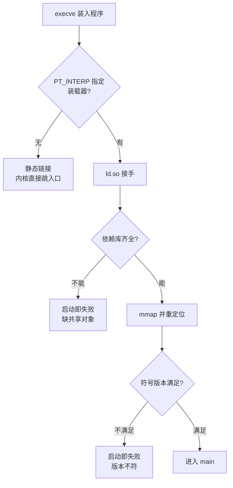

# 动态链接把符号绑定推迟到装载与首次调用

## 要解决的问题是什么：换一台机器二进制就不跑了

动态链接把符号解析推迟到运行时，**环境与版本差异因此集中在启动与首次调用时刻炸出来**。同一份二进制在自己机器上正常运行，复制到另一台机器：**库文件不在对方的搜索路径上时报 `cannot open shared object file: No such file or directory`；文件都在、但记录的符号版本标签对方 glibc 没有时报 `version 'GLIBC_2.34' not found`**。

部署脚本没有出错，缺的文件也补上了，**换来的还是同一句报错——说明缺的另有所指：级联依赖或版本标签**，判别方法见下一节。本篇回答：**装载器按什么顺序找库、符号绑定发生在哪一刻、启动报错与首次调用报错分别意味着什么、以及升级系统或更换发行版之前要核对哪些兼容性内容**。

动态链接的做法是：**可执行文件只记依赖账与符号账，运行时由装载器按顺序找库、解析符号并回填地址**。它的收益是**磁盘与内存里的库只存一份、升级库不必重编所有程序**，代价是**启动时多一段装载与重定位工作、运行时多一些间接寻址开销**，以及**环境差异带来的排障成本**——搜索顺序与报错解读在「常见误区」节展开，延迟绑定的开销在「量化锚点」节展开。它的边界是**只解决「把符号的解析推迟到运行时」这一件事**，**不保证依赖库的存在、版本和 ABI**（应用程序二进制接口：编译产物之间互相调用的二进制约定）**兼容**。

## 先记住哪几句

| 维度 | 回答 |
| --- | --- |
| 要解决的问题 | 多个程序共享一份库、库升级不必重编程序，代价是符号绑定推迟到运行时，环境和版本差异会在这里炸出来。 |
| 本质 | 装载器（ld.so）在程序启动时把依赖库 mmap（内存映射：把文件按页映射到进程地址空间，不立即读入内存）进内存，把符号解析与地址修补（重定位）推迟到装载时或首次调用时完成。 |
| 做法（机制） | ELF 的 PT_INTERP（指向装载器的程序头表项）与依赖表 → GOT（Global Offset Table，动态链接的全局偏移表）/PLT（Procedure Linkage Table，动态链接的过程链接表） 的间接跳转结构 → ld.so 的库搜索顺序。 |
| 做法（排查） | 符号版本核对、LD_PRELOAD/LD_DEBUG 的诊断作用面。 |
| 效果与代价 | 磁盘与内存省一份库，升级库不用重编；代价是启动多一段装载重定位、调用多一层间接寻址、环境差异排障复杂。 |
| 边界 | 动态链接不保证依赖存在与版本兼容；符号介入会改变解析结果；静态链接与动态链接的取舍不取决于偏好，取决于部署形态。 |
| 验证 | ldd/readelf（查看 ELF 文件的工具） -d 看依赖，LD_DEBUG=libs 看搜索全过程，nm（列出符号表的命令） -D 对照符号，LD_DEBUG=bindings 看绑定时刻，strace（跟踪进程系统调用的命令行工具） 对账实际打开的文件。 |

机制链条分四步。第一步，**ELF 头里的 PT_INTERP指定装载器**，内核 execve（exec 系列系统调用，用新程序替换当前进程映像）时**先把 ld.so 装进地址空间**。

第二步，**ld.so 读 DT_NEEDED 依赖表逐个找库**，搜索顺序为 **DT_RPATH → LD_LIBRARY_PATH → DT_RUNPATH → /etc/ld.so.cache → 默认目录**，其中 RPATH（可执行文件里写死的库搜索路径）与 RUNPATH 的区别见「常见误区」节。**第三步，对每个库做重定位，先修数据符号等非延迟项，函数槽位默认留给首次调用回填**。**第四步，首次调用经由 PLT 跳转，那一刻解析符号并回填 GOT**。

ELF 文件同时给两类读者发牌：链接器看 Section header table（节视图），装载器看 Program header table（段视图），同一份数据两种切法：


*图源：Wikimedia Commons，作者 Surueña，CC BY-SA 3.0，https://commons.wikimedia.org/wiki/File:Elf-layout--en.svg。图注：文件起始处的 ELF header 定义入口与两张表的偏移；program header table（段表，装载器视角）与 section header table（节表，链接器视角）是对同一文件的两个视图，.text 是指令、.rodata 是只读数据、.data 是可写数据。*



流程图没有复述搜索顺序与延迟绑定细节，正文已逐段展开；这里补的是文字之外的另一个视角：启动时刻有哪几类失败出口，各自的报错对应哪一步。

## 它是怎么做到的，本质是什么

可执行文件不再把库函数的机器码复制进自己，只在 ELF（Executable and Linkable Format，Linux 上可执行文件与共享库的标准格式）的动态段里**记两张账：一张是「我需要哪些库」（DT_NEEDED 表），一张是「我要用哪些符号、放进哪个槽位」（重定位表）**。运行时的主角是 ld.so（动态链接装载器，程序启动时由内核安排先于主程序运行），它做四件事。

第一，**接手进程的起始阶段**。**内核 execve 读到 PT_INTERP 段，就知道这个程序要用动态链接，先把 interp 指向的 ld.so 装进新地址空间，把控制权交给它**。第二，找库。**ld.so 读取 DT_NEEDED 里列出的库名，沿搜索路径逐层查找，每找到一个就 mmap 到地址空间**（这一步**不把整个文件读进内存，只有程序访问到的页才按需调入**）。第三，重定位。**每个库内部有绝对地址要修补（数据与函数指针），装载器扫描重定位表，把解析出的真实地址写进对应的内存位置**，其中**装进 GOT的条目供代码经由位置固定的表项间接访问**。第四，符号绑定。**调用一个外部函数时，编译产物生成的指令不直接跳目标地址（那个地址装载前无人知晓），而是先跳到 PLT的第一条指令，再经 GOT 里对应的槽位跳到真实函数**。

延迟绑定（Lazy Binding，把符号解析推迟到首次调用那一刻的策略，经由 PLT 解析桩实现）：**默认情况下 GOT 里外部函数的槽位初始并不指向真实函数，而是指回 PLT 自己的解析桩**，**第一次调用发生时才由 `_dl_runtime_resolve` 按符号名全局查找、把真实地址回填 GOT**，**之后的调用与普通间接跳转无异**。**这样做的动机是装载时间：一个大程序依赖上百个库、上万条外部符号，如果启动时全部解析，大量从未被调用的符号也要付一遍查找成本**。**代价是一次性的首调用开销与运行期 GOT 可写的攻击面**，`LD_BIND_NOW=1` 或链接时的 `-z now` 可以关掉延迟，**装载时一次性全部解析**；**部分发行版工具链默认就启用 `-z now`**，此时 **GOT 在装载后已是终值**，做后文两次读 GOT 的对照前先用 `readelf -d ./demo | grep NOW` **确认当前二进制的默认值**。

**符号解析有确定的优先顺序，这解释了 LD_PRELOAD 为什么能介入**：**装载器按「可执行文件自身 → PRELOAD 的库 → 依赖库按被依赖关系排出的装载顺序（拓扑序）」的层次查找符号名，先找到者胜**——**同名符号在装载顺序中先到者覆盖后到者，使 preload 库能替换标准库函数，这个规则就是全局符号介入**。**同名符号在后装载的库里不会再被选中**，因此**用一个自带 `malloc` 的 preload 库就能替换全进程的内存分配器做性能剖析**——**这也是它能诊断问题也能改变行为、必须在受控环境使用的原因**。

符号版本（Symbol Versioning）：glibc（GNU C Library，Linux 最常用的 C 标准库实现）为同名符号挂上 `GLIBC_2.x` 版本标签，**可执行文件在编译时记录「我需要的 memcpy 是 GLIBC_2.14 版」，运行时 ld.so 发现目标 glibc 没有这个版本标签就拒绝启动**。这正是 `version 'GLIBC_2.34' not found` 报错的来源：**文件找到了，但版本账对不上，这个明确的失败优于带着旧语义静默运行**。

## 常见误区

**报错读一半就下结论**。`cannot open shared object file` 有两种完全不同的原因：**库文件确实不在搜索路径上（安装缺失）**，或者**依赖它的另一个库自己没被找到（级联缺失）**。`ldd` 会把整条依赖链逐层标出来，**`not found` 出现在哪一层，那一层才是要补的**。另一类对仗的报错是 `undefined symbol`：**程序和库都找到了，装载或首次调用时按名字找不到符号**，常见原因是 C++ 的名称修饰（name mangling：编译器把命名空间、参数类型等信息编进符号名）产生了不匹配的符名、**库版本太旧没有这个接口**、或**混淆工具改变了符号名**。**两类报错的修复路径不同，一类补文件，一类对版本与符号表**。

**以为复制文件过去就算部署**。**库在文件系统里存在不代表能被找到，搜索顺序是 RPATH → LD_LIBRARY_PATH → RUNPATH → ld.so 缓存 → 默认目录**（RPATH/RUNPATH 是链接时写进 ELF 的内置搜索路径，RUNPATH 只作用于直接依赖、不传递给间接依赖），**一条路径上的同名库会遮蔽后面的**。`LD_LIBRARY_PATH` 指向的开发目录里有旧版本库时，**程序用的是这份旧库而不是系统里的新版，行为随环境漂移却查无实据**。诊断命令是 `LD_DEBUG=libs ./program`，**它会打印每一次搜索、每一个候选路径与最终选中的文件，整条决策链看得见**。

**把部署形态问题当成链接偏好问题**。静态链接把库代码编进可执行文件，**启动不再依赖环境里的库版本，代价是体积变大、库的安全更新要重编每个程序**。选哪种取决于**交付目标跑在哪里：单一容器内、依赖自己控制的环境**，**动态链接的共享与升级优势成立**；**要拷到任意机器、目标环境 glibc 版本未知**，**静态链接（或自带运行时）才消除那一类环境失败**。**两条路线都能在生产上运行，判定依据是部署形态**，细节在「接着读哪几篇」的依赖分层文章展开。

## 动手跑一遍会看到什么：GOT 在首次调用后被改写

**GOT 槽位在首次调用前后的地址变化，是延迟绑定最直接的可观测证据**。环境：任意 Linux 发行版，gcc 与 binutils（二进制工具集，含 readelf/objdump（查看目标文件与反汇编的工具）/nm）。

先用最小例子看装载与搜索：

```bash
printf 'int my_func(void){return 42;}' > libdemo.c
printf '#include <stdio.h>\nint main(){extern int my_func(void);\n  printf("%%d\\n", my_func());\n  return 0;}' > demo.c
gcc -shared -fPIC libdemo.c -o libdemo.so
gcc demo.c -L. -ldemo -o demo
./demo        # 报 cannot open shared object file
LD_LIBRARY_PATH=. ./demo   # 输出 42
LD_DEBUG=libs LD_LIBRARY_PATH=. ./demo 2>&1 | head -30  # 打印完整搜索链
```

再看延迟绑定的两次地址：`objdump -d demo` 里**对 `my_func` 的调用跳进 PLT 桩**；在 `main` 断点处用 gdb（GNU 调试器，可停在任意代码位置查看内存）**两次读 GOT 槽位：首调用前指向解析桩，首调用后已是 `my_func` 的真实地址——这就是「绑定推迟到首次调用」的可观测证据**。换成 `gcc -Wl,-z,now` 重新链接，**装载完成后 GOT 已经是终值，这就是关掉延迟绑定后的形态**。

排查环境问题时的对账命令：`ldd ./demo` **列出装载时实际解析到的整条依赖链，结果会受当前环境影响**；`readelf -d ./demo | grep NEEDED` **看编译时写进 ELF 的依赖名单，是二进制自带的原始账**；`nm -D libdemo.so` **看库到底导出了哪些符号**；`readelf -V ./demo` **查主程序自身携带的符号版本要求**（libdemo 不调用库函数，版本账要查 demo），**预测 glibc 版本不匹配会不会炸**。

## 量化锚点：一次绑定的开销与启动的代价

以下量级是**经验估计，不是测量结论**，用法是**先按这个量级规划，动手前用命令核对**：**一条 PLT 间接跳转在流水线预测良好时是纳秒量级的额外开销，与一次函数调用本身同一数量级**；**延迟绑定的解析过程要查哈希表、比对符号名，单次在微秒以下，且每个符号一生只发生一次**。**装载阶段的成本与库数量线性相关：依赖几十个库的服务进程，冷启动**（缓存或服务刚启动、还没有数据与连接的状态）**里 ld.so 的装载与重定位合计在毫秒量级**，容器环境下叠加 page cache（页缓存：内核把读过的文件页留在内存里加速再次访问）未热会更明显。

核对入口是 `LD_DEBUG=statistics ./program`，**它打印装载耗时与重定位次数的统计，用真实数字替换上面的估计**。这些数字的作用是判断「要不要优化」：**调用密集的热路径里，绑定开销通常低于测量噪声，真正的启动延迟大头在库的数量与 I/O，不在单次解析**。

## 怎么自己动手验证

以下四个实验分别验证搜索顺序、绑定时机、符号介入和版本账对账，每个实验都有可对账的命令输出。

- **启动失败复现**：把 `LD_LIBRARY_PATH` 指向空目录跑上面例子，用 `LD_DEBUG=libs` **观察搜索链在哪一层失败**，再用 `strace`（系统调用跟踪工具，记录进程实际发起的每次调用）以 `strace -e openat ./demo` **对账「实际打开了哪些文件」，与 LD_DEBUG 的叙述互相印证**。
- **延迟绑定开关对照**：同一段调用代码分别用默认与 `-z now` 链接，`LD_DEBUG=statistics` **输出里的重定位统计会给出两种模式的差异**，`LD_DEBUG=bindings ./demo` **会逐条打印绑定发生时刻**，gdb **两次读 GOT 槽位验证回填时刻**。
- **符号介入实验**：写一个同名 `my_func` 的 preload 库，`LD_PRELOAD=./liboverride.so LD_LIBRARY_PATH=. ./demo` **观察输出变成 preload 版本，验证「先到者胜」的解析顺序**。
- **版本账对账**：`readelf -V` **查出二进制要求的最低 GLIBC 版本，与目标机器 `ldd --version` 输出对照，在部署前就能预测 `version not found` 会不会发生**。

## 边界

动态链接解决的是**符号绑定时机与共享**，**不承担版本协商与 ABI 保障**——**glibc 用符号版本把不兼容拦在启动时刻，musl（另一个轻量 C 库实现）没有这套机制，跨 C 库混链（一部分目标对 musl、一部分对 glibc）会在装载或运行时炸出符号层面的失败**。**GOT/PLT 的描述以 Linux/glibc 为主线**；**macOS 的 dyld 与 Windows 的 DLL 加载在结构上同源**（间接表 + 解析桩），但 **Windows 默认装载时一次性解析 IAT**（Import Address Table，导入地址表，角色对应 ELF 的 GOT），**延迟绑定需显式声明 delay-load**，**细节与工具链不同，本文命令不适用于那两个平台**。

## 接着读哪几篇

- [[工程知识/软件构建：让变化可以理解、验证与交付/架构与代码/编译器与JIT把源码变成可执行行为]] —— 本文承接它流程链里「链接和加载」那一步：编译产物定型之后、执行之前发生的事
- [[工程知识/软件构建：让变化可以理解、验证与交付/架构与代码/AST提供语法结构，语义仍需符号与运行证据]] —— 符号解析在静态侧（编译期查引用）与本文的运行时侧（ld.so 按名绑定）是同一问题的两个阶段
- [[工程知识/性能工程：从用户等待到资源瓶颈/操作系统与运行时/进程线程与系统调用构成执行边界]] —— execve 之后内核怎么搭起新进程，本文从这里接手讲装载器做的事
- [[工程知识/软件构建：让变化可以理解、验证与交付/开发工具/依赖升级按风险分层：验证阶梯、节奏策略与 CVE 响应]] —— 库的 ABI 与符号版本账，正是依赖升级风险评估里「环境破坏」一档的判定输入
