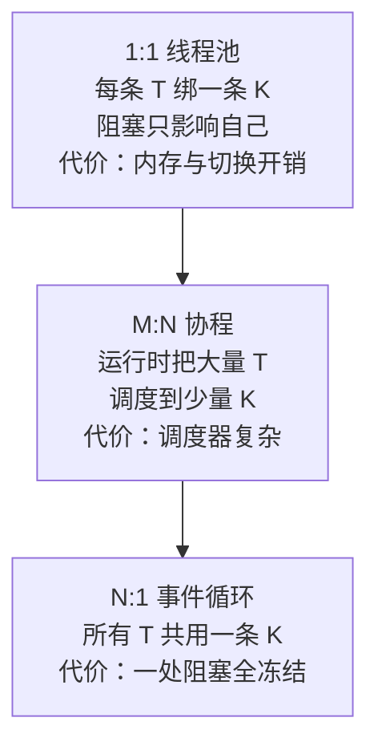
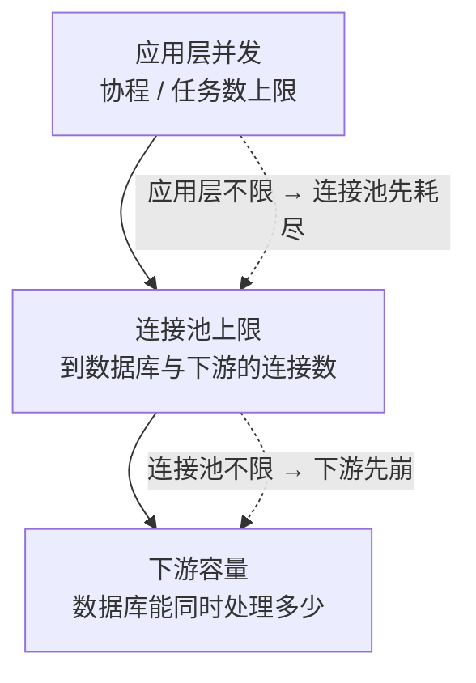
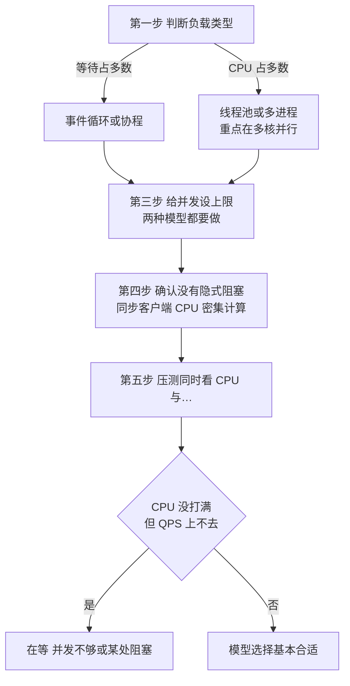

# 跨语言并发模型必须同时比较抽象与运行机制

## 要解决的问题

把机器从 4 核加到 40 核，I/O 密集服务的吞吐只上涨了不足四倍，线程数增加带来的内存与调度开销开始侵蚀收益；把同样逻辑迁到另一种语言之后表现完全不同，原因是抽象的写法相似而运行时的调度方式并不相同。本篇回答：阻塞线程、事件循环（反复取出队列里的回调执行的调度机制）、用户态（普通程序运行的低权限受限状态）协程（用户态调度的轻量执行单元）三种模型各把等待成本记在哪里、同一个抽象词在不同运行时对应什么实现、并发上限为什么必须显式设置、以及压测中 CPU 未打满而吞吐上不去说明什么。

## 这件事发生在什么场景：加了 10 倍机器，QPS 只涨了 1.5 倍

好比收银台从 4 个加到 40 个，排队长队没消——因为每个收银员扫完一件商品就停下手，等仓库确认价格（下游 200ms 等待）才收下一件：柜台再多，卡住的都是等确认的时间。一个 API 服务，每个请求由一个线程处理，线程里会调用下游（平均 200ms）。压测发现：4 核机器只能跑 50 QPS（每秒查询数，系统每秒处理的请求量）。（每秒查询数）比喻到「等确认卡住收银员」为止，账怎么算见下文。

算一下就知道为什么：单请求总耗时约 200ms 且几乎全在等待，单线程理论吞吐约 5 QPS；4 核并行约 20 QPS。线程大部分时间在**等网络回包**，却占着线程不放。

堆机器到 40 核，QPS 涨到 200 左右（10 倍核数换来的约 10 倍吞吐）——但线程数也从 100 涨到 1000，光线程栈就吃掉 1GB 内存，上下文切换（CPU 从一个任务换到另一个任务、保存并恢复现场的过程）开销开始吃掉 CPU。

问题不在机器，在**并发模型：用"阻塞线程"去等 I/O，是拿最贵的资源（内存+调度）去干最便宜的活（等待）。**


来源：[美团技术团队《Java线程池实现原理及其在美团业务中的实践》](https://tech.meituan.com/2020/04/02/java-pooling-pratice-in-meituan.html)（CC 4.0 BY-SA）


来源：[小林coding《进程、线程基础知识》](https://www.xiaolincoding.com/os/4_process/process_base.html)


## 方案是什么：三种模型，三种取舍

先把形状说成一件事：三种并发模型像一家餐厅的三种用工方式——线程池（预先建好一组线程反复取用、避免频繁创建销毁）是给每桌配一名专职服务员（响应快但服务员一多工牌柜就爆了，内存）；事件循环是一名领班端着托盘在所有桌之间周转（一个传菜口，端上出菜快的没问题，碰到一桌要现做的慢菜就把口堵住——这就是阻塞调用，整层都等他）；协程是服务员可以「放下这桌去那桌、回头再来」，对应 M:N 调度，切换成本比换人低得多，但忘了回来谁也替不了他。比喻到「替不了他」为止，现实里三种模型的切换成本与阻塞代价下面逐个展开。

先保留跨语言都成立的抽象，再查清每种运行时的实现。线程、协程、任务、锁和取消这些词在不同语言里看起来相似，调度成本、共享内存、错误传播和阻塞边界却不同：Go 的 goroutine 由运行时做 M:N 调度，Python `asyncio` task 在 `await` 处协作切换，Rust future 必须被 executor poll（无上限但每次要全量传的 IO 多路复用），Java 虚拟线程仍要注意 pinning 和底层阻塞。

| 抽象问题 | Go | Python | Rust/Java 等其他运行时 |
| --- | --- | --- | --- |
| 谁调度 | Go runtime | event loop、OS 线程或进程 | executor、OS 或虚拟线程调度器 |
| 什么会阻塞整体 | 无界 goroutine、下游资源 | event loop 中同步 I/O/CPU | blocking task、pinning、锁竞争 |
| 如何取消 | `context.Context` 协作传播 | `CancelledError`/TaskGroup | token、future drop 或 interruption 语义 |
| 如何证明安全 | race detector + 生命周期 | 结构化并发 + 资源清理 | 类型/所有权、race/并发测试 |
三种模型的差别可以归结为一件事：等待的这 200ms 里，那个执行上下文还在不在。线程池占着不放，事件循环显式交回，协程由运行时接管——等待成本因此分别记在内存、代码结构与运行时调度上。

把这条差别画成执行单元到操作系统线程的映射，三种模型的位置就分开了（`T` 是用户态执行单元，`K` 是操作系统线程）：



*图示：三种线程映射模型的调度结构。1:1 每条用户线程独占一条内核线程，阻塞只影响自己，代价是内存与切换开销；M:N 由运行时把大量用户态执行单元调度到少量内核线程上；N:1 全部执行单元共用一条内核线程，一处同步阻塞会冻结其余。图源：golang.design《Go 程序员面试笔试宝典——调度问题与 GMP 模型》中文版，https://www.golang.design/under-the-hood/zh-cn/part3concurrency/ch09sched/model ；模型对照另参 CSDN《M:N 轻量线程模型发展史》，https://blog.csdn.net/2401_87660168/article/details/165629065 。*

1:1 的边界最清楚：一条用户线程阻塞，其余照常跑，代价是每条线程都要一份线程栈。N:1 反过来，切换最便宜，但一条线程上的同步阻塞会让其余全部停下。M:N 想同时拿到两者，代价是调度器、I/O、垃圾回收与锁都要配合实现。

### 每请求一线程好在哪、贵在哪（线程 / 进程池）

```text
请求 → 分配线程 → 阻塞等待 I/O → 线程被挂起 → I/O 完成 → 唤醒 → 返回
```

- **代表**：Java Servlet（传统）、Python `ThreadingMixIn`、PHP-FPM
- **优点**：代码是顺序的，最好写；异常调用栈完整；CPU 密集任务天然并行
- **缺点**：并发数受线程数限制；线程内存开销大（默认线程栈 1MB）；上下文切换成本
- **适用**：CPU 密集、并发量不高（<1000）、或下游调用极快的场景

### 单线程事件循环怎么用一个 cooks 端一百桌（事件循环）

好比一个服务员同时照看一百桌：接单后把菜单交给后厨（注册回调），自己立刻去下一桌，菜好了传菜铃一响再回来端（I/O 完成触发回调）——一个人看一百桌，靠的是不站在灶台前干等。这个比喻到「不等端菜」为止：回调地狱、单个慢任务卡全场这些代价，下文展开。

```text
请求 → 注册回调 → 事件循环继续处理别的 → I/O 完成触发回调 → 继续
```

- **代表**：Node.js、Python asyncio、Rust tokio（单线程模式）
- **优点**：并发连接数可以很高（几万）；内存开销小；没有锁竞争（多个执行流争抢同一把锁造成的等待开销）
- **缺点**：**回调地狱 / async 传染**（一个 async 函数只能被 async 调用）；一个 CPU 密集任务会卡住整个循环；调试时调用栈断裂
- **适用**：I/O 密集、高并发、单请求逻辑简单

### 协程的 M:N 调度是怎么回事

```text
请求 → 轻量协程 → 遇 I/O 自动让出 → 运行时调度到别的协程 → 完成后恢复
```

- **代表**：Go goroutine、Rust tokio 多线程、Kotlin 协程、Java 虚拟线程（Loom）
- **优点**：**写起来像同步代码，跑起来像异步**；协程栈极小（Go 初始 2KB）；可跨多核
- **缺点**：仍需理解"协程里不能阻塞"；需要运行时支持；调试工具链相对复杂
- **适用**：绝大多数后端服务的默认选择

协程与普通子程序的区别就在"让出"这一步：子程序被调用后只能一路跑完再返回，调用者全程等着；协程可以在中途主动让出，把执行权交给别的协程，之后再从让出点继续：


*图源：Wikimedia Commons，作者 Kbalaji1993，CC BY-SA 4.0，https://commons.wikimedia.org/wiki/File:Coroutines.png。左侧主函数控制子程序的顺序，调用关系是单向的；右侧协程之间可以互相移交执行权，"遇 I/O 自动让出"能成立正是因为执行权可以在协程之间来回传递。*

### 两者的差别在哪儿

| 模型 | 并发上限 | 内存/连接 | 代码复杂度 | CPU 密集 |
| --- | --- | --- | --- | --- |
| 线程池 | ~千级 | 1MB+ | 低 | 好 |
| 事件循环 | ~十万级 | 几 KB | 高（async 传染） | 差（会阻塞） |
| 协程 | ~百万级 | 2-8KB | 中 | 好（可跨核） |

## 效果从哪儿来，要付什么代价

**选对模型的收益是数量级的**：同样的 4 核机器，把"每请求一线程"换成协程，I/O 密集服务的 QPS 常能提升 **5-20 倍**——因为等待不再占用线程。

**代价**

- **认知负担**：事件循环模型下，任何同步阻塞调用（比如用错了同步的文件 I/O）都会悄悄拖垮整个服务，而且压测时不一定暴露
- **可观测性（通过系统对外输出判断内部状态的能力）变差**：异步调用栈断裂后，一次请求的调用链要靠 trace id 串起来，不能只看调用栈
- **调试难度**：并发 bug（数据竞争、死锁）复现困难，需要 race detector 这类工具

并发上限要在三层分别设，缺任何一层都会把压力推给下一层：



三层上限里，上层开得再大也会被下层的实际能力卡住，超出下层的部分不会变成吞吐，只会变成排队和超时，所以调上限要按对端容量 → 连接池（预先建好连接反复取用、省去反复握手建连的开销） → 协程数反推：先量数据库能同时处理多少，再定连接池大小，最后才是协程或任务数。只放开最上面那一层不会提升吞吐，只会把崩溃点挪到连接池或下游。

## 从什么地方做

选型前先量清楚计算与等待各占多少，答案决定选哪种并发模型，不问就动手必然走弯路。

**第一步：先判断负载类型**

问一句：**这个服务处理一个请求时，CPU 时间和等待时间各占多少？**比喻到「分诊定科室」为止，五步的先后依赖见下文。

五步不是并列清单，前一步的结论会决定后一步该看什么：



第二步（优先用语言原生模型）没有画进这条链，因为它不产生分支——它是每一步之上的固定约束：Go 用 goroutine、Node 用 async、Java 21+ 用虚拟线程，逆着语言来会让后面四步都变形。最后那道判断是回头检查的手段：CPU 没打满而 QPS 上不去，是选错模型最典型的信号。

- 等待占 >80% → I/O 密集 → 事件循环或协程
- CPU 占 >80% → CPU 密集 → 线程池/多进程，重点是多核并行而不是并发数

**第二步：优先选语言原生支持的模型**

不要逆着语言来。Go 就用 goroutine，Node 就用 async，Java 21+ 就用虚拟线程。硬在 Go 里写回调式代码、或在 Node 里用 worker 池扛 I/O，都是自找麻烦。

**第三步：给并发设上限**

无论哪种模型，**对下游的并发必须限流（控制单位时间放进来的请求数量，超过配额就拒绝）**。协程很便宜，于是很容易不小心对数据库发起 10 万并发——数据库会先崩。用信号量（带计数的同步原语、控制同时访问的数量）或连接池限制：

```go
sem := make(chan struct{}, 100) // 最多 100 并发
```

**第四步：确认没有隐式阻塞**

在协程模型里检查：有没有用同步的 HTTP 客户端？有没有在协程里做 CPU 密集计算？（后者会占满 P，导致其他协程长时间得不到调度）

**第五步：压测时同时看 CPU 和等待**

如果 CPU 没打满但 QPS 上不去，说明在等——要么并发数不够，要么某处阻塞了。这是选错模型最典型的信号。

## 常见错误

**错误 1：把线程池调大来解决 I/O 瓶颈**

线程数从 100 加到 2000，QPS 略涨但延迟和内存飙升。**加线程不能消除等待，只是让更多请求同时在等。**

**错误 2：在协程里用阻塞 I/O**

Go 里用了 `database/sql` 却配了 `SetMaxOpenConns(1)`，所有协程排队等一个连接——并发模型是协程，实际退化成串行。

**错误 3：忽略背压**

上游来 10 万 QPS，下游只能处理 1 万。没有背压（下游处理不过来时把压力传回上游减速）机制时，请求会在内存里堆积直到 OOM（Out Of Memory，内存耗尽被系统终止）。（内存耗尽，进程申请不到需要的内存）**必须有队列上限 + 快速失败。**

**错误 4：共享状态不用锁**

协程模型下数据竞争（多个执行流同时读写同一数据且无同步，结果随时间顺序变化）更容易发生，因为并发量大了几个数量级。开 race detector 跑测试是标配。

并发模型决定的是单机内的执行语义，跨网络之后还要叠加超时与重试的语义，见 [[工程知识/后端系统：在并发、失败与变化中维持服务/分布式可靠性/超时、重试与幂等共同定义调用语义]]。

相关（运行时对照）：[[工程知识/软件构建：让变化可以理解、验证与交付/语言与运行时/TypeScript类型边界与Node事件循环共同约束服务]] —— 单线程事件循环下的并发边界

## 怎么自己动手验证

1. 对照压测：把同一份请求处理逻辑分别用两种运行时的实现承载，逐级增加并发并记录 CPU 使用率与吞吐，预期在「CPU 未打满而吞吐不再上涨」时能定位到等待结构而不是核数。
2. 等待结构核验：核对连接池上限、协程数与下游并发上限之间的乘积关系，把连接池上限设为 1，预期协程实现退化为串行，与观测到的吞吐变化一致。
3. 背压核验：把上游流量提到下游处理能力的数倍，预期队列触顶后快速失败且内存保持平稳，而不是请求在内存中堆积至进程终止。
4. 数据竞争：在开启 race detector 的条件下跑并发测试，预期报告出共享状态的未同步访问。
5. 断言锚点：并发上限显式设置且与下游容量对应，等待结构可被测量区分，压测结论能回到具体的运行时机制。

