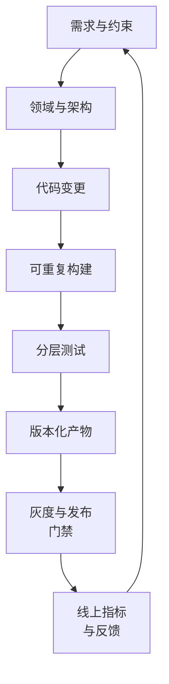
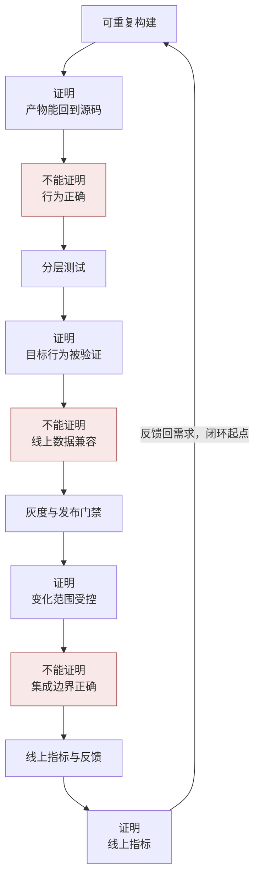
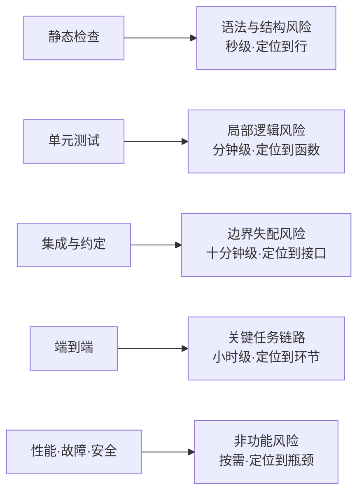

# 软件构建：让变化可以理解、验证与交付

## 软件构建到底要让什么变得可控

来源：[JavaGuide](https://javaguide.cn/high-availability/timeout-and-retry.html)（CC 4.0 BY-SA）

打个比方：盖一栋楼，图纸通过评审、材料进场、工人开工之后，楼能不能住人要靠一层层的验收说话——隐蔽工程验过才浇混凝土，消防验过才交付。软件的「意图到生产事实」也是这样一条验收链。

**需求在评审里通过、代码合并、产物上线之后，没有人能说清这次变更的正确性由哪一层证据保证**：单元测试通过不能说明集成边界正确，集成测试通过不能说明线上数据兼容，能构建出产物也不能说明产物能回到源码。**软件构建要解决的问题是：从意图到生产事实的链路分成哪几层不能省略的边界、每层边界由谁负责、哪种证据只能证明前置步骤、构建产物怎样取得完整身份、以及发布如何作为受控实验收束剩余风险**。这个比喻只说明「每步验收管一步」，各层证据具体证明什么，以下文为准。

**软件工程的交付对象可以被理解、构建、验证、发布和恢复的行为变化，而不是**代码文本**。架构划分高成本边界，语言和运行时承载执行，构建系统把输入变成产物，测试与观测提供证据，发布系统控制变化范围**。

## 一次意图怎么变成生产事实



## 哪六个边界难以省略

"意图变成生产事实"的每个环节在流水线上有实物原型。下图是 1913 年福特 Highland Park 工厂的装配线：底盘沿传送带前进，每个工位只装固定的几样零件，装完的部位当下有人检验，不合格的件下线返工，不把问题留给总装末端——**变化（车型改进）以零件批次为单位进入流水线，验证布置在装配动作旁边，交付（整车下线）是全部环节都通过之后的自然结果**。**软件构建把这条链上的每个角色换成了工具与门禁，链条的形状没有变**。


> 图：福特装配线（1913 年修复版照片），来自 [Wikimedia Commons](https://commons.wikimedia.org/wiki/File:Ford_assembly_line_-_1913_(restored).jpg)，公有领域。

| 边界 | 关键问题 |
| --- | --- |
| 需求 | 成功条件、反例、风险和不可改变约束是什么？ |
| 模块 | 状态由谁拥有，依赖方向是否清晰，失败如何传播？ |
| 运行时 | 并发单位、取消、资源释放和错误传播由谁负责？ |
| 构建 | 源码、工具链、依赖、配置和缓存是否足以重现产物？ |
| 验证 | 哪种证据能证明目标行为，哪些只证明前置步骤？ |
| 发布 | 如何灰度、观察、停止、回滚并处理数据兼容？ |



**每个白色框是这一层能证明的东西，紧随其后的红色框是它证明不了的东西，红框之后才是下一层——链条这样串起来，是因为后一层存在的理由就是前一层留下的那句"不能证明"**。**末端例外：线上指标之后没有更后的层来收束，它靠把结果反馈回需求侧形成闭环**，对应本文开头的循环图。


六个边界与前面循环图的对应关系：需求对应入口，模块与运行时落在"领域与架构"到"代码变更"之间，构建、验证、发布分别是循环图上的三个节点。表里的边界是判据，图上的节点是流程，两者视角不同。

## 为什么代码结构不等于架构

目录、类和函数是看得见的结构，**架构还包括图上看不见的部分：数据所有权、运行拓扑、故障模型和演进顺序**。AST（抽象语法树，把代码按语法结构拆成的树）能帮助定位语法对象，符号索引能连接定义与引用，**trace/coverage 才能证明某次运行经过目标路径**。这个比喻只到「图上没有的不等于不存在」为止，架构证据具体怎么取，参见 [[工程知识/软件构建：让变化可以理解、验证与交付/架构与代码/AST提供语法结构，语义仍需符号与运行证据]]。

## 构建产物为什么需要完整身份

一个可信产物至少能按下面这条身份链回到源头：

```text
source revision + dirty state + toolchain + dependency lock
+ build configuration + generated inputs + build command
```

Make、Gradle、Maven（Java 的构建与依赖管理工具）、Cargo、Go、npm（Node 的包管理器）各自描述依赖并执行构建流程的一部分；**容器镜像也只是封装运行环境，不保证构建过程可重现**。**缓存键遗漏环境、编译选项或生成输入时，缓存会命中一份来源不明的旧产物，摘要与预期对不上却查不出原因**。这里的 dirty state 指工作副本相对源码版本存在未提交的改动。

**Google 内部的构建系统 Rapid 把这条身份链做成了显式依赖：构建任务只从源码库取输入、把测试与打包做成独立服务、产出的构建产物统一交给部署服务——产物从哪来、经过什么验证、能否追溯，全部是系统边界上的显式接口**。下图是 SRE（Site Reliability Engineering，站点可靠性工程：用软件方法运营大规模服务的工程实践）书第 8 章给出的 Rapid 架构：


*图源：Google SRE Book 第 8 章「Release Engineering」，https://sre.google/sre-book/release-engineering/。*

## 测试怎么按风险挑

**按成本与覆盖挑层级：静态检查快但不证明运行行为；单元测试保护局部逻辑；集成和接口约定测试验证边界；端到端测试验证关键任务；性能、故障和安全测试覆盖非功能风险**。

**选哪一层的依据是这层能挡住哪类风险、多久给回反馈、失败后能不能定位，不看金字塔比例**



图上五层从「秒级·定位到行」的静态检查走到「按需·定位到瓶颈」的非功能测试，**越往右挡住的风险越接近真实故障，反馈却越慢、定位越粗，所以没有哪一层能被另一层替代——测试层级风险、反馈速度和诊断能力三者的组合，而不是**按金字塔形比例分配的数量配额**。

**AI（人工智能辅助，这里指自动化生成或判定类工具）可以帮助识别项目、生成用例和分析失败，但执行框架必须保存真实命令、版本、退出码、日志和产物**。参见 [[工程知识/软件构建：让变化可以理解、验证与交付/测试与交付/发布门禁必须绑定真实证据]]。

## 基础链路要补齐什么

**软件质量还依赖算法、静态分析、API/schema 演进、依赖供应链、运行时内存模型和 CI（Continuous Integration，持续集成：代码合并后自动构建与测试）/CD（持续集成与持续交付，自动构建测试并发布的那套流程）**。它们分别决定复杂度、可见结构、兼容范围、构建输入、并发正确性和反馈速度。

这些链路在云原生生态里各有对应的开源实现：CNCF（Cloud Native Computing Foundation，托管 Kubernetes 等项目的基金会）全景图把上千个项目按「应用定义与镜像构建、持续集成与交付、数据库、流与消息、调度编排」等类别排成矩阵，**每个格子都是一个可接入的成熟件——为本篇提到的每个环节补齐基础设施时，先在这张地图上按类别找现成实现，再评估是否需要自行开发**：


*图源：[CNCF Cloud Native Landscape](https://landscape.cncf.io/)（页面截图，2026-09-27）。本篇的六条链路都能在这张图上找到对应的类别与成熟项目；选型标准仍是本篇的证据链——产物可回溯、行为可验证，而不是格子里的名字够响。*

- 算法与数据结构：[[工程知识/软件构建：让变化可以理解、验证与交付/算法与数据结构/算法复杂度连接规模与资源成本]]
- API 与迁移：[[工程知识/软件构建：让变化可以理解、验证与交付/架构与代码/API与Schema演进必须兼容新旧消费者]]
- 静态分析：[[工程知识/软件构建：让变化可以理解、验证与交付/架构与代码/静态分析发现结构问题但不能证明行为正确]]
- 编译与执行：[[工程知识/软件构建：让变化可以理解、验证与交付/架构与代码/编译器与JIT把源码变成可执行行为]]
- 依赖供应链：[[工程知识/软件构建：让变化可以理解、验证与交付/开发工具/依赖供应链需要锁定来源与构建输入]]
- 代码与环境调查：[[工程知识/软件构建：让变化可以理解、验证与交付/开发工具/Git操作先区分工作区、索引与历史]]、[[工程知识/软件构建：让变化可以理解、验证与交付/开发工具/Linux调查先收集事实再改变状态]]
- 持续交付：[[工程知识/软件构建：让变化可以理解、验证与交付/测试与交付/CI流水线把反馈速度和发布证据连接起来]]
- 发布控制：[[工程知识/软件构建：让变化可以理解、验证与交付/测试与交付/配置与特性开关分离部署与发布]]
- 故障验证：[[工程知识/软件构建：让变化可以理解、验证与交付/测试与交付/调试从假设到最小复现]]、[[工程知识/软件构建：让变化可以理解、验证与交付/测试与交付/混沌工程验证系统是否真的能处理故障]]
- 运行时并发：[[工程知识/软件构建：让变化可以理解、验证与交付/语言与运行时/内存模型决定并发读写何时可见]]、[[工程知识/软件构建：让变化可以理解、验证与交付/语言与运行时/跨语言并发模型必须同时比较抽象与运行机制]]
- 数据访问边界：[[工程知识/软件构建：让变化可以理解、验证与交付/语言与运行时/Python数据访问必须显式拥有连接与事务]]
- 横切关注点：[[工程知识/软件构建：让变化可以理解、验证与交付/架构与代码/装饰器与中间件把横切关注点串成链]]

## 为什么发布要当成受控实验

**新药上市不走「直接全员开卖」：先一期小规模试，有不良反应立即停，指标合格再放大人数——发布是同一个流程**。**部署成功只表示新产物进入环境，不表示行为正确**。**发布应按稳定主体分桶，比较新旧版本的任务成功、错误、延迟、资源与业务护栏；达到阈值自动停止**。**数据库和协议变更使用 expand/migrate/contract，确保发布和回滚（把系统状态退回到改动之前的版本）期间新旧代码可同时工作**。比喻到「小规模试、达标放量」为止：临床试验的双盲设计与发布的分桶口径差别很大，具体做法以下文与发布类文章为准。

## 接着该读哪几篇

- 架构决策：[[工程知识/软件构建：让变化可以理解、验证与交付/架构与代码/架构组织高成本决策与演进边界]]
- 代码结构：[[工程知识/软件构建：让变化可以理解、验证与交付/架构与代码/AST提供语法结构，语义仍需符号与运行证据]]
- 语言运行时：[[工程知识/软件构建：让变化可以理解、验证与交付/语言与运行时/Python并发先区分协程、线程、进程与解释器]]
- 构建工具：[[工程知识/软件构建：让变化可以理解、验证与交付/开发工具/Make描述依赖图，不自动保证可重复构建]]
- 验证策略：[[工程知识/软件构建：让变化可以理解、验证与交付/测试与交付/测试策略从风险选择证据]]
- 发布证据：[[工程知识/软件构建：让变化可以理解、验证与交付/测试与交付/发布门禁必须绑定真实证据]]

## 怎么自己动手验证

1. **产物身份：在干净检出目录重新构建，把产物摘要与源码 revision、依赖锁定文件、工具链版本三者对照，预期任何一项改变都会导致摘要变化，任何一项都能从产物反向查到**。
2. **证据分层：取一次真实变更，逐层追问构建、单元测试、集成测试、发布四类证据各自排除了哪类风险；对回答不了的层，说明该层证据当前实际证明了什么**。

3. **发布受控实验：把新旧版本按稳定主体分桶，比较任务成功、错误、延迟、资源与业务护栏指标，预期达到阈值**时发布自动停止**。
4. **兼容性演练：对一次包含 schema 变更的发布走完 expand/migrate/contract 并在中途回滚，预期新旧代码在发布与回滚期间可以同时工作**。
5. **断言锚点：产物可回到源码与依赖，每层边界都有对应的证据类型，发布阈值**触发过停止**，回滚路径被演练过**。

## 效果从哪儿来，要付什么代价

**按这套结构组织交付过程，换来的是每一层边界都有对应的证据类型：构建产物可以回到源码与依赖，测试结果能说明覆盖了哪类风险，发布过程能在出现异常时收束影响范围**。**代价是构建与验证链条本身需要维护**，**缓存键、工具链版本、证据留存与发布阈值的任何一处遗漏都会让上层的结论失效**。

