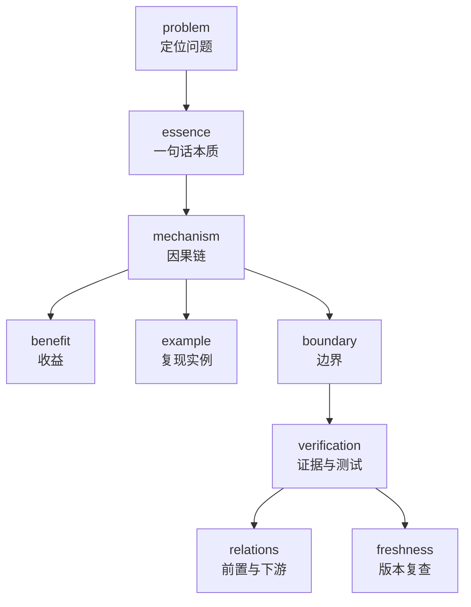

# 一篇知识怎么写

知识库的最小单位不是"资料摘要"，而是**一个能帮人做出判断、完成操作、并迁移到新场景的知识对象**。读完你能按九个问题写出一篇合格的知识条目，并判断哪些内容不该收进知识库。

所以每个页面都要讲清同样四件事：**它为了解决什么问题出现、怎么解决的、效果如何、代价在哪。**
"是什么"只是入口，它不能代替"为什么、什么时候、怎么验证"。

判断标准很简单：**把产品名和流行术语删掉后，如果只剩口号，那还没抽出来可复用的机制。**

## 一页必须回答哪九个问题

```yaml
problem:     它解决什么真实问题？不解决会付出什么代价？
essence:     一句话说本质，去掉产品名仍成立
mechanism:   输入、状态、转换、输出、反馈如何形成因果链
benefit:     改善哪个指标或决策？收益来自哪一段机制？
example:     一个最小、可复现、能看到结果的例子
boundary:    前提、失败模式、反例、不该用的场景
verification: 来源、实验、日志或测试如何证明主张
relations:   前置概念、替代方案、下游影响
freshness:   版本、发布日期、变化速度、下次复核日期
```

九个问题构成一页知识的九个槽位，彼此的关系是：problem 定锚，essence 与 mechanism 撑起主体，benefit 与 example 给证据，boundary 与 verification 守住可信度，relations 与 freshness 让页面接进网络并保持新鲜：



九槽齐全的页面在站点上是什么样子，拿本站渲染页当实物：标题区给出 problem 定位与复核日期（freshness），正文按机制、边界、验证逐段排布，文末相关区把前置与下游链出去（relations）——结构本身就是九个槽的展开：


*图源：本站文章渲染页（2026-09-27 页面截图）。九槽不是模板套路，是「读者从这里进来能不能带走机制」的检查清单——写完对照数一遍，缺哪槽补哪槽。*

### 你点名的五段怎么落到正文里

这五段是**叙事顺序**，不是必须逐字出现的标题 —— 用连续段落写清楚也算数。

| 段 | 要写什么 | 常见毛病 |
|---|---|---|
| **背景** | 这个技术是为了解决什么问题出现的 | 只写"XX 很重要"，不说它为什么存在 |
| **方案** | 它怎么解决那个问题，机制是什么 | 只抄 API 或命令，不讲为什么能解决问题 |
| **效果** | 实际改变了哪个指标，变了多少 | 没有数字，或数字没有测试条件 |
| **优缺点** | 代价是什么，什么情况下不该用 | 只讲好处，不提限制 |

**"效果"最难写对。** 说"快了 2 倍"没有意义 —— 得说清跑在多大数据、什么版本、
什么硬件上，别人才知道能不能套用。

## 怎么判断知识对象、再选定结构

不同知识对象的读者要建立的不是同一种心智模型：机制要的是因果链，决策要的是取舍理由，清单要的是逐项可查。套同一个模板会把所有页面压成同一种形状，该展开的地方被结构挤掉。**不要所有页面套同一个模板。** 先看读者在理解哪一种对象，再决定留哪些结构：

| 知识对象 | 主线 | 必须补足 | 常见失败写法 |
|---|---|---|---|
| 原理与概念 | 问题 → 本质 → 因果 | 反例、前提、与相邻概念的区别 | 用同义词重复定义 |
| 算法与协议 | 输入 → 步骤 → 不变量 → 输出 | 复杂度、故障分支、最小样例 | 只抄流程，不说为什么对 |
| 系统与架构 | 约束 → 组件 → 数据/控制流 → 状态 | 一致性边界、容量、降级（压力过大时关闭次要功能，保住主流程）恢复 | 只有框图，没有失败路径 |
| 工具与产品 | 问题 → 能力 → 机制 → 适用边界 | 版本、依赖、替代方案、真实体验 | 把 README 功能列表当知识 |
| 选型与决策 | 目标 → 约束 → 备选 → 取舍 | 决策矩阵、退出条件 | 脱离负载做排行榜 |
| 演进与前沿 | 旧瓶颈 → 新机制 → 收益 → 新代价 | 稳定内核、已过时部分、复查日期 | 按年份堆名词，把"新"当"好" |
| 排障与复盘 | 现象 → 假设 → 观测 → 根因 → 修复 | 最小复现、反证、影响范围 | 把最终命令记成流水账 |

## 哪三种证据不能混写

这是整篇最硬的约束。**把三类证据混在一起，页面就不可信了。**

| 证据层 | 是什么 | **不能推出什么** |
|---|---|---|
| **来源证据** | 官方文档、论文、源码、发布记录 | 不能推出你本地一定能跑 |
| **执行证据** | 命令、版本、退出码、日志、产物 | 不能推出所有场景都适用 |
| **学习证据** | 解释、预测、操作、迁移中的表现 | 不能替代产品事实或安全审计 |

模型可以提出解释、生成练习、归纳错因，**但不能把自己的文字当作来源或执行证据**。

写的时候自问：这句话的证据是哪一层？如果我说"这样更快"但没有执行证据，
就必须标注这是来源主张，而不是实测结果。

## 可信来源怎么筛

| 级别 | 类型 | 用法 |
|---|---|---|
| **P0** | 官方文档、RFC、标准、changelog | 直接引用版本与限制 |
| **P1** | 原始论文、官方 benchmark、维护者博客 | 引用方法与设计决策 |
| **P2** | 工程师文章、会议演讲、高质量教程 | 仅作线索，须回溯 P0/P1 |
| **P3** | 社交媒体、二手总结、营销材料 | 仅用于发现，不引用 |

**关键规则**：P2/P3 永远不能直接成为结论。它们的价值是"提示有个东西值得查"。

来源失效（deprecated、breaking change、链接 404）时，**追加"已被 X 取代"并说明差异**，
`status` 改为 `deprecated`，**不要删旧结论** —— 半年后你会想知道为什么改过。

详细的调研与更新流程见 [[知识库管理/方法/知识从哪来怎么更新]]。

## 时效内容为什么必须写出演进因果

"最新"不是多堆产品名，而是能解释**技术为什么从上一代走到现在**。至少区分四层：

- **稳定内核** —— 跨版本仍成立的目标与原理。RAG（Retrieval-Augmented Generation，检索增强生成：先检索资料再让模型基于资料回答） 的稳定内核是"用外部证据改变生成上下文"，不是某个向量库的接口。
- **被暴露的瓶颈** —— 旧方案在什么规模、数据、权限、延迟约束下失效。**没有瓶颈就解释不了演进方向。**
- **当前机制** —— 新方案改变了哪段信息流或反馈回路，因此改善什么、又引入什么成本。
- **待验证方向** —— 论文结果、预览能力、厂商声明必须单列，标来源日期与复现状态。

时间线只说清了先后顺序，说不清后一阶段是在补前一阶段的哪个具体缺口；不知道补的是什么，就无法判断自己这个场景该不该上。所以"传统 RAG → 混合召回 → 重排（布局或尺寸变化触发重新计算排版） → 查询规划 → Agentic RAG"不能只画成时间线。
要逐步回答：**上一阶段漏掉了什么信息，新机制在哪里介入，质量/延迟/成本怎样重新权衡。**

## 三层阅读深度怎么安排

一页成熟的知识应该允许按时间预算进入，而不是要求从头读到尾：

1. **30 秒** —— 标题和开头直接说清问题、本质、何时值得继续读
2. **5 分钟** —— 机制、收益来源、主要取舍，给一个能观察到结果的例子
3. **深入使用** —— 异常路径、验证方法、决策条件、一手来源、相邻主题链接

**摘要不能与正文割裂。** 第一层给可检验的结论，第二层展开因果，第三层让人能操作或反驳。
后面的内容是在**证明**前面的结论，不是另起一个资料堆。

## Frontmatter 该写哪些字段

```yaml
title: 一句话说清知识对象
type: concept | playbook | reference | decision | architecture
status: active | deprecated
updated: 2026-09-17          # 改动就更新
review_after: 2027-03-17     # 按 change_rate 反推
change_rate: stable | medium | fast
confidence: high | medium | low   # 冲突证据出现时降级
tags: [domain/subdomain]
sources:
  - "https://..."            # P0/P1 优先
  - ""
```

**`review_after` 由 `change_rate` 决定**：`fast` 一个月（AI 能力、工具链、定价），
`medium` 三个月（框架用法、工程实践），`stable` 六个月（协议、算法、原理）。

**`confidence` 不是自我评价**，而是"有没有相反证据"。发现冲突就降级，别硬撑。

## 动笔前为什么要先搜

**动笔前必须搜。** 否则同一概念散成多页，之后互相矛盾。

```bash
rg -n "目标术语|同义词|失败现象" vault/工程知识
rg -n "\[\[.*目标术语" vault
```

按观察结果只选一种处理：

| 观察 | 动作 |
|---|---|
| 问题、机制、决策结果都相同 | **合并**进 canonical 页，旧页删掉 |
| 同一对象，一个是总览、一个回答子问题 | 保留并互链，开头各自说清职责 |
| 名词相同，但约束/失败模型不同 | **分开**，标题直接体现差异 |
| 只是工具或项目的新名字 | 放进来源/动态页，不为产品名新建分类 |

单篇写完落在全库的哪个位置，站点知识全景页是现成的对照物：每一格是知识层次与知识类型的交叉点，写新页之前先看它该落的格子是满是空——空格（红框）就是缺口审计的输入，篇数与字数则提示这一格已有积累的深浅：


*图源：本站知识全景页（2026-09-27 页面截图）。「写之前先搜」在全库尺度上的形态就是先看格子再动笔：同一格已有 30 篇机制原理时，第 31 篇要么合并、要么换格子。*

## 发布前要硬查哪几项

- [ ] 删掉产品名后仍有可复用的机制
- [ ] 四段齐全：背景、方案、效果、优缺点
- [ ] 效果有数字，且**数字带测试条件与版本**
- [ ] 三类证据没混写，未验证的主张明确标注
- [ ] 关键主张能回溯到 P0/P1 来源
- [ ] 有至少一个可运行的最小例子
- [ ] 写了失败模式与不适用场景
- [ ] `review_after` 与 `change_rate` 匹配
- [ ] 至少一条真实入链和出链
- [ ] frontmatter 完整，`updated` 是今天

## 哪些写法一看就坏

| 毛病 | 为什么坏 | 改成 |
|---|---|---|
| 堆砌命令 | 读者不知道为什么要做 | 说清每个步骤解决什么 |
| 过度抽象 | 没有可操作的抓手 | 至少给一个具体场景 |
| 假设背景 | 读者卡在前置概念 | 链接前置页或简短解释 |
| 时间性表述 | "最新""目前"会过期 | 用具体版本号和日期 |
| 情感化表述 | "强大""优雅"不可验证 | 用指标和对比替代 |
| 只讲成功 | 无法判断边界 | 补失败模式与前提 |

## 相关

- [[知识库管理/方法/知识完善度怎么判断——四象限与九个信号]] —— 写完后怎么判完善度
- [[知识库管理/方法/知识缺口怎么补——图谱关系槽与补强工作流]] —— 有缺口时怎么补

- [[知识库管理/方法/知识从哪来怎么更新]] —— 调研、验证与更新流程
- [[知识库管理/归档/知识点写作与教学输出规范]] —— 原始完整版（含教学输出与学习路径）
- [[知识库管理/归档/知识质量标准]] —— 合格与不合格判定
- [[知识库管理/知识库管理]] —— 结构与硬规则
