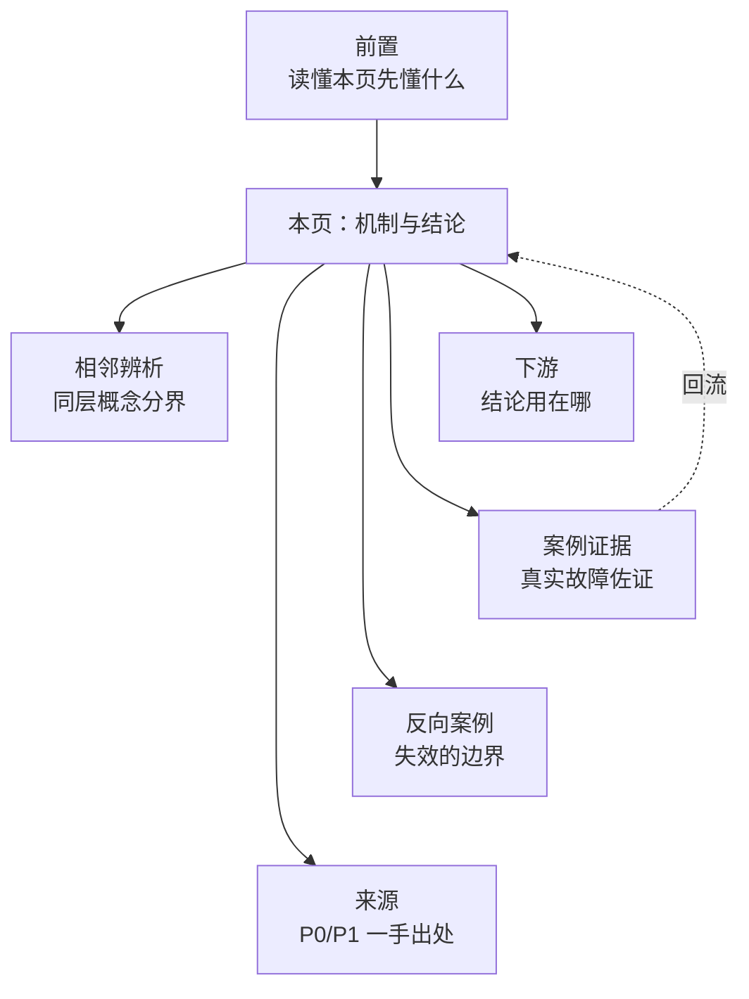

# 知识缺口怎么补——图谱关系槽与补强工作流

[[知识库管理/方法/知识完善度怎么判断——四象限与九个信号]] 解决"哪篇不完善"。这一页解决"补的时候具体改什么、按什么顺序改"。读完你能按关系槽找出一篇缺什么，并按顺序补齐。

先给结论：**绝大多数缺口不用重写文章，只需补上三种连接。** 全库 154 篇概念页里 153 篇没有任何缺陷案例回流，但案例库里躺着 40 个真实故障。这不等于 153 篇文章都要重写——它们缺的多半是连接，不是内容。

## 一页该接而没接的口子有哪几类

补一张页，先看清它有哪些"口子"该接而没接。这些口子是可枚举的，按类型叫关系槽。

| 关系槽 | 指向 | 缺了会怎样 |
| --- | --- | --- |
| **前置** | 读懂本页需要先懂的页 | 读者卡在术语上 |
| **相邻辨析** | 容易混淆的同层概念 | 概念边界糊，读者选错方案 |
| **下游** | 用到本页结论的场景页 | 结论悬空，看不出有什么用 |
| **案例证据** | 证明本页机制的真实故障 | 主张无支撑，不可反驳 |
| **反向案例** | 本页机制失效的故障 | 只有适用面，看不到边界 |
| **来源** | P0/P1 一手来源 | 无法回溯，无法判断时效 |

六种槽在一篇文章上的位置，一张图看清——每个槽都是文章对外的接口，缺一个就少一条读者能走进来或走出去的路：



这些槽位接起来之后长什么样，站点图谱视图是现成的实物——六个领域的主题圆盘被引用连线织成一张网，缺口审计要找的就是这张网上断掉和悬空的线：


*图源：本站图谱视图（2026-09-27 页面截图）。补缺口就是把这张网上的断线接上：概念页链到案例、概念页之间互为前置与下游。*

**六种槽里最容易整体缺失的是案例槽。** 检测很简单：数全库有哪些概念页链接到了缺陷案例。

按主题分，案例库的供给并不缺——40 个案例覆盖：内存与资源 25 篇、并发与竞态（多个执行流争抢资源、结果取决于时序） 24 篇、幂等（同一操作执行多次与执行一次效果相同）与重试 21 篇、数据一致性 20 篇、游标与遍历 18 篇、时序与 TTL（Time To Live，存活时间：到期后自动失效或删除） 16 篇、解析与编码 15 篇、生命周期 13 篇、权限安全 10 篇、复用回收 6 篇。

供给充足，需求侧几乎为零。缺口是**连接缺席**，不是内容缺席。

## 怎么判断该补哪个槽

不是六个槽都要填满。按页的象限决定：

| 象限 | 优先补的槽 | 理由 |
| --- | --- | --- |
| **A 成熟页** | 新增案例回流 | 内容已足，只随新案例增长 |
| **B 孤岛** | 前置 + 下游 + 案例证据 | 内容够，缺的是通向它的路 |
| **C 空心枢纽** | 全部，先补机制再补槽 | 主干要重写，接链接救不了 |
| **D 占位页** | 先决定补写还是标注 | 见下节 |

**B 类页补三个槽通常两分钟**：一条前置链接、一条下游链接、一条同主题案例。这是全库性价比最高的操作。

## 案例回流怎么做

三种做法，按成本从低到高。

**一、关系行挂一条**。成本最低，适合本页机制与案例机制对应清晰时：

```markdown
关系：[[工程知识/缺陷分析：从个案到体系/安全/案例二十六：公告栏没查门禁——Redis 的 ACL 键名泄露与解析崩溃]]
```

**二、正文加一节"失效长什么样"**。适合案例能直接说明本页边界时。要点是写清机制怎么失效、现象是什么、怎么观测——不是复述案例，而是把案例的机制抽到本页语境里。

**三、用案例反写 `boundary` 段**。适合案例揭示了本页未覆盖的失效模式时。这时案例不只是佐证，它在修正本页结论。

判断用哪种：问"这个案例有没有说出本页没写的机制"。没有就只挂链接，有就补一节，修正了结论就反写 boundary。

## 补强一页的完整流程怎么走

```
1. 扫描    → 脚本出可疑名单（篇幅、链接、案例槽、日期）
2. 归类    → 每个页落到一个象限
3. 排序    → C 优先，B 次之，D 只补核心
4. 补写    → 按该象限对应的槽位清单逐项补
5. 验证    → 重跑扫描，确认信号数变化
6. 门禁    → 写风格 + 站点测试 + 关系链接三道
```

**第 3 步的排序原则不能改**：完善度是网络属性，C 类枢纽的缺陷会放大到所有指向它的页面，所以先修枢纽而不是先修最简单的。

**第 5 步必须真的重跑。** 补完要看到信号数变化才算完成，凭感觉判断会漏。

### 哪六条信号可以用脚本扫

九个信号里六条可脚本扫。下面这段输出可疑名单，人工再确认三条需要读的信号：

```python
from pathlib import Path
import re

root = Path("vault/工程知识")
cases = {p.stem[:8] for p in (root / "缺陷分析：从个案到体系").rglob("案例*.md")}

for p in sorted(root.rglob("*.md")):
    if "缺陷分析：从个案到体系" in p.parts:
        continue
    t = p.read_text(encoding="utf-8")
    body = re.sub(r"^---\n.*?\n---\n", "", t, flags=re.S)
    n = len(re.sub(r"\s", "", body))
    gaps = []
    if n < 1500:
        gaps.append("短")
    if "```" not in body:
        gaps.append("无例子")
    if not re.search(r"\d", body):
        gaps.append("无数字")
    if not any(c in t for c in cases):
        gaps.append("无案例")
    if "关系：" not in t:
        gaps.append("无关系行")
    if not re.search(r"验证|怎么测|断言|assert", body):
        gaps.append("无验证")
    if gaps:
        print(f"{'/'.join(gaps):<28} {n:>5} {p.relative_to(root)}")
```

**脚本只出名单，不做判定。** 它判断不了散文质量，也不会知道某页是否合理地不需要代码块。

名单之外的缺口有第二种形态：不在单篇上，而在类型分布上。知识全景页把全库按 7 个知识层次 × 6 个知识类型摆成矩阵，哪一格是空的（红框）、哪一格单薄，在全景上一眼可见——453 篇里「词汇与词源」整列几乎空白，「故障模式」150 篇与「工程实践」46 篇的悬殊也是结构信息：


*图源：本站知识全景页（2026-09-27 页面截图）。关系槽审计查的是「页与页之间缺哪条线」，矩阵审计查的是「类型维度上缺哪一整格」——两种缺口互补，扫描脚本管前者，全景页管后者。*

### 补完一页要过哪三道门禁

补完任何一页都要过：

```bash（Bourne Again Shell，Linux 默认 shell）
python3 scripts/audit-writing-style.py        # 文风
python3 -m unittest（Python 内置测试框架） tests.test_site（测试站点字段）           # 站点与链接
python3 scripts/review-knowledge-quality.py   # 重复、日期、来源
```

三者都过才算完成。**只跑其中一个会漏**——它们各管一种失效模式：文风管表达，站点测试管链接可达与页面能渲染，质量脚本管重复段落与过期日期。

## 补的时候不要做什么

**不要为了凑信号数硬加内容。** 九个信号是诊断工具，不是填空清单。某页合理地不需要代码块时就不该补——补一个跑不起来的代码块比没有更糟，它假装这里有可复现的证据。

**不要一次改全库。** 先拿一个域做完整轮，确认补法有效、门禁稳定，再推到其余域。全库同时开工无法判断哪种补法有效。

**不要把案例原文搬进概念页。** 案例页讲具体故障的前因后果，概念页要的是抽出来的可复用机制。搬原文会让概念页变成案例索引，损失抽象层。

**不要给 D 类占位页硬凑篇幅。** 它要么是坑位（标 `status: draft` 即可），要么是需要真正补写的内容。用套话凑到 1500 字只是把占位页伪装成成熟页，比标 draft 更有害——它骗过了读者的预期。

## 相关

- [[知识库管理/方法/知识完善度怎么判断——四象限与九个信号]] —— 诊断维度（本页的上游）
- [[知识库管理/方法/一篇知识怎么写]] —— 单页写作规范
- [[知识库管理/归档/知识质量标准]] —— 合格判定
